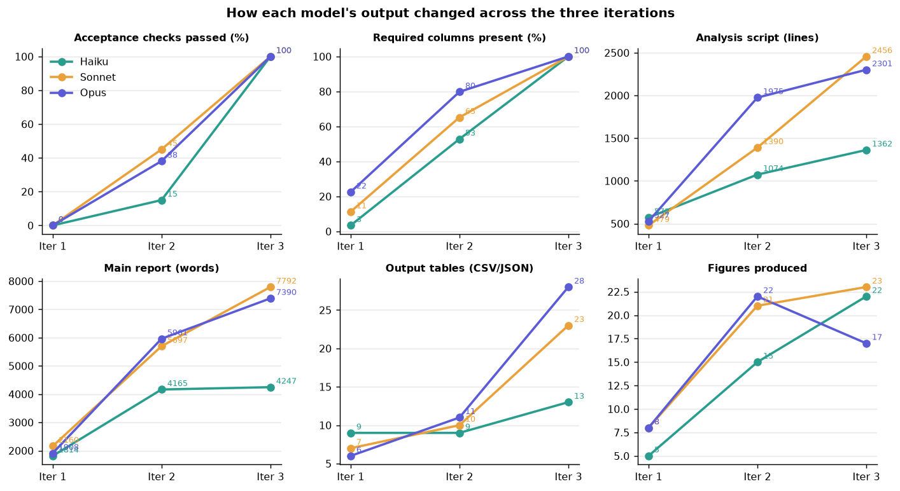
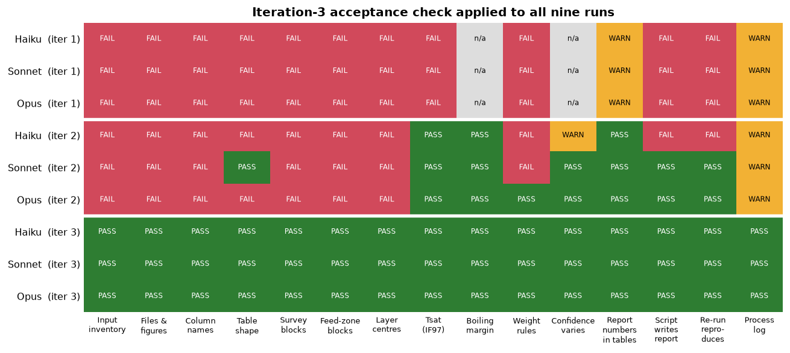
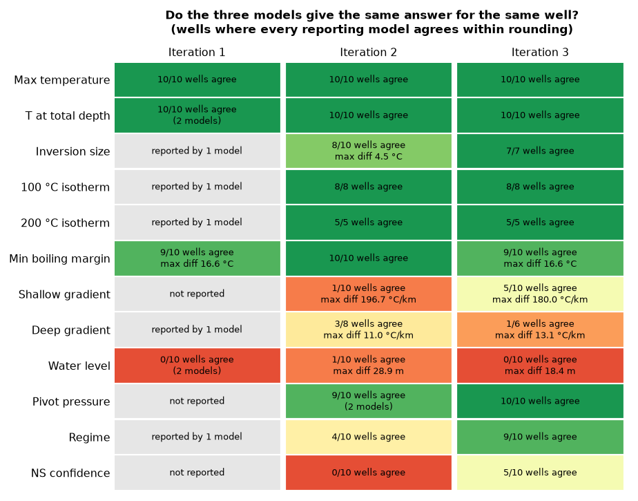
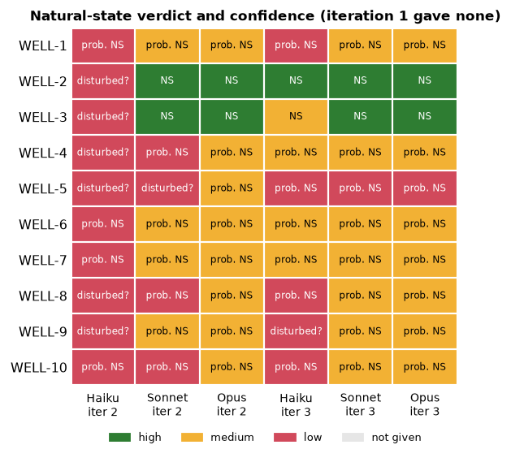
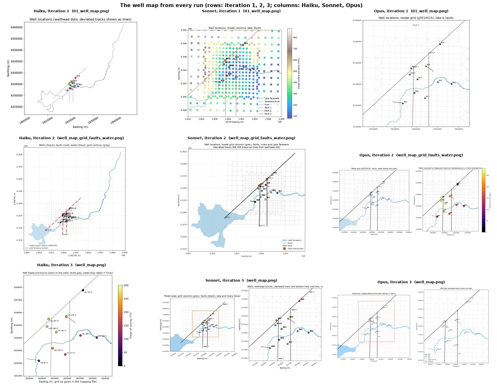
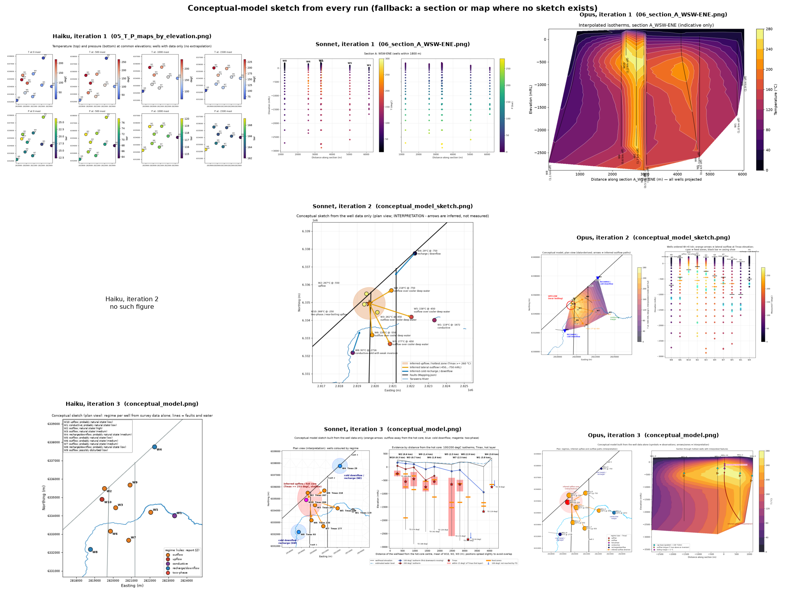

# Three iterations: how Haiku, Sonnet and Opus changed as the instructions tightened

*A comparison of nine natural-state interpretation runs: three models across three iterations of CLAUDE.md.*

Runs compared (git branches): `Haiku1`, `Sonnet1`, `Opus1` (23 Nov), `Haiku2`, `Sonnet2`, `Opus2` (24 Nov), `Haiku3`, `Sonnet3`, `Opus3` (25 Nov). The comparison script found that each branch's `Output/` holds only that run's own files: nothing was left over from the run before it in the same iteration. Comparison numbers come from `Output/model_comparison/*.csv`, written by `Scripts/compare_model_runs.py`. Values attributed to one run are quoted from that run's own outputs on its branch, and rounded figures ("about 4,200 words") summarise the tables.

---

## The short version

- **The instructions changed more than the models did.** Iteration 1 gave an 18-line brief and got three different, mostly incomparable answers. Iteration 3 gave a 220-line specification plus an acceptance checker, and all three models passed every one of the checker's 26 items.
- **The physical story was there from the start.** Opus's iteration-1 report already placed the upflow at the Fault 1 / Fault 3 junction beneath WELL-2 and WELL-10, found the −250 to −900 mRL outflow layer, the cold recharge at WELL-4 and WELL-8, and the thin cap, and showed that the "2015" surveys are pre-production. Later iterations did not change that picture. They made it **checkable, comparable and properly weighted**.
- **The models converged on the facts and stayed different on judgement.** By iteration 3 they agree exactly on every measured quantity. They still differ on definition-dependent numbers (water level, gradients) and on how harshly to grade natural-state confidence.
- **The gap between models narrowed but did not close.** Sonnet and Opus were close in every iteration. Haiku closed most of the gap on compliance (15 % to 100 % of checks passed from iteration 2 to 3). It remains behind on interpretation, and it made a new geometry error in iteration 3.

---

## 1. What changed between iterations

| | Iteration 1 | Iteration 2 | Iteration 3 |
|---|---|---|---|
| CLAUDE.md | 18 lines: use Baseline, model is reference only, natural state only, write for an engineer, log the prompt | 125 lines: named input files, data vs reference table, IF97 (no Kell), hydrostatic rules, NS gauge test, standard file names, default weights, report structure | 220 lines, **dataset-agnostic**: input inventory, exact column lists, fixed definitions (300 m windows, cased/open bands, inversion ≥ 3 °C), the gauge test overrides the date label, confidence factors, feed-zone quality factors |
| Acceptance checker | none | none | `check_deliverables.py`, 26 automatic checks, run with `--rerun` |
| What the models had to guess | almost everything: outputs, formats, method | column names, window definitions, weights | only a few definitions (§4) |

> **A caution on fairness.** The yardstick used throughout is the *iteration-3* acceptance check. Iterations 1 and 2 were never asked to meet it. Their low scores show how far each run was from the final specification, not how well it followed the instructions it was given. Read the iteration-1 and 2 numbers as a baseline, not as a grade.

---

## 2. Compliance with the final specification

`acceptance_summary.csv` and `trend_metrics.csv`:

| Run | Checks passed | Required files | Required columns | Figure types |
|---|---|---|---|---|
| Haiku 1 / Sonnet 1 / Opus 1 | 0 % / 0 % / 0 % | 50 / 75 / 75 % | 3 / 11 / 23 % | 0 / 0 / 0 % |
| Haiku 2 / Sonnet 2 / Opus 2 | 15 % / 45 % / 38 % | 92 / 92 / 92 % | 53 / 65 / 80 % | 86 / 100 / 100 % |
| Haiku 3 / Sonnet 3 / Opus 3 | **100 % / 100 % / 100 %** | 100 / 100 / 100 % | 100 / 100 / 100 % | 100 / 100 / 100 % |

What the heatmap shows:

- **Iteration 1** fails nearly everywhere because it predates the file and column specification. Only one failure matters beyond naming: no script wrote the report, so the report could drift from the tables.
- **Iteration 2** passes the physics checks: Tsat and boiling margin pass for all three runs. It fails on structure: no input inventory, column names slightly off, and the report not written by the script (Haiku). Some failures are real method errors:
  - Sonnet gave non-zero pressure weights to 234 points outside feed zones;
  - Opus used its own hydrostatic band labels instead of cased/open;
  - Haiku gave every well the same "low" confidence, so the factor changed no relative weight.
- **Iteration 3**: everything passes, for every model, including a clean re-run from git.

The re-run check (R3) is a good proxy for engineering discipline. In iteration 1 no run generated its report from the script. In iteration 2, Sonnet and Opus did; Haiku did not. In iteration 3 all three did.

---

## 3. Correctness: errors that came and went

Independent checks against the grid file and the well-to-block file (`run_overview.csv`, `model_surface_check.csv`):

| Run | Survey-point blocks wrong | Model surface wrong | Other method issue |
|---|---|---|---|
| Haiku 1 | n/a (no target table) | n/a | used the **Kell density** fit, valid below about 150 °C, at up to 269 °C |
| Sonnet 1 | n/a (one row per block, not per point) | n/a | listed reference-model boundary conditions (for example the base heat flux) in its data table without labelling them as reference |
| Opus 1 | 0 / 266 | 0 / 10 | used WELL-10's production enthalpy as evidence of two-phase |
| Haiku 2 | **37 / 266** (33 in WELL-2, 4 in WELL-9: wrong model column) | 1 / 10 (WELL-2, same cause) | called WELL-2, 3, 4, 5, 8 and 9 "possibly disturbed" from the date label, although its own gauge test matched to 0.1 bar |
| Sonnet 2 | 0 / 266 | 0 / 10 | pressure weights at non-feed-zone points |
| Opus 2 | 0 / 266 | 0 / 10 | non-standard hydrostatic bands |
| Haiku 3 | 0 / 266 | **6 / 10** (used the top of the wellhead's layer instead of SURFA) | missed the wellhead-below-surface issue |
| Sonnet 3 | 0 / 266 | 0 / 10 | unformatted `{len(irregular)}` in the report |
| Opus 3 | 0 / 266 | 0 / 10 | none found |

Tsat was accurate in every run that tabulated it: the worst error against an independent IF97 Region 4 was 0.05 K (Opus 1, which rounded to 0.1 °C).

The pattern is clear. **Each rule added in v2 and v3 removed a specific class of error.**

- Naming `well_blocks_json` as "the authority for block assignment" removed Haiku's wrong-column error.
- Banning Kell removed the low-temperature density fit.
- "The gauge comparison decides the verdict, not the date label" removed Haiku's iteration-2 downgrade.

Opus and Sonnet made none of these errors in the first place. Haiku made one of each, and in iteration 3 it found a new one (the model surface), which no rule or check covered.

> **Gap in the checker:** `check_deliverables.py` does not test `model_surface_mRL` against the grid file's surface section. Adding that check would have caught Haiku's iteration-3 error.

---

## 4. Do the models agree with each other?

`model_agreement_by_iteration.csv` counts the wells where every model that reports a quantity gives the same value, within rounding.

- **Measured facts converged fully.** Max temperature and temperature at total depth agree on 10/10 wells in every iteration where they are reported. The isotherm elevations, inversion size and pivot pressure all agree on every well by iteration 3. In iteration 1, most of these were reported by only one model, so there was nothing to compare.
- **Judgements converged partly.**
  - Regime agreement rose from 4/10 wells (iteration 2) to 9/10 (iteration 3). The remaining split is WELL-10: Sonnet calls it two-phase, and Haiku and Opus call it upflow.
  - Natural-state confidence rose from 0/10 to 5/10. All five remaining differences are Haiku grading lower than Sonnet and Opus, who agree on all ten wells.
- **Definition-dependent numbers did not converge.**
  - Water level: 0/10 → 1/10 → 0/10 wells agree, although the worst gap fell from 36.9 to 28.9 to 18.4 m.
  - Shallow gradient: 1/10 → 5/10.
  - Deep gradient: 3/8 → 1/6.

  Each model picks its own reading of "liquid-filled", of "below the inversion base", and of how to extrapolate a water level. These numbers will not agree until CLAUDE.md pins those choices down.

The verdict grid tells the story of the natural-state rule.

- **Iteration 1:** no model gave per-well verdicts at all.
- **Iteration 2:** Haiku graded every well "low" and six "possibly disturbed", because the surveys are labelled 2015. Sonnet and Opus used the gauge match to give WELL-2 and WELL-3 "high".
- **Iteration 3:** the v3 rule ("the gauge comparison decides") made Haiku accept WELL-2 as natural state. Haiku still grades WELL-3, WELL-9 and three wells without a gauge (WELL-1, WELL-8, WELL-10) lower than the other two models.

---

## 5. Depth and effort

| | Iter 1 (H / S / O) | Iter 2 (H / S / O) | Iter 3 (H / S / O) |
|---|---|---|---|
| Script lines | 572 / 479 / 527 | 1,074 / 1,390 / 1,975 | 1,362 / 2,456 / 2,301 |
| Report words | 1,814 / 2,160 / 1,908 | 4,165 / 5,697 / 5,961 | 4,247 / 7,792 / 7,390 |
| Output tables | 9 / 7 / 6 | 9 / 10 / 11 | 13 / 23 / 28 |
| Figures | 5 / 8 / 8 | 15 / 21 / 22 | 22 / 23 / 17 |
| Process-log words | 902 / 396 / 450 | 1,235 / 716 / 1,284 | 2,288 / 2,249 / 2,100 |

- **Everything grew about four-fold.** In iteration 1 the three models were the same size. From iteration 2 on, Sonnet and Opus wrote nearly twice as much code and report text as Haiku. Haiku's report stayed at about 4,200 words from iteration 2 to 3; Sonnet's and Opus's grew by about 1,400–2,100 words.
- **Opus produces the most supporting tables** (28 in iteration 3), for example `conceptual_model_evidence.csv`, `column_assignment_check.csv` and `section_points.csv`. Sonnet produces the most figures. Opus made fewer figures in iteration 3 (17) because it combined its map panels into single files, not because it dropped content.
- **Process logs** became about 2,100–2,300 words for all three models once v3 asked for the acceptance-check output and an explanation of every WARN.

The well maps show the presentation maturing:

- **Iteration 1:** the maps ranged from a regional outline with the wells crammed into one corner (Haiku) to a coloured grid (Sonnet) and grid plus faults (Opus).
- **Iteration 3:** all three models zoom on the field and show faults and water. Sonnet and Opus also show the grid and an overview inset. Haiku drops the grid.

The conceptual sketch only became a requirement in iteration 2.

- **Iteration 1:** only Opus drew an interpreted section.
- **Iteration 2:** Haiku drew no sketch; Sonnet and Opus drew annotated plan views.
- **Iteration 3:** all three drew one. Haiku's is a regime-coloured plan view without flow paths. Sonnet's and Opus's add an evidence or interpreted section.

---

## 6. Per-model trajectories

**Haiku.**

- Iteration 1: the least structured run. It had no target table, used Kell density, called the hot outflow wells "hot upflow", and gave no verdicts.
- Iteration 2: about half the specified columns, a wrong model column for WELL-2, and over-cautious verdicts driven by the date label.
- Iteration 3: fully compliant and reproducible, with correct blocks. It still grades confidence more harshly, read the model surface wrongly, and draws the thinnest conceptual model.

**It improves the most when a rule is explicit, and does not generalise beyond the rules.**

**Sonnet.**

- Iteration 1: careful on data checks, but its target table was organised per block, not per survey point.
- Iteration 2: the best compliance score of its iteration (45 %). Its one real method error was pressure weights at non-feed-zone points.
- Iteration 3: the longest, most cross-referenced report, and the most careful about uncertainty. For example, it treats boiling margins as upper bounds and limits interpolation in sections. It has small presentation slips (an unformatted placeholder, and WELL-10 labelled two-phase).

**It is consistent, and strongest on caveats.**

**Opus.**

- Iteration 1: already had the right conceptual model and the natural-state argument. It had no weights or verdict structure, and leaned on production enthalpy.
- Iteration 2: the most columns of its iteration (80 %), a reference-model comparison, and a feed-zone pressure trend fit.
- Iteration 3: no errors found, the most quantified conceptual model (cap base and thickness, outflow correlation, upflow at the fault junction), and the most evidence tables.

**It is the strongest on interpretation from the first iteration on, and the instructions mainly gave it structure.**

---

## 7. What to take from this

1. **Instruction quality drove compliance; model choice drove interpretation.** With v3 and the checker, all three models deliver a usable, reproducible target set. Choosing between them is now about the depth and reliability of the conceptual model. On that, Opus is slightly ahead of Sonnet, and both are clearly ahead of Haiku.
2. **Every v2/v3 rule that targeted an observed error fixed it.** Rules for the block authority, Kell, the gauge test overriding the date label, and confidence variation each removed a specific error. Haiku's iteration-3 model-surface error shows the remaining risk: a model that follows rules literally can still go wrong wherever no rule or check exists.
3. **Next changes to the instructions,** in order of value for comparability:
   - add a model-surface check (SURFA versus `well_geometry_check.csv`) to `check_deliverables.py`;
   - define "liquid-filled" (P ≥ 1.5 bar, or below the water level?) for the shallow gradient;
   - say whether "below the inversion base" includes the base point;
   - fix the water-level method;
   - say whether near-atmospheric points count in the minimum boiling margin;
   - give a regime rule for near-boiling but not two-phase wells (WELL-10).
4. **For the calibration itself,** use the iteration-3 Sonnet or Opus targets. They agree at 259 of 266 points (see `model_comparison_iteration3.md`). Treat water levels and the gradients as soft targets.

---

## Files

| File | What it holds |
|---|---|
| `Output/model_comparison/runs.csv` | Branch, commit, date and carried-over files (none) for each run |
| `Output/model_comparison/run_overview.csv` | Acceptance counts, deliverable coverage, sizes, block, Tsat and surface checks for each run |
| `Output/model_comparison/acceptance_results.csv`, `acceptance_summary.csv`, `acceptance/` | Iteration-3 acceptance check applied to all nine runs |
| `Output/model_comparison/trend_metrics.csv` | Values plotted in the trends figure |
| `Output/model_comparison/well_metrics_all_runs.csv` | Per-well values mapped to the standard columns, for all nine runs |
| `Output/model_comparison/model_agreement_by_iteration.csv` | Agreement counts in the agreement figure |
| `Output/model_comparison/ns_confidence_by_run.csv`, `regime_by_run.csv` | Verdict and regime for each well and run |
| `Output/model_comparison/model_surface_check.csv` | Each run's model surface against the grid file |
| `Output/figures/model_comparison/x_*.png` | Figures in this report |
| `Scripts/compare_model_runs.py` | Regenerates every table and figure from the git branches |
