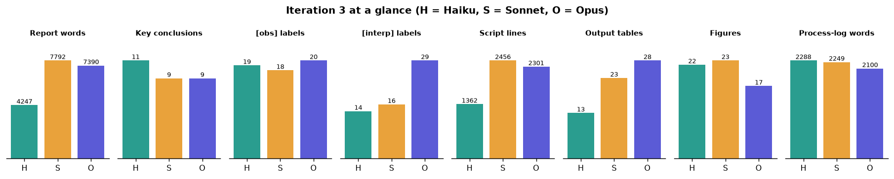
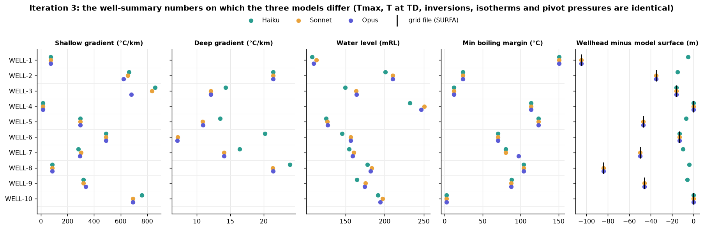
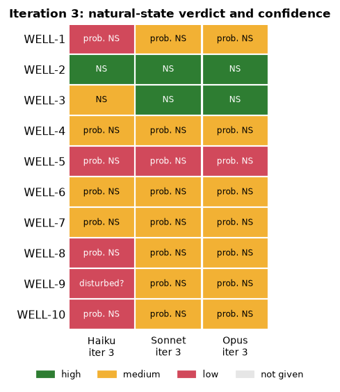
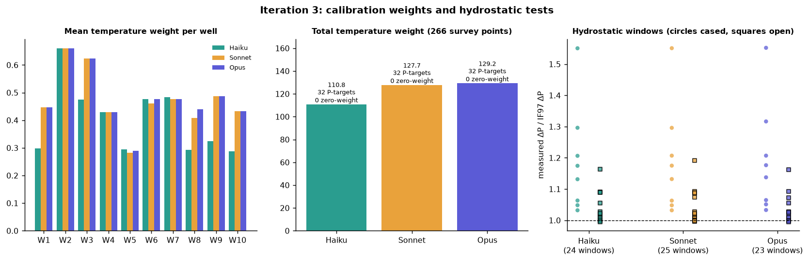
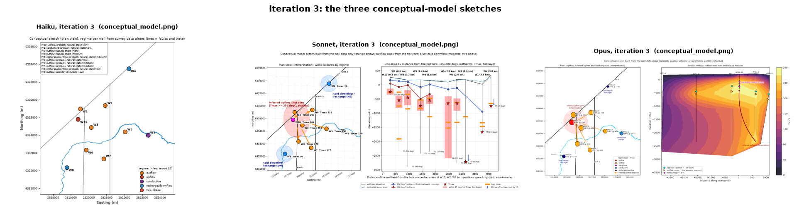
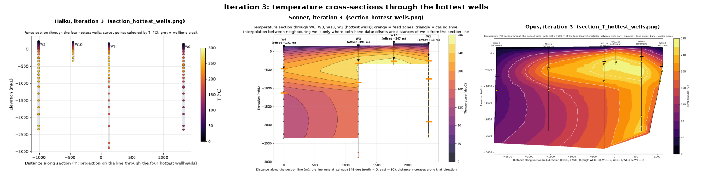
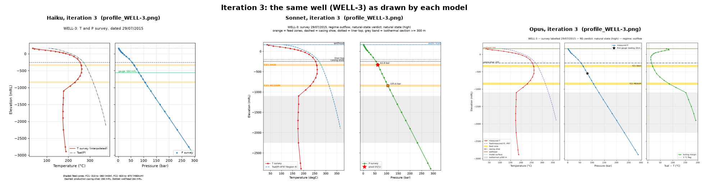

# Iteration 3: Haiku vs Sonnet vs Opus

*How the three models handled the same natural-state interpretation task, under the same instructions (CLAUDE.md v3) and the same acceptance check.*

Runs compared: `origin/Haiku3` (92b4957), `origin/Sonnet3` (07b13ab), `origin/Opus3` (2fa3728). Comparison numbers come from `Output/model_comparison/*.csv`, written by `Scripts/compare_model_runs.py`; run that script again to regenerate the tables and figures. Physical values attributed to one model (for example "Opus: cap 414–740 m thick") are quoted from that run's own report and output tables on its branch.

---

## The short version

| | Haiku | Sonnet | Opus |
|---|---|---|---|
| Acceptance check (26 items, re-run from git) | **26 PASS** | **26 PASS** | **26 PASS** |
| Survey-point blocks matching the well-to-block file | 266/266 | 266/266 | 266/266 |
| Model surface read correctly from the grid file | **4/10 wells** | 10/10 | 10/10 |
| Natural-state confidence: high / medium / low wells | 1 / 4 / 5 | 2 / 7 / 1 | 2 / 7 / 1 |
| Total temperature weight over the 266 points | 110.8 | 127.7 | 129.2 |
| Main report length (words) | 4,247 | 7,792 | 7,390 |
| Analysis script (lines) | 1,362 | 2,456 | 2,301 |
| Output tables / figures | 13 / 22 | 23 / 23 | 28 / 17 |
| Conceptual-model sketch | plan view, regimes only | plan view + evidence section | plan view + interpreted section |

**Bottom line.**

- **All three models now produce a complete, reproducible, rule-compliant deliverable set.** The acceptance check cannot tell them apart.
- **On the measured facts they agree exactly.** Tmax, temperature at total depth, inversions, the 100 °C and 200 °C isotherms, pivot pressures, feed-zone blocks and Tsat are identical.
- **They differ in three areas:**
  1. Sensitive derived numbers (water level, shallow and deep gradients), where the instructions leave room for interpretation.
  2. How strictly each model grades natural-state confidence.
  3. Depth of interpretation.
- **Opus and Sonnet are close to each other, and both are ahead of Haiku on interpretation.** They give the same weight at 259 of 266 points.
- **Haiku made one real error.** It read the model surface wrongly, so it missed that eight wellheads sit 13–105 m below the model surface. Sonnet and Opus both list this as a key conclusion.

---

## 1. Compliance: a three-way tie

The acceptance check (`Scripts/check_deliverables.py --rerun`) was re-run on a clean copy of each branch. All three runs pass all 26 items (`acceptance_summary.csv`). That covers the input inventory, required columns, block assignments, layer centres, independent IF97 Tsat, weight rules, report numbers traced to tables, and a clean re-run that reproduces every table.

> Sonnet's re-run produced files that differ from git only in line endings: Sonnet writes CRLF on Windows, and git stores LF. That is an artefact of extracting from git, not a reproducibility fault. The comparison script treats it as a PASS and records why (`acceptance_results.csv`, column `note`). Sonnet's own acceptance run, inside its session, also passed.

Two independent checks agree with the acceptance check (`run_overview.csv`):

- **Block assignment:** 266 of 266 survey points match the well-to-block file in all three runs.
- **Tsat:** the largest error against an independent IF97 Region 4 is 0.005 K (Haiku), 0.00005 K (Sonnet) and 0.0005 K (Opus). All are far inside the 0.1 K limit.

**What this means:** with v3 instructions and the checker, compliance is no longer what separates the models. The differences are all in judgement and depth.

---

## 2. Numbers: identical where the data decide, different where a definition does

`iter3_metric_disagreement_counts.csv` counts, for each well-summary column, the wells where the three models do not give the same value:

| Agree on every well | Differ |
|---|---|
| Tmax and its elevation, T at TD, inversion size/top/base, z(100 °C), z(200 °C), pivot pressure | water level (10 wells), shallow gradient (5), deep gradient (5), NS confidence (5), min boiling margin (1), regime (1), NS verdict (1) |

Each difference has a traceable cause in the scripts:

- **Water level** differs on all 10 wells, by up to 18.4 m (WELL-4: Haiku 232.4, Opus 246.8, Sonnet 250.8 mRL). Haiku is the lowest on every well. Each model extrapolates the shallow pressure points upward with a different method, which CLAUDE.md allows ("state the method"). **For calibration:** treat water level as a ±10–20 m soft target, not a hard one.
- **Shallow gradient** differs on 5 wells, by up to 180 °C/km (WELL-3: Haiku 860.4, Sonnet 835.9, Opus 680.4 °C/km). The models defined "liquid-filled survey" in three different ways:
  - Haiku: boiling margin > 0, with the 300 m window starting at the wellhead.
  - Sonnet: the window starts at the estimated water level.
  - Opus: P ≥ 1.5 bar.
- **Deep gradient** differs on 5 of the 6 wells that have one, by up to 13.1 °C/km (WELL-6: Haiku 20.2, Sonnet and Opus 7.1 °C/km). The fits use only 2–5 points. Haiku excludes the point exactly at the inversion base ("below" read as strictly below), and Sonnet and Opus include it. Dropping one point on WELL-6 changes the slope from 7.1 to 20.2 °C/km. **For calibration:** the deep gradients are too fragile to be targets; use the deep temperatures themselves.
- **Minimum boiling margin** differs only on WELL-7: Opus gives 97.06 °C at 150 mRL, and Haiku and Sonnet give 80.5 °C at 170 mRL. Opus only takes the minimum over points with P ≥ 1.5 bar, which skips the near-atmospheric top of the column. The difference has no consequence for calibration, because the margin is large either way.

**Instruction gap to close:** CLAUDE.md should fix the "liquid-filled" test, whether "below" is inclusive, and whether near-atmospheric points count in the minimum boiling margin. Then these columns become comparable between runs.

---

## 3. Natural-state verdicts: Haiku is stricter

All three run the same gauge test and get the same numbers (`iter3_pressure_gauge_test.csv`): WELL-2 and WELL-3 match the first gauge reading to −0.10 bar, WELL-9 is 2.05 bar above it, and WELL-10's gauge only starts in 2020. They then grade those results differently:

| Well | Haiku | Sonnet = Opus | Why they differ |
|---|---|---|---|
| WELL-3 | NS, **medium** | NS, high | Haiku downgrades because the gauge sits between feed zones |
| WELL-9 | **possibly disturbed, low** | probably NS, medium | Haiku treats the 2.05 bar miss as a failed test; Sonnet and Opus treat it as a datum or depth question, because the feed-zone pressures sit on the field trend |
| WELL-1, WELL-8, WELL-10 | low | medium | Haiku gives low to every well that cannot be tested directly; Sonnet and Opus use the trend test (§4.1 of CLAUDE.md) to lift them to medium |

Sonnet and Opus agree on all 10 wells. Haiku's grading is defensible: WELL-9 does fail the "within reading precision" test. But Haiku does not apply the trend test for wells without a gauge as fully as the instructions ask.

**Effect on weights:** Haiku's lower confidence multiplies straight through. Its total temperature weight is 110.8, against 127.7 (Sonnet) and 129.2 (Opus). Haiku matches the other two models' weight at only 136–139 of the 266 points. Sonnet and Opus match at 259 of 266 (`iter3_point_weight_agreement.csv`). The 7 Sonnet–Opus differences come from how long an isothermal section must be before it counts as possible internal flow: Sonnet flags 29 points and Opus 22 (`iter3_weight_reasons.csv`). All three models use the same location classes for the other points:

- 131 points behind casing;
- 32 feed-zone points;
- 19 points at the wellhead or in the top block;
- 32 pressure targets, all at feed zones.

---

## 4. Hydrostatic test: same result, three slightly different window sets

All three find the same anomaly: pressure profiles above the feed zones are heavier than any water column. The cased windows reach a ratio of about 1.55 (Haiku 1.5507, Sonnet 1.5510, Opus 1.5522). That implies densities near 1341 kg/m³. The open-hole windows below the shoe sit close to 1: medians of 1.0198 (Haiku), 1.0190 (Sonnet) and 1.0211 (Opus) (`iter3_hydrostatic_by_band.csv`). The number of windows differs (24, 25 and 23), because each model splits windows at feed zones and shoes slightly differently.

All three rule out a datum, a unit or gravity convention, two-phase fluid and rounding, as CLAUDE.md asks. They frame the result differently:

- **Sonnet** calls it "the largest unresolved data problem". It warns that the boiling margins of the hot wells are upper bounds until the pressure convention is confirmed. Sonnet is the only model to draw that consequence.
- **Opus** concludes the pressures above the feed zones behave like a formation profile, not a wellbore column, and says not to tune shallow permeability to them.
- **Haiku** says to treat the upper pressures as unreliable.

---

## 5. Interpretation: where the depth of the reports differs

All three reports follow the required 8-section structure and label claims as observation or interpretation. Opus uses the most interpretation labels (29, against 16 for Sonnet and 14 for Haiku). Sonnet and Opus attach an explicit **Action** to almost every conclusion (8 and 9 action lines, against 1 for Haiku).

| Topic | Haiku | Sonnet | Opus |
|---|---|---|---|
| Upflow | "hot upflow cluster" around W2, W3, W6, W9, W10; does not place the source | hot core at W2, W3, W10 next to Fault 3 | beneath W10/W2 at the junction of Faults 1 and 3; W2 reheats to 253.7 °C at TD |
| Outflow | inversions = outflow **and/or** downflow; "the data alone do not separate these" | permeable layer at −450 to −750 mRL carrying fluid S, E and NE | outflow tongue at −450 to −750 mRL; peak T falls with distance from W10 (r = −0.92) |
| Cap | reads the 490–860 °C/km shallow gradients as **wellbore effects**, "diagnostics, not targets" | thin cap; 100 °C only 60–97 m below the hot wellheads | conductive cap, base at −250 to −550 mRL, 414–740 m thick |
| Two-phase | W10 near boiling (2.6 °C), not shown to be two-phase | W10 classed **two-phase** (margin < 5 °C rule) but "possible" in the text | W10 at boiling point for depth, not two-phase |
| Deep pressure connection | feed zones within 3 bar of the W2/W3 trend | 9 wells within 7.2 bar at −1500 mRL | 7 wells within 1.5 bar at −1000 mRL; WELL-1 4.17 bar low |
| Wellheads vs model surface | "up to 16 m below" (wrong, see §6) | 8 wells, up to 105 m below | 8 wells, up to 105 m below |

The biggest interpretive split is the **cap**. Haiku treats the steep shallow gradients as a wellbore artefact. Sonnet and Opus treat them as a conductive cap. The points in question lie mostly behind casing, and CLAUDE.md §4.2 notes that behind casing "temperatures are usually closer to the conductive formation temperature". That favours the Sonnet and Opus reading. Haiku's reading would leave the engineer without a cap thickness to calibrate.

### The figures

- **Haiku's** conceptual model is a plan view with wells coloured by regime. It has no outflow arrows, no cap and no section, so it shows less than the text describes. Its well map also omits the model grid, which CLAUDE.md asks for.
- **Sonnet's** pairs a plan view (inferred upflow zone, outflow arrows, recharge zones) with an "evidence by distance" panel of isotherm elevations and Tmax.
- **Opus's** pairs a plan view with an interpreted temperature section showing the cap base, outflow tongue and inferred upflow path.

The sections show three different attitudes to interpolation:

- **Haiku** plots survey points only, with no interpolation. This is safe, but harder to read.
- **Sonnet** contours only between neighbouring wells where both have data. This is the most careful approach.
- **Opus** contours the whole field, including wells projected from up to about 730 m off the line. This is the easiest to read, but it fills large areas far from any survey point. An engineer should not read deep contours beneath WELL-10, whose survey stops at −350 mRL, as data.

All three profile plots show T and P with Tsat, casing and feed zones. Sonnet and Opus also mark the isothermal section. Opus adds a third boiling-margin panel and the gauge reading.

---

## 6. Errors found in each run

| Run | Issue | Effect on calibration |
|---|---|---|
| **Haiku** | `model_surface_mRL` is the top of the wellhead's layer, not the grid file's SURFA value, and is wrong for 6 of 10 wells (`model_surface_check.csv`). The report therefore says wellheads are "up to 16 m" below the surface instead of up to 105 m. | **Medium.** It misses a geometry problem that Sonnet and Opus put in their key conclusions. Weights are not affected, because the top-block rule still picks the same 19 points. |
| **Haiku** | Conceptual sketch and well map are thinner than required (no arrows, no cap, no grid). | Low to medium: less guidance for setting up the model structure. |
| **Sonnet** | The report contains an unformatted code placeholder, `{len(irregular)}`, in §7 item 11. A Python f-string is missing its `f`. | Cosmetic, but it shows the report text was not fully proof-read. |
| **Sonnet** | Labels WELL-10 "two-phase" in `well_summary.csv` while its own text says two-phase is only "possible". | Low. The engineer should read WELL-10 as near-boiling. |
| **Opus** | Field-wide contouring in the cross-section extends far from the data. | Low. Read the section as a sketch. |
| **All** | Water level and the two gradients depend on definitions the instructions leave open (§2). | Medium for anyone comparing runs; low for a single calibration. |

---

## 7. Verdict

1. **Opus**, narrowly. It gives the most quantified and actionable conceptual model: cap base and thickness, an upflow location tied to the fault junction, an outflow trend with a correlation, and deep pressure connection. It also has the most output tables (28), no factual errors, and matches Sonnet on every verdict.
2. **Sonnet**, very close behind. It has the most careful handling of uncertainty: boiling margins as upper bounds, and the most conservative section interpolation. It also has the longest and most thoroughly cross-referenced report. It loses ground only on small presentation slips.
3. **Haiku.** It is fully compliant and reproducible, and the cheapest script (1,362 lines). It is a little more cautious on verdicts, which some reviewers will prefer. But it has one real geometry error, a less committal conceptual model, and lower, less consistent weights. It is good enough as a first pass or a cross-check, but not as the sole basis for a calibration set-up.

**If you calibrate from one run,** use Opus or Sonnet targets. They agree at 259 of 266 points. Take the wellhead-below-surface issue from either. Treat water levels and gradients as soft targets, whichever run you use.

---

## Files

| File | What it holds |
|---|---|
| `Output/model_comparison/run_overview.csv` | One row per run: acceptance counts, deliverable coverage, sizes, block and Tsat checks |
| `Output/model_comparison/acceptance/acceptance_*.txt` | Full acceptance-check output for each run |
| `Output/model_comparison/iter3_well_summary_side_by_side.csv` | Every well-summary value, three models side by side, with a `models_differ` flag |
| `Output/model_comparison/iter3_weights_by_well.csv`, `iter3_weight_totals.csv`, `iter3_weight_reasons.csv`, `iter3_point_weight_agreement.csv`, `iter3_feedzone_weights.csv` | Weight comparisons |
| `Output/model_comparison/iter3_hydrostatic_by_band.csv`, `iter3_pressure_gauge_test.csv` | Hydrostatic and gauge-test comparisons |
| `Output/model_comparison/model_surface_check.csv` | Each run's model surface against the grid file |
| `Output/figures/model_comparison/i3_*.png` | Figures in this report |
