# Natural-state data interpretation for model calibration

Generated by `Scripts/natural_state_analysis.py` on 2026-11-26.

Claim tags: [obs] observation; [interp] interpretation; [assumption] assumed value; [reference model] description of the starting model, never evidence. All elevations in mRL, pressures in bar (absolute), temperatures in °C.

## 1. Key conclusions for calibration

1. **The upflow lies beneath WELL-10, WELL-2.** WELL-10 reaches 268.7 °C at -250 mRL with no inversion and the shallowest 200 °C crossing (45.6 mRL); WELL-2 reaches 266.9 °C at -550 mRL [obs]. The Fault 1 / Fault 3 intersection lies 478 m from the centre of these wells [obs], so the faults are a plausible conduit [interp]. Liquid at 268.7 °C carries about 1178.2 kJ/kg (IF97 Region 1) [obs].
   **Action:** put the deep mass and heat input below the columns of WELL-10, WELL-2 (columns ajf, arz), with an enthalpy of at least 1178.2 kJ/kg; calibrate its rate against the temperatures of the outflow wells.
2. **A lateral outflow spreads from the upflow at -450 to -750 mRL.** WELL-2 has a 30.9 °C inversion below its 266.9 °C peak at -550 mRL; WELL-3 has a 86.9 °C inversion below its 261.4 °C peak at -450 mRL; WELL-6 has a 98.1 °C inversion below its 220.5 °C peak at -550 mRL; WELL-9 has a 57.7 °C inversion below its 217.7 °C peak at -750 mRL; WELL-7 has a 46.0 °C inversion below its 176.7 °C peak at -650 mRL; WELL-5 has a 13.3 °C inversion below its 158.0 °C peak at -650 mRL [obs]. Peak temperatures fall, and peak depths deepen, away from the upflow wells, which is the signature of a hot tongue moving laterally above cooler water [interp].
   **Action:** give the model a laterally permeable layer between about -450 and -750 mRL connecting the upflow to these wells, with lower vertical permeability below it; weight the peak and the inversion temperatures fully (they are the most diagnostic targets).
3. **Cool water underlies the outflow and enters from the margins.** WELL-2 falls to 236.0 °C at -1500 mRL; WELL-3 falls to 174.5 °C at -1700 mRL; WELL-6 falls to 122.4 °C at -1900 mRL; WELL-9 falls to 160.0 °C at -2250 mRL; WELL-7 falls to 130.7 °C at -1700 mRL [obs]. WELL-4 reaches only 29.0 °C (at -750 mRL); WELL-8 reaches only 93.1 °C (at -2716 mRL) [obs]. Cold recharge or downflow occurs at the margins and a cool deep inflow runs beneath the outflow [interp].
   **Action:** allow cold water to enter at depth from the lateral boundaries (or from the north and southwest margins) rather than sealing them; the deep isothermal sections are targets for that inflow, not for conduction.
4. **A conductive cap overlies the hot wells.** Shallow gradients in the hot wells are 622.2 (WELL-2), 680.4 (WELL-3), 489.8 (WELL-6), 336.1 (WELL-9), 691.7 (WELL-10) °C/km, and the gradient drops below 50 °C/km at -250 to -650 mRL [obs]. The cap base deepens away from the upflow [interp].
   **Action:** use low permeability from the surface to the cap base in these columns; calibrate it against the shallow gradients (open-hole weights) rather than against shallow pressures.
5. **Deep pressures are connected across the field.** Feed-zone pressures of all wells lie within 3.32 bar of one hydrostatic trend fitted to the gauge-verified feed zones (RMS 0.696 bar, implied density 894.0 kg/m3) [obs]. Only WELL-1 exceeds the 3.00 bar tolerance (3.32 bar below the trend) [obs].
   **Action:** use feed-zone pressures as the pressure targets (weight_P); a single connected reservoir is adequate; treat the WELL-1 offset as a test of the permeability between WELL-1 and the main field (see section 7).
6. **The surveys represent the natural state, despite their date label.** All surveys are dated 2015-07-29, after first field production on 2014-01-01 [obs]. Yet WELL-2, WELL-3 match their first gauge readings (taken on 2014-01-01) to within 0.1 bar, whereas the same gauges fell by 8.2 to 11.5 bar by their second reading one year later [obs]. WELL-10's survey pressure at its gauge (56.70 bar) is 8.0 bar above its first reading in 2020 [obs]. The surveys therefore pre-date production and the date is a label problem [interp].
   **Action:** use every survey as a natural-state target with the confidence weights below (high: WELL-2, WELL-3; medium: WELL-4, WELL-6, WELL-7, WELL-8, WELL-9, WELL-10; low: WELL-1, WELL-5); ask the data owner to confirm the survey dates.
7. **The top of the upflow is close to boiling.** WELL-10 has a minimum boiling margin of 2.65 °C at -150 mRL [obs]; no survey point is two-phase (margin ≤ 1 °C) [obs].
   **Action:** the model must keep WELL-10 liquid but within a few degrees of saturation; an upflow that is too hot or too shallow will boil here, so use this margin as a constraint on the upflow rate and depth.
8. **Pressure gradients behind casing exceed a static water column.** Measured to IF97 ratios in cased windows reach 1.5507 (WELL-3), against a cold-well component of 1.0419; in open hole the cold-well component is 0.9944 and hot-well ratios lie between 0.9975 and 1.1613 [obs]. Datum, gravity or unit conventions and two-phase fluid cannot explain an excess that is confined to the cased, hot, shallow part of the profiles (section 4) [interp].
   **Action:** do not use pressures above the feed zones as targets (their weight_P is zero); if the model's cap pressures matter, treat the excess as a sign of upward flow through the cap and resolve its origin with the data owner.

## 2. The data

### 2.1 What exists

The input inventory (`../Additional_Output/input_inventory.csv`) assigns every file under `Baseline/` a role [obs]:

| Role | Path | Note |
|---|---|---|
| well_data_json | `Baseline/Teaching_Model_3D/Data/Data_json` | Per-well JSON: track, casing/liner design, feed zones, downhole T and P surveys, transient pressure, production/injection flow and enthalpy. Primary data source |
| well_data_json | `Baseline/Teaching_Model_3D/Data/Area_data.json` | Field-total steam flow and power output (production record). Read only for the date of first field production (4.1 timing test) |
| well_data_dat | `Baseline/Teaching_Model_3D/Data/Data_dat` | Plain-column copies of the well data; cross-check only. Irregular file prefix 'Wel10' for WELL-10 |
| well_groups | `Baseline/Teaching_Model_3D/Data/Groups_data.json` | Well list and grouping (one group 'All'); defines well order |
| mapping | `Baseline/Teaching_Model_3D/Data/Mapping` | Faults (polylines), lake (filled polygon) and rivers (ragged multi-segment) |
| reference_other | `Baseline/Teaching_Model_3D/Data/Plotting` | Plotting configuration with hard-coded paths from another machine; not read |
| out_of_scope | `Baseline/Teaching_Model_3D/Data/Make_up_json` | Empty directory |
| geometry_dat | `Baseline/Teaching_Model_3D/Models/TE14515/gTE14515.dat` | MULgraph grid: VERTICES, GRID, LAYERS, SURFA, WELLS sections used (geometry only) |
| well_blocks_json | `Baseline/Teaching_Model_3D/Models/TE14515/gTE14515_wells.json` | Well-to-block intersections, feed-zone blocks and interpolation weights; authority for block assignment |
| reference_bc | `Baseline/Teaching_Model_3D/Models/TE14515/gTE14515_boundary_conditions.json` | Reference model boundary conditions (atmosphere, rain, basal heat flux, lake columns); reference only |
| reference_rock | `Baseline/Teaching_Model_3D/Models/TE14515/gTE14515_dict_rocktype.json` | Reference model rock-type legend (lithology, faults, zones); reference only |
| reference_other | `Baseline/Teaching_Model_3D/Models/TE14515/gTE14515.auxjson` | Viewer scene file with hard-coded source paths; not read |
| reference_other | `Baseline/Teaching_Model_3D/Models/TE14515/currentGeomSetup.json` | Model set-up and plotting configuration; not read |
| reference_other | `Baseline/Teaching_Model_3D/Models/TE14515/NaturalState/TE14515_NS_000.dat` | Reference natural-state simulator input (rocks, generators, parameters); reference only, not evidence |
| reference_results | `Baseline/Teaching_Model_3D/Models/TE14515/NaturalState/TE14515_NS_000.incon` | Reference model initial conditions; reference only, not read |
| reference_other | `Baseline/Teaching_Model_3D/Models/TE14515/NaturalState/currentNSSetup.json` | Natural-state run configuration; not read |
| out_of_scope | `Baseline/Teaching_Model_3D/Models/TE14515/NaturalState/Reports` | Empty directory |
| out_of_scope | `Baseline/Teaching_Model_3D/Models/TE14515/Production` | Production model set-up; out of scope |
| out_of_scope | `Baseline/Teaching_Model_3D/Models/TE14515/FutureScenarios` | Future-scenario set-up; out of scope |
| out_of_scope | `Baseline/Teaching_Model_3D/Parameters/ProductionHistory` | Production, reinjection and monitoring spreadsheets for the production model; not read |

There are 10 wells in one group ('All'). Each has one temperature and one pressure survey on the same date and at the same elevations, a track, a casing/liner design and feed zones [obs]. WELL-2, WELL-3, WELL-9, WELL-10 carry a transient pressure gauge; WELL-2, WELL-3, WELL-9, WELL-10 have production records; WELL-4, WELL-5, WELL-8 have injection records [obs].

### 2.2 How it was checked

- **JSON against plain-column files:** 38 files compared; every value matches exactly (largest difference 0.0) [obs]. Transient files use years since 2014-01-01 (established by matching), production mass flow is stored with a negative sign, and the WELL-10 files use the irregular prefix 'Wel10' [obs]. Details: `../Additional_Output/dat_json_crosscheck.csv`.
- **Survey, feed zones, casing and track:** 106 checks in `../Additional_Output/integrity_checks.csv`; 1 issue(s): WELL-4 deepest liner bottom at track TD (design bottom -3251 mRL; track TD -750.0 mRL) [obs]. All survey points and feed zones lie within the tracks and every feed zone lies within a slotted liner [obs].
- **Geometry:** survey and feed-zone blocks are taken from the well-to-block file; the wellhead column found by point-in-polygon on the grid agrees with the block file for every well; model surface values come from the grid surface section [obs]. 8 wellheads lie below the model surface, by up to 105.0 m (WELL-1) [obs]; no survey point lies above the model surface [obs].
- **Thermodynamics:** IAPWS-IF97 Region 4 and Region 1 pass the verification tables; Tsat(1.01325 bar) = 99.97 °C and Tsat(100 bar) = 311.00 °C [obs].

### 2.3 Provenance labels

Every `Source` and `Comment` field of the surveys, gauges and flow records is empty; the only source label is 'Synthetic data' on the well designs; every survey carries `StableFlag` = True [obs]. Feed-zone quality tags found: HIGH, LOW, MEDIUM, Synthetic; mapped to weight_P factors HIGH = 1.0, LOW = 0.5, MEDIUM = 0.8, Synthetic = 0.5 ('Synthetic' is not a quality grade, so it takes the lowest factor) [obs]. The data are therefore labelled synthetic; nothing in the files records who measured them or how [obs].

### 2.4 Natural-state timing verdict for each well

First production anywhere in the field: 2014-01-01 [obs]. Injectate enthalpy 335.0 kJ/kg gives 80.0 °C (IF97 Region 1 inverse at 1.01325 bar) [obs]. Reading precision of the gauges: 0.1 bar. Trend tolerance: 3.00 bar (3 bar exceeds twice the 0.696 bar RMS of the gauge-verified feed zones) [obs].

| Well | Gauge (mRL) | Survey P at gauge (bar) | First reading (date, bar) | Difference (bar) | Max feed-zone offset from trend (bar) | Verdict | Confidence |
|---|---|---|---|---|---|---|---|
| WELL-1 | blank | blank | no gauge | blank | 3.32 | possibly disturbed | low |
| WELL-2 | -750 | 98.20 | 2014-01-01, 98.3 | -0.10 | 0.49 | natural state | high |
| WELL-3 | -550 | 80.70 | 2014-01-01, 80.8 | -0.10 | 1.24 | natural state | high |
| WELL-4 | blank | blank | no gauge | blank | 1.52 | probably natural state | medium |
| WELL-5 | blank | blank | no gauge | blank | 0.82 | probably natural state at best | low |
| WELL-6 | blank | blank | no gauge | blank | 0.90 | probably natural state | medium |
| WELL-7 | blank | blank | no gauge | blank | 1.99 | probably natural state | medium |
| WELL-8 | blank | blank | no gauge | blank | 0.61 | probably natural state | medium |
| WELL-9 | -675 | 91.25 | 2014-01-01, 89.2 | 2.05 | 0.98 | probably natural state | medium |
| WELL-10 | -250 | 56.70 | 2020-01-01, 48.7 | 8.00 | 1.93 | probably natural state | medium |

Reason for each verdict [obs unless stated]:

- **WELL-1:** feed-zone pressures off the verified trend by up to 3.32 bar (tolerance 3.00 bar).
- **WELL-2:** survey P at the gauge (-750 mRL) 98.20 bar vs first gauge reading 98.3 bar on 2014-01-01 (difference -0.10 bar, within the 0.1 bar reading precision); the reading is not later than the first field production (2014-01-01).
- **WELL-3:** survey P at the gauge (-550 mRL) 80.70 bar vs first gauge reading 80.8 bar on 2014-01-01 (difference -0.10 bar, within the 0.1 bar reading precision); the reading is not later than the first field production (2014-01-01).
- **WELL-4:** no pre-production gauge reading (no gauge); feed-zone pressures lie within 1.52 bar of the verified trend (tolerance 3.00 bar); injector whose feed zones (up to 27.3 degC) are colder than the injectate (80.0 degC) with no isothermal section near it, which is evidence against an injection-affected survey.
- **WELL-5:** injector since 2014-01-01; feed-zone temperatures (up to 147.3 degC) are hotter than the injectate (80.0 degC), so injection cooling could be hidden; feed-zone pressures lie within 0.82 bar of the verified trend (tolerance 3.00 bar).
- **WELL-6:** no pre-production gauge reading (no gauge); feed-zone pressures lie within 0.90 bar of the verified trend (tolerance 3.00 bar).
- **WELL-7:** no pre-production gauge reading (no gauge); feed-zone pressures lie within 1.99 bar of the verified trend (tolerance 3.00 bar).
- **WELL-8:** no pre-production gauge reading (no gauge); feed-zone pressures lie within 0.61 bar of the verified trend (tolerance 3.00 bar); injector whose feed zones (up to 63.9 degC) are colder than the injectate (80.0 degC) with no isothermal section near it, which is evidence against an injection-affected survey.
- **WELL-9:** gauge test misses: survey P at -675 mRL is 91.25 bar vs first reading 89.2 bar (difference +2.05 bar, more than the 0.1 bar precision; recorded as a data question); feed-zone pressures lie within 0.98 bar of the verified trend (tolerance 3.00 bar).
- **WELL-10:** no pre-production gauge reading (gauge series starts 2020-01-01, after first field production (2014-01-01)); feed-zone pressures lie within 1.93 bar of the verified trend (tolerance 3.00 bar).

WELL-9's survey pressure at the gauge is +2.05 bar above the first reading. A disturbed survey would read lower, not higher; the survey value 89.2 bar is reached at -651.2 mRL, 23.8 m above the stated gauge elevation, so a gauge-depth or datum error in a deviated well is the likelier cause [interp]. This is recorded as a data question (section 7).

Confidence differs between wells, so the factor does change relative weights [obs].

*F7. Gauge pressure against time at each gauge elevation (WELL-2 -750 mRL, WELL-3 -550 mRL, WELL-9 -675 mRL, WELL-10 -250 mRL), with the survey pressure at the gauge, the ±0.1 bar band around the first reading, the first own flow and first field production; grey = flowing. Claim type: obs.*

## 3. Temperature structure

Per-well characteristics from `well_summary.csv` (definitions of CLAUDE.md §4.4; blank = not defined) [obs]:

| Well | Tmax °C (mRL) | T at TD °C (mRL) | Inversion °C (top, base mRL) | Shallow / deep gradient °C/km | z100 / z200 mRL | Min boiling margin °C (mRL) | Water level mRL | Regime | NS confidence |
|---|---|---|---|---|---|---|---|---|---|
| WELL-1 | 118.6 (-1672) | 118.6 (-1672.0) | blank (blank, blank) | 73.2 / blank | -945.9 / blank | 150.36 (15) | 112.9 | conductive | low |
| WELL-2 | 266.9 (-550) | 253.7 (-2348.0) | 30.9 (-550, -1500) | 622.2 / blank | 128.2 / -81.0 | 23.76 (-450) | 210.5 | outflow | high |
| WELL-3 | 261.4 (-450) | 188.2 (-2887.0) | 86.9 (-450, -1700) | 680.4 / 12.1 | 104.5 / -13.7 | 12.18 (-150) | 163.9 | outflow | high |
| WELL-4 | 29.0 (-750) | 29.0 (-750.0) | blank (blank, blank) | 13.9 / blank | blank / blank | 113.77 (230) | 250.8 | recharge/downflow | medium |
| WELL-5 | 158.0 (-650) | 154.7 (-2595.0) | 13.3 (-650, -1700) | 295.2 / 10.9 | -159.9 / blank | 123.58 (93) | 127.0 | outflow | low |
| WELL-6 | 220.5 (-550) | 126.1 (-2359.0) | 98.1 (-550, -1900) | 489.8 / 7.1 | 13.0 / -328.5 | 69.98 (-450) | 156.9 | outflow | medium |
| WELL-7 | 176.7 (-650) | 144.7 (-2762.0) | 46.0 (-650, -1700) | 292.8 / 14.1 | -113.7 / blank | 97.06 (150) | 160.5 | outflow | medium |
| WELL-8 | 93.1 (-2716) | 93.1 (-2716.1) | 4.5 (-850, -1300) | 84.6 / 21.4 | blank / blank | 104.11 (176) | 183.7 | recharge/downflow | medium |
| WELL-9 | 217.7 (-750) | 161.6 (-2427.1) | 57.7 (-750, -2250) | 336.1 / blank | -84.1 / -496.1 | 87.77 (-550) | 175.4 | outflow | medium |
| WELL-10 | 268.7 (-250) | 268.5 (-350.0) | blank (blank, blank) | 691.7 / blank | 164.7 / 45.6 | 2.65 (-150) | 197.5 | upflow | medium |

Regime notes [interp]: WELL-1: monotonic profile with no inversion; warm conductive margin, consistent with distal heating by the outflow above or a conductive flank. WELL-3: outflow inversion above a deep temperature increase towards TD: heat source also at depth. WELL-8: cold well with a 4.5 degC inversion between -850 and -1300 mRL: cool lateral inflow or downflow at that depth. WELL-10: shallow well (TD -350 mRL): no inversion is seen within its depth, so 'upflow' is the rule result; the well may sit on the top of the upflow or on the near-source part of the outflow.

Wellbore effects considered before interpreting features [interp]:

- Open-hole isothermal sections (≥ 300 m within 5 °C) occur in WELL-2, WELL-3, WELL-5, WELL-6, WELL-7, WELL-8 [obs]. They lie between feed zones or below the deepest one, where internal flow in the well could homogenise temperature, so these points carry weight 0.5 rather than 0.8 [interp]. The deep cool sections are nevertheless continuous with the inversions above them and recur in several wells at similar depths, so they are not purely a wellbore artefact [interp].
- Inversion peaks lie below the production casing shoe in WELL-2, WELL-3, WELL-6, WELL-9, WELL-7 and at or above it in WELL-5 [obs]. A peak near a feed zone could be a wellbore inflow; in the outflow wells the peak is broad (hundreds of metres) and repeats from well to well at similar depths, which a single-well effect would not produce [interp].
- The steep shallow gradients are measured behind casing in the hot wells, where temperatures are closer to the conductive formation temperature [interp].

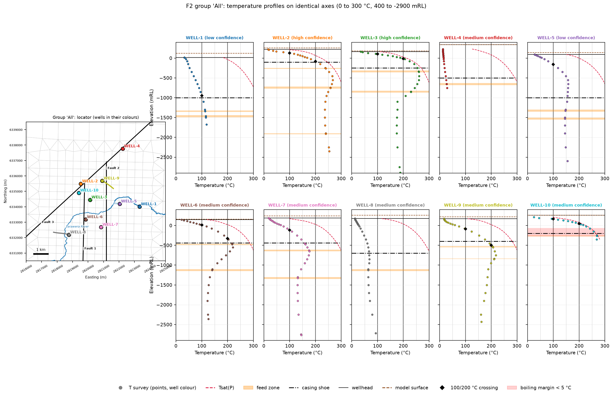

*F2. Temperature profiles of all wells on identical axes (400 to -2900 mRL, 0 to 300 °C), with Tsat(P), casing shoe, feed zones, wellhead and model surface. Individual well figures with pressure panels are `figures/profile_<well>.png`. Claim type: obs.*

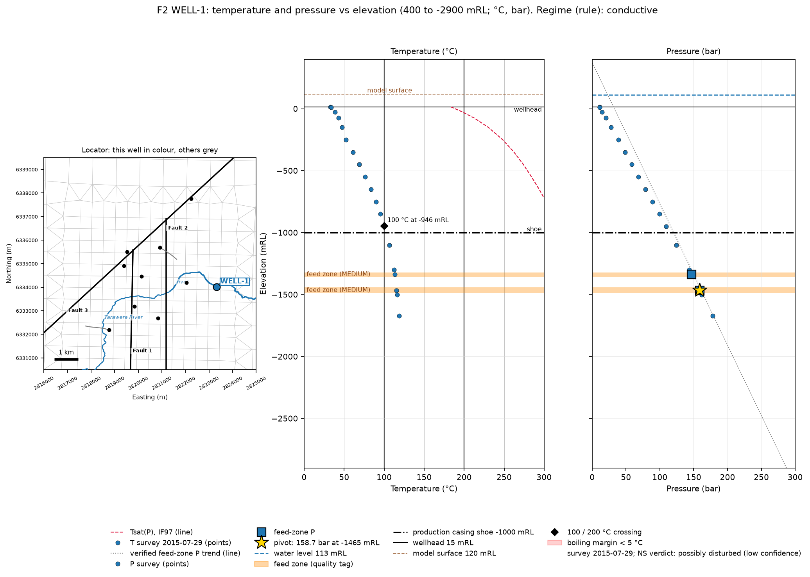

*F2. WELL-1: T and P against elevation (400 to -2900 mRL) with locator map, survey 2015-07-29, verdict possibly disturbed (low). Claim type: obs.*

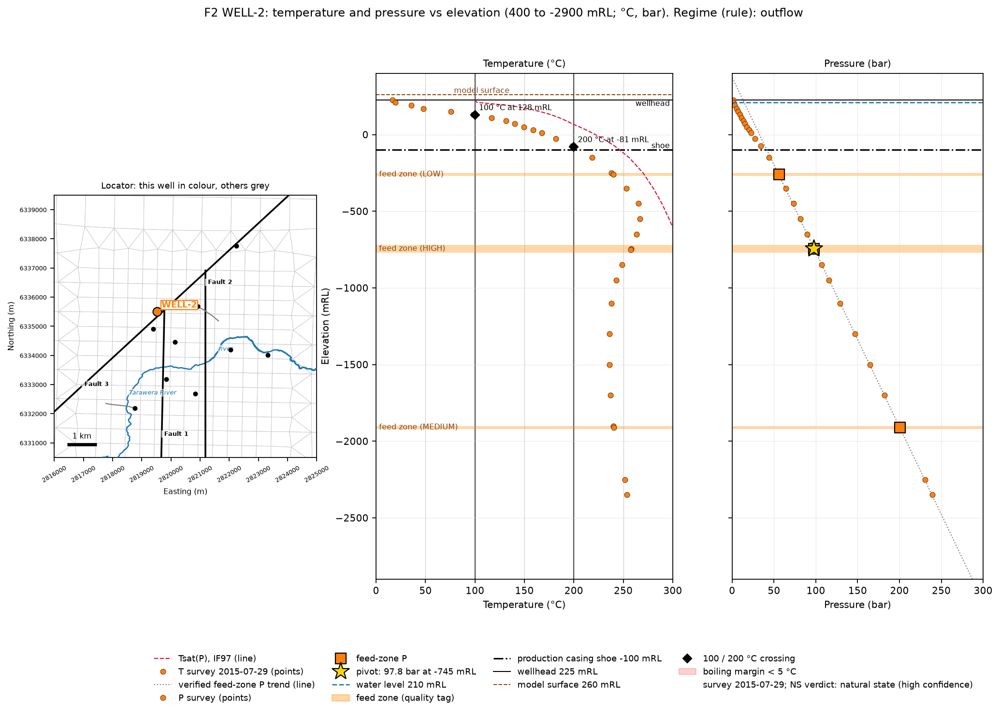

*F2. WELL-2: T and P against elevation (400 to -2900 mRL) with locator map, survey 2015-07-29, verdict natural state (high). Claim type: obs.*

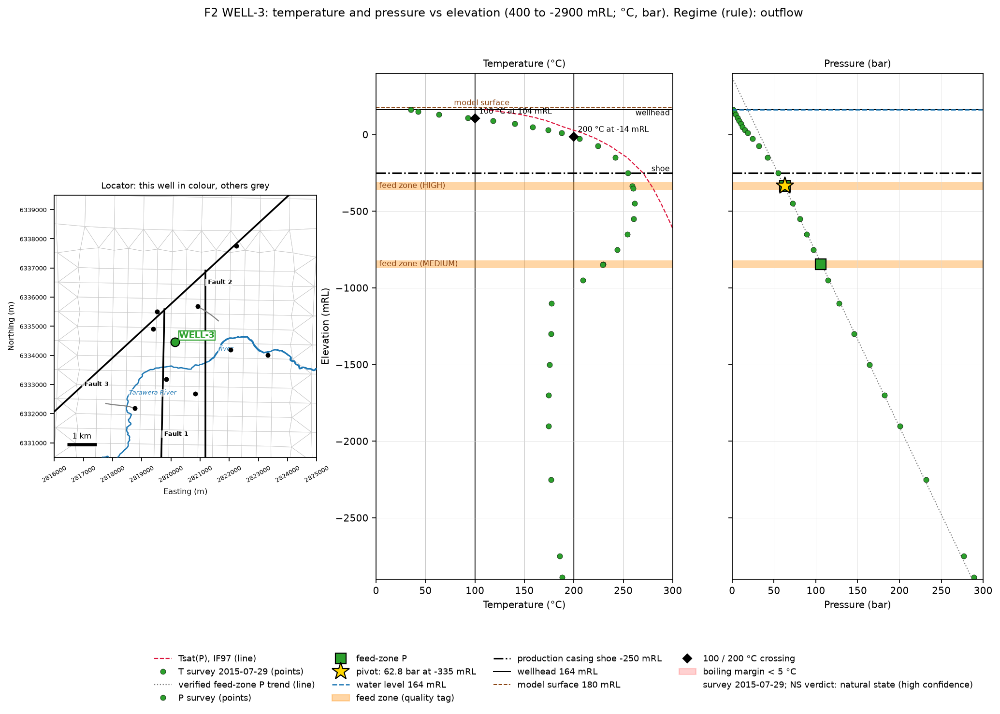

*F2. WELL-3: T and P against elevation (400 to -2900 mRL) with locator map, survey 2015-07-29, verdict natural state (high). Claim type: obs.*

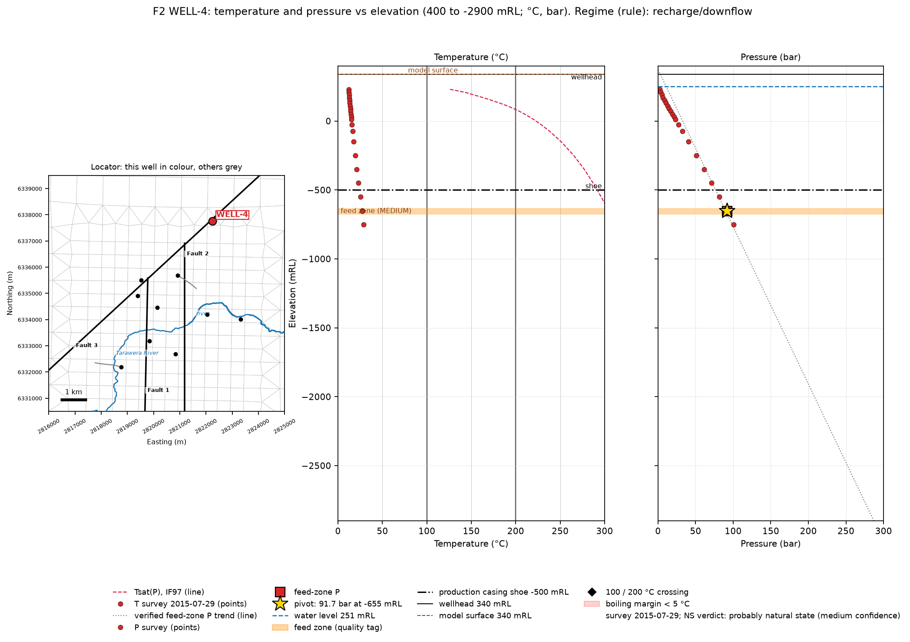

*F2. WELL-4: T and P against elevation (400 to -2900 mRL) with locator map, survey 2015-07-29, verdict probably natural state (medium). Claim type: obs.*

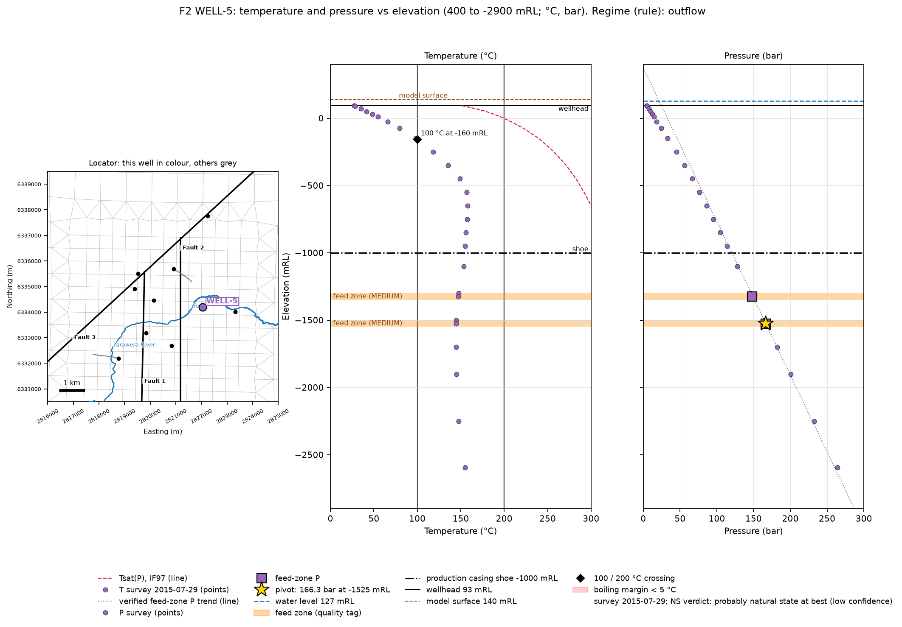

*F2. WELL-5: T and P against elevation (400 to -2900 mRL) with locator map, survey 2015-07-29, verdict probably natural state at best (low). Claim type: obs.*

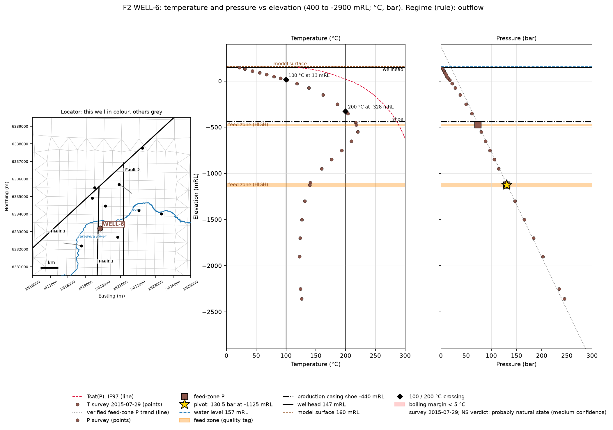

*F2. WELL-6: T and P against elevation (400 to -2900 mRL) with locator map, survey 2015-07-29, verdict probably natural state (medium). Claim type: obs.*

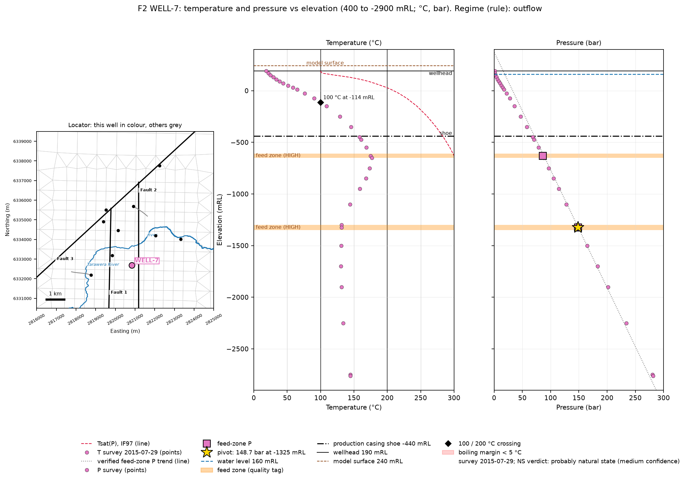

*F2. WELL-7: T and P against elevation (400 to -2900 mRL) with locator map, survey 2015-07-29, verdict probably natural state (medium). Claim type: obs.*

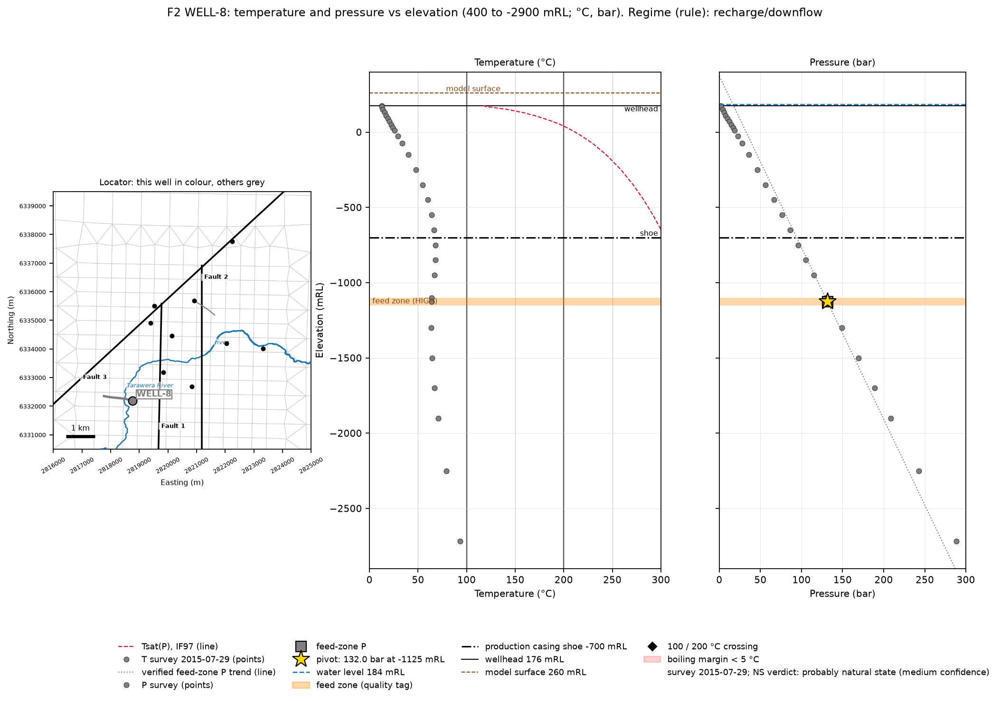

*F2. WELL-8: T and P against elevation (400 to -2900 mRL) with locator map, survey 2015-07-29, verdict probably natural state (medium). Claim type: obs.*

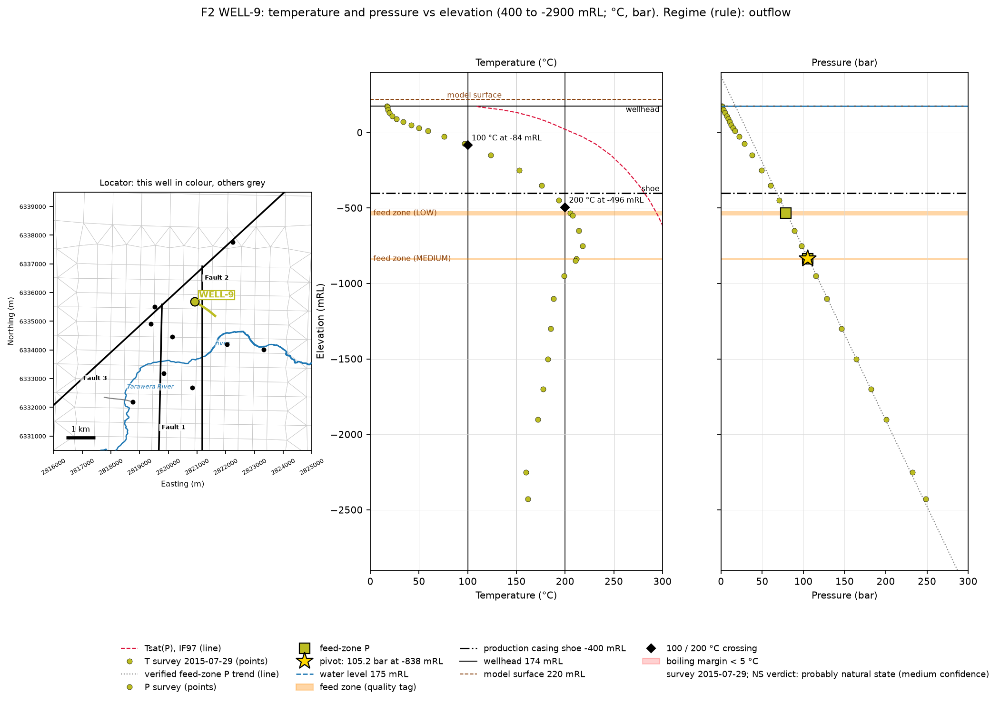

*F2. WELL-9: T and P against elevation (400 to -2900 mRL) with locator map, survey 2015-07-29, verdict probably natural state (medium). Claim type: obs.*

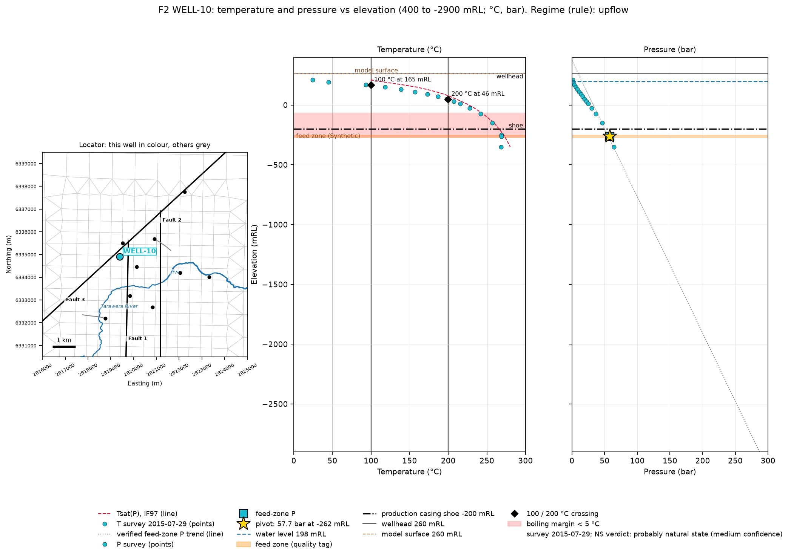

*F2. WELL-10: T and P against elevation (400 to -2900 mRL) with locator map, survey 2015-07-29, verdict probably natural state (medium). Claim type: obs.*

Lateral pattern in 500 m bands (`../Additional_Output/T_P_at_elevation_bands.csv`) [obs]: field medians 38.9 °C (500 to 0 mRL), 130.3 °C (0 to -500 mRL), 170.1 °C (-500 to -1000 mRL), 143.5 °C (-1000 to -1500 mRL), 137.9 °C (-1500 to -2000 mRL), 147.4 °C (-2000 to -2500 mRL), 149.6 °C (-2500 to -3000 mRL). The upflow and outflow wells are the hot outliers above -1000 mRL, and WELL-4, WELL-8 the cold ones at every depth [obs].

*F3. Well mean temperature minus the band field median, 500 m bands from 500 to -3000 mRL, plotted at each well's track position at mid-band; crosses within ±10 °C, open circles = no data. Claim type: obs.*

*F4. Section A-A' from (2817815.2, 6327487.5) to (2820583.4, 6340434.9), through the two hottest wells by Tmax (CLAUDE.md default); wells within 500 m: WELL-8 (+61 m), WELL-10 (+0 m), WELL-2 (+0 m). Temperature points and isotherms within the data envelope; vertical exaggeration 2.1. Claim type: obs (points), interp (isotherms).*

*F4. Section B-B' from (2813030.9, 6336340.7) to (2827963.6, 6332962.8), from the hottest well towards the conductive margin (eastward decline of temperature); wells within 500 m: WELL-10 (+0 m), WELL-3 (-273 m), WELL-5 (-109 m), WELL-1 (+0 m). Temperature points and isotherms within the data envelope; vertical exaggeration 2.4. Claim type: obs (points), interp (isotherms).*

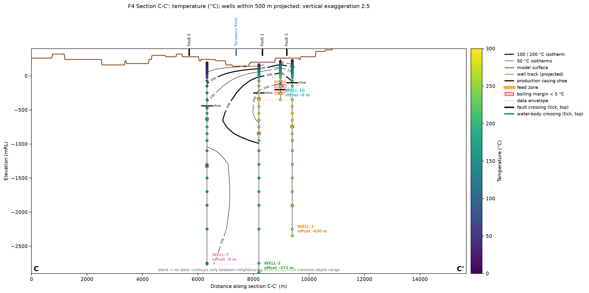

*F4. Section C-C' from (2824284.5, 6327376.5) to (2815751.6, 6340519.5), from the hottest well to the southernmost outflow well; wells within 500 m: WELL-7 (-0 m), WELL-3 (-372 m), WELL-10 (-0 m), WELL-2 (-430 m). Temperature points and isotherms within the data envelope; vertical exaggeration 2.5. Claim type: obs (points), interp (isotherms).*

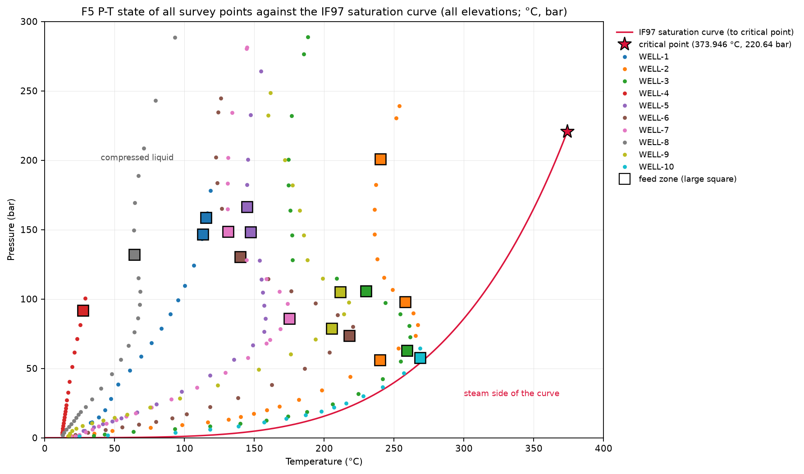

*F5. All survey points and feed zones on P-T axes with the IF97 saturation curve, ending at the critical point. Claim type: obs.*

## 4. Pressure structure

Survey pressures at common elevations (interpolated, never extrapolated; `../Additional_Output/T_P_at_common_elevations.csv`), and the deviation from the verified trend P = 32.756 + 0.08767 × depth below 0 mRL [obs]:

| Well | 0 mRL | -250 mRL | -500 mRL | -750 mRL | -1000 mRL | -1500 mRL | -2000 mRL | -2500 mRL |
|---|---|---|---|---|---|---|---|---|
| WELL-1 | 12.3 (-20.5, cased) | 38.6 (-16.1, cased) | 63.5 (-13.1, cased) | 89.0 (-9.5, cased) | 114.4 (-6.0, cased) | 162.0 (-2.3) |  |  |
| WELL-2 | 24.1 (-8.7, cased) | 55.0 (+0.3) | 77.5 (+0.9) | 98.2 (-0.3) | 120.0 (-0.4) | 164.5 (+0.2) | 208.6 (+0.5) |  |
| WELL-3 | 20.2 (-12.6, cased) | 55.0 (+0.3, cased) | 76.6 (+0.0) | 97.4 (-1.1) | 119.1 (-1.3) | 163.9 (-0.4) | 209.4 (+1.3) | 254.2 (+2.3) |
| WELL-4 | 24.5 (-8.3, cased) | 51.1 (-3.6, cased) | 76.3 (-0.3, cased) | 100.5 (+2.0) |  |  |  |  |
| WELL-5 | 15.4 (-17.4, cased) | 44.9 (-9.8, cased) | 71.7 (-4.9, cased) | 95.4 (-3.1, cased) | 118.6 (-1.8, cased) | 164.0 (-0.3) | 209.7 (+1.6) | 255.4 (+3.5) |
| WELL-6 | 18.6 (-14.2, cased) | 49.9 (-4.8, cased) | 75.7 (-0.9) | 97.0 (-1.5) | 119.1 (-1.3) | 165.1 (+0.8) | 211.4 (+3.3) |  |
| WELL-7 | 18.9 (-13.9, cased) | 46.9 (-7.8, cased) | 73.3 (-3.3) | 96.6 (-1.9) | 118.9 (-1.5) | 164.8 (+0.5) | 211.1 (+3.0) | 257.3 (+5.4) |
| WELL-8 | 19.8 (-13.0, cased) | 46.1 (-8.6, cased) | 71.3 (-5.3, cased) | 95.9 (-2.6) | 119.8 (-0.6) | 169.2 (+4.9) | 218.4 (+10.3) | 267.4 (+15.5) |
| WELL-9 | 18.3 (-14.5, cased) | 49.3 (-5.4, cased) | 75.6 (-1.0) | 97.7 (-0.8) | 119.3 (-1.1) | 163.9 (-0.4) | 209.4 (+1.3) |  |
| WELL-10 | 26.3 (-6.5, cased) | 56.7 (+2.0) |  |  |  |  |  |  |

Values in brackets are P minus the verified trend; 'cased' marks wellbore-column values that are not formation pressure (§4.2) [obs]. Below the feed zones the deviation grows with depth in cold wells (for example WELL-8) because their colder water column is denser than the hot trend fluid; this is a density effect, not overpressure [interp].

Feed-zone pressures (the formation pressure targets) [obs]:

| Well | Feed zone | Mid (mRL) | Quality | P (bar) | P minus trend (bar) | T (°C) | Block |
|---|---|---|---|---|---|---|---|
| WELL-1 | 1 | -1337.5 | MEDIUM | 146.7 | -3.32 | 113.2 | arg63 |
| WELL-1 | 2 | -1465.0 | MEDIUM | 158.7 | -2.50 | 115.5 | arg64 |
| WELL-2 | 1 | -260.0 | LOW | 55.9 | +0.35 | 239.7 | ajf54 |
| WELL-2 | 2 | -745.0 | HIGH | 97.8 | -0.27 | 258.0 | ajf59 |
| WELL-2 | 3 | -1910.0 | MEDIUM | 200.7 | +0.49 | 240.3 | ajf66 |
| WELL-3 | 1 | -335.0 | HIGH | 62.8 | +0.67 | 259.1 | asd55 |
| WELL-3 | 2 | -845.0 | MEDIUM | 105.6 | -1.24 | 229.8 | asd60 |
| WELL-4 | 1 | -655.0 | MEDIUM | 91.7 | +1.52 | 27.3 | aop58 |
| WELL-5 | 1 | -1325.0 | MEDIUM | 148.1 | -0.82 | 147.3 | arc63 |
| WELL-5 | 2 | -1525.0 | MEDIUM | 166.3 | -0.16 | 144.8 | arc64 |
| WELL-6 | 1 | -475.0 | HIGH | 73.5 | -0.90 | 218.0 | aph56 |
| WELL-6 | 2 | -1125.0 | HIGH | 130.5 | -0.89 | 139.8 | aph62 |
| WELL-7 | 1 | -630.0 | HIGH | 86.0 | -1.99 | 175.1 | apk58 |
| WELL-7 | 2 | -1325.0 | HIGH | 148.7 | -0.22 | 131.3 | apk63 |
| WELL-8 | 1 | -1125.0 | HIGH | 132.0 | +0.61 | 63.9 | ana62 |
| WELL-9 | 1 | -535.0 | LOW | 78.9 | -0.76 | 205.4 | ajj57 |
| WELL-9 | 2 | -837.5 | MEDIUM | 105.2 | -0.98 | 211.6 | ajq60 |
| WELL-10 | 1 | -262.5 | Synthetic | 57.7 | +1.93 | 268.7 | arz54 |

Pivot pressures (dominant feed zone, CLAUDE.md §4.4): WELL-1 158.7 bar at -1465.0 mRL; WELL-2 97.8 bar at -745.0 mRL; WELL-3 62.8 bar at -335.0 mRL; WELL-4 91.7 bar at -655.0 mRL; WELL-5 166.3 bar at -1525.0 mRL; WELL-6 130.5 bar at -1125.0 mRL; WELL-7 148.7 bar at -1325.0 mRL; WELL-8 132.0 bar at -1125.0 mRL; WELL-9 105.2 bar at -837.5 mRL; WELL-10 57.7 bar at -262.5 mRL [obs]. Water levels from the three shallowest liquid points range from 112.9 to 250.8 mRL; WELL-1's (112.9 mRL) is 97.9 m above its top survey point, i.e. the well is artesian [obs].

**Hydrostatic check by band** (`../Additional_Output/hydrostatic_check.csv`, `hydrostatic_summary.csv`; windows ≥ 300 m in single-phase liquid intervals; ratio = measured ΔP / ΔP from IF97 Region 1 density over the measured T profile, g = 9.80665 m/s2; rounding uncertainty of the ratio ≤ 0.0070) [obs]:

| Well | Cased: n, median ratio, excess over cold component | Open: n, median ratio, excess over cold component |
|---|---|---|
| WELL-1 | 1, 1.0646, +0.0227 | 1, 1.0077, +0.0133 |
| WELL-2 | 1, 1.2972, +0.2553 | 3, 1.0914, +0.0970 |
| WELL-3 | 1, 1.5507, +0.5088 | 2, 1.0458, +0.0514 |
| WELL-4 | 1, 1.0329, -0.0090 | 1, 0.9785, -0.0159 |
| WELL-5 | 1, 1.1371, +0.0952 | 2, 1.0003, +0.0059 |
| WELL-6 | 1, 1.3159, +0.2740 | 2, 1.0038, +0.0094 |
| WELL-7 | 1, 1.1761, +0.1342 | 2, 1.0139, +0.0195 |
| WELL-8 | 1, 1.0509, +0.0090 | 2, 1.0070, +0.0126 |
| WELL-9 | 1, 1.2067, +0.1648 | 2, 1.0391, +0.0447 |
| WELL-10 | 1, 1.3942, +0.3523 | no window |
| ALL | 10, 1.1914, +0.1495 | 17, 1.0196, +0.0252 |

The cold wells (WELL-4, WELL-8) give a field-wide component of 1.0419 (cased) and 0.9944 (open) [obs]. This is presented as a possible datum or convention issue, not physical overpressure: a few percent excess in cold columns could come from a pressure-gauge or depth convention [interp]. Checks on the larger excess in the hot cased windows [interp]: a datum offset cannot change a gradient; a gravity or unit convention would act at every depth, but the open-hole windows of the same wells are close to the cold component; two-phase fluid would make the column lighter, not heavier; rounding contributes at most 0.0070. None of these explains it. The excess is real in the data and confined to the shallow hot section; it is consistent with these 'pressures' being formation pressures with upward flow through a low-permeability cap rather than a static wellbore column, which is a question for the data owner (section 7).

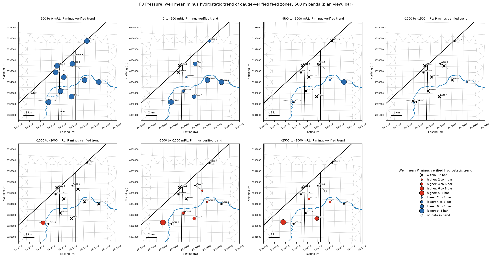

*F3 (pressure). Well mean pressure minus the verified hydrostatic trend in 500 m bands, classes of 2 bar. Shallow bands include cased wellbore pressures. Claim type: mixed (trend is fitted).*

*F4 (pressure). Section A-A': survey pressure minus the verified hydrostatic trend, contoured at 2 bar within the data envelope. Claim type: mixed.*

*F4 (pressure). Section B-B': survey pressure minus the verified hydrostatic trend, contoured at 2 bar within the data envelope. Claim type: mixed.*

*F4 (pressure). Section C-C': survey pressure minus the verified hydrostatic trend, contoured at 2 bar within the data envelope. Claim type: mixed.*

## 5. Conceptual model

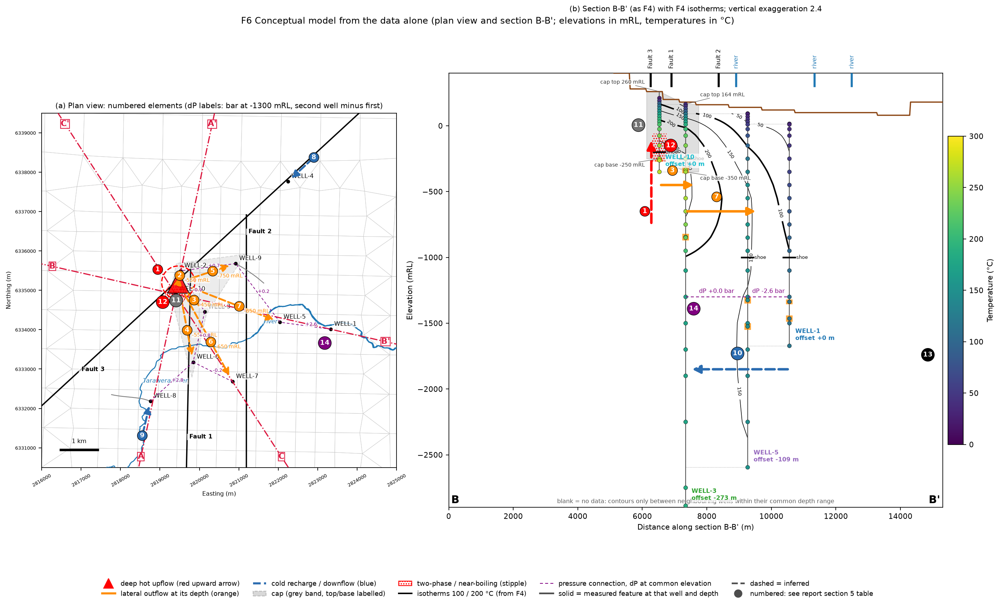

*F6. Conceptual model from the data alone: plan view and section B-B' (the F4 line from the hottest well WELL-10 towards the conductive margin, chosen because it crosses the upflow, two outflow wells and the margin; line A crosses only the upflow wells and WELL-8). Numbers refer to the table below. Claim type: interp.*

| No. | Element | Symbol | Location | Supporting observation | Claim type |
|---|---|---|---|---|---|
| 1 | Deep hot upflow | red upward arrow (dashed (inferred)) | beneath WELL-10, WELL-2; Fault 1 / Fault 3 intersection (2819778, 6335556) is 478 m from their centre | WELL-10 Tmax 268.7 °C at -250 mRL, 200 °C crossing 45.6 mRL, regime upflow; WELL-2 Tmax 266.9 °C at -550 mRL, 200 °C crossing -81.0 mRL, regime outflow | interp |
| 2 | Lateral outflow towards WELL-2 | orange horizontal arrow (solid in the section where the well is on the line; dashed path in plan) | from the upflow to WELL-2 at -550 mRL | WELL-2: inversion 30.9 °C, peak 266.9 °C at -550 mRL, base -1500 mRL | interp |
| 3 | Lateral outflow towards WELL-3 | orange horizontal arrow (solid in the section where the well is on the line; dashed path in plan) | from the upflow to WELL-3 at -450 mRL | WELL-3: inversion 86.9 °C, peak 261.4 °C at -450 mRL, base -1700 mRL | interp |
| 4 | Lateral outflow towards WELL-6 | orange horizontal arrow (solid in the section where the well is on the line; dashed path in plan) | from the upflow to WELL-6 at -550 mRL | WELL-6: inversion 98.1 °C, peak 220.5 °C at -550 mRL, base -1900 mRL | interp |
| 5 | Lateral outflow towards WELL-9 | orange horizontal arrow (solid in the section where the well is on the line; dashed path in plan) | from the upflow to WELL-9 at -750 mRL | WELL-9: inversion 57.7 °C, peak 217.7 °C at -750 mRL, base -2250 mRL | interp |
| 6 | Lateral outflow towards WELL-7 | orange horizontal arrow (solid in the section where the well is on the line; dashed path in plan) | from the upflow to WELL-7 at -650 mRL | WELL-7: inversion 46.0 °C, peak 176.7 °C at -650 mRL, base -1700 mRL | interp |
| 7 | Lateral outflow towards WELL-5 | orange horizontal arrow (solid in the section where the well is on the line; dashed path in plan) | from the upflow to WELL-5 at -650 mRL | WELL-5: inversion 13.3 °C, peak 158.0 °C at -650 mRL, base -1700 mRL | interp |
| 8 | Cold recharge or downflow at WELL-4 | blue arrow (dashed (inferred)) | WELL-4 (field margin) | WELL-4: Tmax 29.0 °C at -750 mRL, shallow gradient 13.9 °C/km | interp |
| 9 | Cold recharge or downflow at WELL-8 | blue arrow (dashed (inferred)) | WELL-8 (field margin) | WELL-8: Tmax 93.1 °C at -2716 mRL, shallow gradient 84.6 °C/km, inversion 4.5 °C -850 to -1300 mRL | interp |
| 10 | Cool water beneath the outflow (deep lateral inflow) | blue arrow (dashed (inferred)) | below the inversion bases, WELL-2, WELL-3, WELL-6, WELL-9, WELL-7 | WELL-2 falls to 236.0 °C at -1500 mRL; WELL-3 falls to 174.5 °C at -1700 mRL; WELL-6 falls to 122.4 °C at -1900 mRL; WELL-9 falls to 160.0 °C at -2250 mRL; WELL-7 falls to 130.7 °C at -1700 mRL | interp |
| 11 | Cap (low permeability, conductive gradient) | grey band (outlined) | WELL-2, WELL-3, WELL-6, WELL-9, WELL-10: base -250 to -650 mRL | shallow gradients WELL-2 622.2 °C/km; WELL-3 680.4 °C/km; WELL-6 489.8 °C/km; WELL-9 336.1 °C/km; WELL-10 691.7 °C/km | interp |
| 12 | Near-boiling zone | stipple (stipple) | WELL-10 | WELL-10 minimum boiling margin 2.65 °C at -150 mRL | obs |
| 13 | Isotherms 100 °C and 200 °C | black lines (from F4) (solid) | section B-B' | interpolated between neighbouring wells inside the data envelope | interp |
| 14 | Pressure connection between wells | thin dashed line, labelled dP (thin dashed) | open-hole pressures at -1300 mRL | WELL-1-WELL-5 +2.6 bar; WELL-5-WELL-9 +0.2 bar; WELL-9-WELL-2 +0.7 bar; WELL-2-WELL-3 -0.9 bar; WELL-3-WELL-6 +0.8 bar; WELL-6-WELL-7 -0.2 bar; WELL-6-WELL-8 +2.8 bar | mixed |

Relation to mapped features [obs unless stated]:

- WELL-1: nearest fault Fault 2 at 2141.2 m; nearest water body river at 95.8 m.
- WELL-2: nearest fault Fault 3 at 124.7 m; nearest water body Tarawera River at 1905.6 m.
- WELL-3: nearest fault Fault 1 at 377.6 m; nearest water body Tarawera River at 827.6 m.
- WELL-4: nearest fault Fault 3 at 50.3 m; nearest water body river at 3125.5 m.
- WELL-5: nearest fault Fault 2 at 855.2 m; nearest water body river at 345.0 m.
- WELL-6: nearest fault Fault 1 at 112.6 m; nearest water body Tarawera River at 423.9 m.
- WELL-7: nearest fault Fault 2 at 348.8 m; nearest water body Tarawera River at 858.2 m.
- WELL-8: nearest fault Fault 1 at 950.3 m; nearest water body Tarawera River at 234.9 m.
- WELL-9: nearest fault Fault 2 at 268.8 m; nearest water body river at 1488.2 m.
- WELL-10: nearest fault Fault 3 at 225.7 m; nearest water body Tarawera River at 1336.5 m.

What the data cannot decide [interp]:

- Whether the upflow rises along Fault 1 or Fault 3 or is distributed: no well penetrates below -350 mRL at WELL-10. A deep well, or a deep temperature log, near the fault intersection would decide it.
- Whether the cold water beneath the outflow comes from the south, east or north: deep temperatures in WELL-4, WELL-8 are colder than any inflow water seen elsewhere, but no well lies between them and the outflow wells at depth. Deep wells or deep temperature logs on the margins would decide it.
- Whether WELL-1's lower feed-zone pressures reflect a flow barrier (it lies east of Fault 2 and near the river) or a pressure-gauge problem: an interference test or a repeat survey would decide it.
- Whether WELL-4, WELL-8 show downflow from the surface (low gradients near the top) or lateral inflow (inversion at depth in WELL-8): both are consistent with the profiles.

## 6. Recommended calibration set-up

**Targets and weights** [obs, rules of CLAUDE.md §5.5]:

- Temperature targets: all 266 survey points in `NS_calibration_targets.csv` (`weight`), feed-zone temperatures in `feedzones.csv` (`weight_T`), and layer-centre values in `T_P_at_layer_centres.csv` for block-by-block comparison.
- Pressure targets: only the 32 survey points inside feed zones (`weight_P`) and the 18 feed-zone pressures; all other pressures have weight_P = 0.
- Location weights: above model surface 0; within 30 m of the wellhead or in the column's top block 0.3; feed zone 1.0; behind casing 0.5; open-hole isothermal section 0.5; other open hole 0.8. No point lies above the model surface or in a top block, so the 0 and top-block cases are unused [obs].
- Points by location class: behind casing 131, feed zone 32, open hole 56, open hole, isothermal section 28, within 30 m of wellhead 19 [obs].
- Confidence factors: high 1.0 (WELL-2, WELL-3), medium 0.75 (WELL-4, WELL-6, WELL-7, WELL-8, WELL-9, WELL-10), low 0.5 (WELL-1, WELL-5). Pressure quality factors: HIGH 1.0, MEDIUM 0.8, LOW and 'Synthetic' 0.5. No departure from the defaults [obs].

**Heat and mass in and out** [interp]:

- In: a deep hot upflow below WELL-10, WELL-2 (≥ 1178.2 kJ/kg), plus cold water at depth from the lateral margins, and possibly downflow at WELL-4, WELL-8.
- Out: lateral outflow at -450 to -750 mRL towards WELL-2, WELL-3, WELL-6, WELL-9, WELL-7, WELL-5; ultimately to the surface or the rivers (the data do not show the discharge point: the files hold no surface thermal features or spring flows).

**Permeability structure implied by the data** [interp]:

- Low permeability cap from the surface to -250 to -650 mRL over the hot area.
- A laterally permeable outflow layer at about -450 to -750 mRL, with lower vertical permeability beneath it, so that cooler water can persist below.
- A vertical conduit beneath WELL-10, WELL-2, possibly along Fault 1 and Fault 3.
- Good lateral pressure connection at feed-zone depths across the field (all feed zones within the tolerance of one trend except WELL-1).

**Boundary requirements** [interp]:

- Lateral boundaries that admit cold water at depth (the deep cool inflow and the cold margin wells require it).
- A top boundary that allows the cap to remain conductive and liquid; WELL-1's artesian water level (112.9 mRL) suggests confined pressure in the east.

**Starting model for comparison** [reference model]: the reference boundary conditions use a default basal heat flux of 0.1 W/m2, a default rainfall of 1000.0 mm/yr with infiltration fraction 0.1, an atmosphere at 12.3 °C and 5 lake columns. These are properties of the starting model, not evidence.

## 7. Data quality issues and open questions

Ranked by their effect on calibration:

1. **Survey date label** [obs]: every survey is dated 2015-07-29, after production and injection began (2014-01-01), but the gauge test shows pre-production pressures. Effect: decides whether the surveys can be natural-state targets at all. Resolve: confirm the survey dates.
2. **Super-hydrostatic shallow pressure gradients** [obs]: cased-window ratios up to 1.5507 (WELL-3). Effect: pressures above the reservoir cannot be used, and if they are formation pressures they constrain the cap permeability. Resolve: ask how the pressures were obtained (wellbore log or formation estimate).
3. **WELL-9 gauge mismatch** [obs]: survey 91.25 bar vs first reading 89.2 bar at -675 mRL in a deviated well (horizontal deviation 867.6 m). Effect: WELL-9 is medium rather than high confidence. Resolve: confirm whether the gauge elevation is true vertical or along-hole.
4. **WELL-1 off the pressure trend** [obs]: feed zones -3.32 and -2.50 bar from the trend (tolerance 3.00 bar), so WELL-1 is 'possibly disturbed' (low) by the rubric, although it has no flow records [obs]. A natural lateral pressure difference across Fault 2 is an alternative explanation [interp]. Effect: halves WELL-1 weights. Resolve: check whether WELL-1 was ever flowed or whether it is separated from the main field.
5. **WELL-5 is an injector hotter than the injectate** [obs]: injection cooling could be hidden, so its weights are halved. Resolve: confirm the survey pre-dates injection.
6. **Wellheads below the model surface** [obs]: by up to 105.0 m (WELL-1); the model surface is smoother than the topography at the wells. Effect: the shallowest points sit deeper in the model's column than in reality. Resolve: accept, or refine the surface.
7. **WELL-4 deepest liner bottom at track TD** [obs]: design bottom -3251 mRL; track TD -750.0 mRL. Effect: none on the natural-state targets (the survey stops at the track TD). Resolve: correct the well design or the track.
8. **Quality tag 'Synthetic'** on WELL-10's feed zone is not a quality grade [obs]; it takes factor 0.5. Resolve: supply a grade.
9. **Empty provenance fields** [obs]: no Source or Comment on surveys and gauges; well designs say 'Synthetic data'. Effect: the trust in every value rests on the labels alone.
10. **File naming** [obs]: the WELL-10 plain-column files use 'Wel10'; production flows in those files have the opposite sign to the JSON. No effect on the analysis (JSON is primary).

## 8. Output file index

`Output/Calibration_Input/` (what the calibrator needs):

- `NS_data_interpretation.md`
- `NS_calibration_targets.csv`
- `feedzones.csv`
- `T_P_at_layer_centres.csv`
- `well_summary.csv`
- `figures_index.csv`
- `figures/` (23 standard figures F1 to F7; see `figures_index.csv`)

`Output/Additional_Output/` (supporting detail):

- `input_inventory.csv`
- `pressure_consistency_check.csv`
- `hydrostatic_check.csv`
- `hydrostatic_summary.csv`
- `well_geometry_check.csv`
- `T_P_at_elevation_bands.csv`
- `T_P_at_common_elevations.csv`
- `dat_json_crosscheck.csv`
- `integrity_checks.csv`
- `provenance_fields.csv`
- `section_lines.csv`
- `pressure_connections.csv`
- `conceptual_model_elements.csv`
- `parameters_used.csv`
- `run_console_log.txt`
- `acceptance_check.txt`
- `process_log.md`

