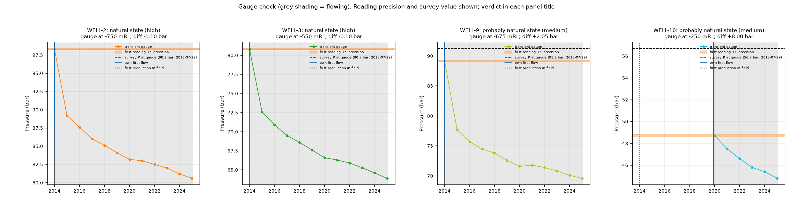

# Natural-state data interpretation: Teaching_Model_3D (TE14515)

Generated by `Scripts/natural_state_analysis.py` from `Baseline/` (read-only). Every number below is read from a table in this folder or in `../Additional_Output/`. Tags: `[obs]` measured in the data, `[interp]` an interpretation of measured data, `[assumption]` an assumed value, `[reference model]` content of the starting model (never evidence).

## 1. Key conclusions for calibration

1. **Natural-state verdicts.** Of 10 wells, 2 are natural state with high confidence (WELL-2, WELL-3); 6 are probably natural state with medium confidence (WELL-4, WELL-6, WELL-7, WELL-8, WELL-9, WELL-10); WELL-5 is probably natural state at best, low confidence; and WELL-1 is possibly disturbed, low confidence. [interp] Source: `pressure_consistency_check.csv`, rules in section 2.
   **Action:** use the natural-state targets at the weights in `NS_calibration_targets.csv`; treat WELL-1 and WELL-5 as low-weight targets only.

2. **The two gauge-verified wells match their first gauge reading, but the survey date conflicts with the gauge.** WELL-2 survey pressure at -750 mRL is 98.2 bar, against a first gauge reading of 98.3 bar on 2014-01-01; WELL-3 differs by -0.10 bar. [obs] On the survey label date (2015-07-29) the WELL-2 gauge read 88.3 bar, so the survey agrees with the first reading and not with the gauge at its own date. [interp] The gauge test decides the verdict (§4.1), so both wells stay at high confidence; the date label is a data question.
   **Action:** confirm the survey date for WELL-2 and WELL-3. If the survey was taken at the start of production, these two surveys are the best natural-state anchors in the dataset.

3. **Cased-section pressures disagree with the temperature profiles.** Above each production casing shoe, the measured pressure gradient is steeper than the IF97 column for the measured temperatures in every well that has a cased window: the cased-band ratio runs from 1.05 to 1.54, against a cased component of 1.05 (one cold window, WELL-8). [obs] The steepest cased window (WELL-3, 150 to -150 mRL) implies a liquid density of 1363 kg/m3, which is not possible for water. [interp] A datum, gravity or unit convention would act at every depth and cannot explain this, and two-phase fluid would make the column lighter; the cased pressures are most likely the wellbore column (§4.2), not formation pressure.
   **Action:** do not use cased-section pressures as formation targets. Use feed-zone pressures only (`feedzones.csv`).

4. **Open-hole pressures agree with IF97 for most wells, apart from a field-wide offset.** The open-band cold-well component is 1.007, a field-wide offset of about 0.7 percent. [obs] Open-hole median excesses above 3 percent occur in WELL-2, WELL-3, WELL-9 ([hydrostatic_by_well_band.csv](../Additional_Output/hydrostatic_by_well_band.csv)). [obs] A datum or convention offset is the first thing to check (§4.3). Flowing wells could also carry bore friction in the measured gradient. [interp]
   **Action:** confirm the gravity and unit convention and the elevation datum used for the gauges before calibrating to open-hole pressure gradients; carry the component as a known offset.

5. **Hot upflow at WELL-10.** WELL-10 has the highest temperature in the field (268.7 degC at -250.0 mRL), no inversion, and a minimum boiling margin of 2.6 degC at -150 mRL, so the top of the upflow is near boiling. [obs] Regime: upflow by the Tmax rule (§4.4). [interp]
   **Action:** place the heat source beneath WELL-10, with a near-boiling target at -150 mRL and a feed-zone temperature target at -262.5 mRL.

6. **Lateral outflow at depth.** Measured inversions (temperature drop below the running maximum, at least 3 degC) occur in WELL-2, WELL-3, WELL-5, WELL-6, WELL-7, WELL-8, WELL-9, with tops between -850 and -450 mRL. [obs] Regime outflow for WELL-2, WELL-3, WELL-5, WELL-6, WELL-7, WELL-9 (inversion at least 10 degC). [interp] Lateral outflow away from the upflow at these depths.
   **Action:** put permeable horizons at the inversion depths listed in `well_summary.csv`, and calibrate lateral permeability to reproduce those inversions.

7. **Cold recharge or downflow in the cold wells.** WELL-4, WELL-8 have Tmax below 100 degC (29.0, 93.1 degC). [obs] Both wells have Tmax below 100 degC. [interp] Cold downflow or recharge on that side; the regime does not show the direction of flow.
   **Action:** set cold recharge boundaries near these wells at their measured temperatures; the open-hole isothermal section of WELL-8 is listed in `injector_and_isothermal_check.csv`.

8. **Wellheads sit below the model surface.** In 8 wells the wellhead is 13 to 105 m below the model surface of its column. [obs] 0 survey points lie above the model surface. [obs] The grid topography and the wellhead elevations do not agree. [interp]
   **Action:** reconcile the model topography with the wellhead elevations before using near-surface temperatures.

9. **The cap is not resolved by the survey data.** No interval of conductive gradient is identified above the upflow that can be separated from the outflow profile. [interp] The cap is therefore drawn as absent in F6. What would decide it: a shallow vertical profile in a well on the upflow with a linear conductive gradient above the 100 degC isotherm, or a lithology log of the caprock.
   **Action:** calibrate cap thickness and permeability contrast as free parameters, with the outflow inversions as the constraint.

## 2. The data

**Inventory.** 20 inventory rows classify every file under `Baseline/` (see [input_inventory.csv](../Additional_Output/input_inventory.csv)). Geometry and block assignment come from the grid file and the well-to-block file. Model properties (reference rock, boundary conditions, results, set-up) are reference only and were not used as evidence. Production and future-scenario files are out of scope. Field production timing was taken from the well flow records.

**Checks.** Plain-column copies were compared with the JSON for every survey and transient point ([data_crosscheck.csv](../Additional_Output/data_crosscheck.csv)): 24 series match exactly and 0 disagree. [obs] Flow and enthalpy series were not cross-checked. Irregular file names: `Wel10_*` for WELL-10. Survey dates in use: 2015-07-29; each well has one survey date. [obs]

**Provenance labels.**
- Design source field of every well reads 'Synthetic data'. [obs]
- Feed-zone quality tags found: HIGH, LOW, MEDIUM, Synthetic. The WELL-10 tag 'Synthetic' is not a quality grade. [obs]
- Feed-zone top and bottom are labelled 'm' in the JSON but are elevations in mRL (§3). [obs]
- Survey StableFlag is true for every survey; transient records carry no flag. [obs]

**Natural-state timing for each well with a gauge** ([pressure_consistency_check.csv](../Additional_Output/pressure_consistency_check.csv)):

| Well | Gauge elevation (mRL) | First reading (date, bar) | Own first flow | Pre-production reading | Survey minus first reading (bar) | Verdict | Confidence |
|---|---|---|---|---|---|---|---|
| WELL-2 | -750 | 2014-01-01, 98.3 | 2014-01-01 | yes | -0.10 | natural state | high |
| WELL-3 | -550 | 2014-01-01, 80.8 | 2014-01-01 | yes | -0.10 | natural state | high |
| WELL-9 | -675 | 2014-01-01, 89.2 | 2014-01-01 | yes | +2.05 | probably natural state | medium |
| WELL-10 | -250 | 2020-01-01, 48.7 | 2019-12-01 | no | +8.00 | probably natural state | medium |

Wells without a gauge: WELL-1, WELL-4, WELL-5, WELL-6, WELL-7, WELL-8. For these, the feed-zone pressures were tested against the verified trend: P = 32.76 + 0.08767 x depth bar, fitted to the gauge-verified feed zones of WELL-2, WELL-3 (RMS 0.70 bar). The tolerance is 3.0 bar, the floor, because twice the RMS is smaller. [interp] Figure F7 shows the gauge test:  [obs]

Figure F7 (gauge check) [obs]: transient pressure against time, survey pressure at the gauge elevation, first production in the field, and flowing periods.

**Verdict rules applied (§4.1).** Rule 1: survey matches a pre-production gauge reading within the precision. Rule 2: injector whose formation is hotter than its injectate. Rule 3: gauge misses by more than the precision, feed zones on the trend. Rule 4: no pre-production gauge reading, feed zones on the trend. Rule 5: feed-zone pressures off the trend by more than the tolerance. Rules applied per well: WELL-1 rule 5; WELL-2 rule 1; WELL-3 rule 1; WELL-4 rule 4; WELL-5 rule 2; WELL-6 rule 4; WELL-7 rule 4; WELL-8 rule 4; WELL-9 rule 3; WELL-10 rule 4. [interp]

Figure F1 (base map) [obs]: wells, faults, water bodies, model grid and section line A-A'. 

## 3. Temperature structure

| Well | Tmax (degC) | at (mRL) | T at TD (degC) | Inversion (degC) | Regime | 100 degC at (mRL) | Min boiling margin (degC) | Verdict | Confidence |
|---|---|---|---|---|---|---|---|---|---|
| WELL-1 | 118.6 | -1672 | 118.6 | none | conductive | -946 | 150.4 | possibly disturbed | low |
| WELL-2 | 266.9 | -550 | 253.7 | 30.9 | outflow | 128 | 23.8 | natural state | high |
| WELL-3 | 261.4 | -450 | 188.2 | 86.9 | outflow | 104 | 12.2 | natural state | high |
| WELL-4 | 29.0 | -750 | 29.0 | none | recharge/downflow | not reached | 113.8 | probably natural state | medium |
| WELL-5 | 158.0 | -650 | 154.7 | 13.3 | outflow | -160 | 123.6 | probably natural state at best | low |
| WELL-6 | 220.5 | -550 | 126.1 | 98.1 | outflow | 13 | 70.0 | probably natural state | medium |
| WELL-7 | 176.7 | -650 | 144.7 | 46.0 | outflow | -114 | 97.1 | probably natural state | medium |
| WELL-8 | 93.1 | -2716 | 93.1 | 4.5 | recharge/downflow | not reached | 104.1 | probably natural state | medium |
| WELL-9 | 217.7 | -750 | 161.6 | 57.7 | outflow | -84 | 87.8 | probably natural state | medium |
| WELL-10 | 268.7 | -250 | 268.5 | none | upflow | 165 | 2.6 | probably natural state | medium |

[obs] Values are from `well_summary.csv`. Inversions, Tmax and isotherm crossings follow the §4.4 definitions.

Profiles and their shoe, feed-zone and boiling-margin annotations: figures [F2](figures/profile_panels_All.png) (all wells on common axes), and one profile per well in `figures/profile_<well>.png`. [obs]

Lateral temperature structure at depth bands without interpolation: [F3 temperature](figures/maps_temperature_bands.png). [obs] Section along the line through the two hottest wells: [F4](figures/section_A.png), the line runs through WELL-10 and WELL-2, from E2817776 N6327306 to E2820611 N6340566 (NZTM, m). Offsets of wells from the section line are printed on the figure. [obs] Interpolated companion (not data, not used for targets): [section](../Additional_Output/figures/section_A_interpolated.png) and [plan](../Additional_Output/figures/maps_temperature_interpolated.png). [interp]

## 4. Pressure structure

Pressure at common elevations, interpolated within each survey and never extrapolated ([T_P_at_common_elevations.csv](../Additional_Output/T_P_at_common_elevations.csv)):

| Elevation (mRL) | Well | T (degC) | P (bar) | P minus trend (bar) |
|---|---|---|---|---|
| 0 | WELL-1 | 35.0 | 12.3 | -20.5 |
| 0 | WELL-2 | 171.8 | 24.1 | -8.7 |
| 0 | WELL-3 | 192.8 | 20.2 | -12.6 |
| 0 | WELL-4 | 15.3 | 24.5 | -8.3 |
| 0 | WELL-5 | 57.9 | 15.4 | -17.3 |
| 0 | WELL-6 | 106.3 | 18.6 | -14.2 |
| 0 | WELL-7 | 68.3 | 18.9 | -13.9 |
| 0 | WELL-8 | 26.7 | 19.8 | -13.0 |
| 0 | WELL-9 | 63.6 | 18.3 | -14.5 |
| 0 | WELL-10 | 219.1 | 26.3 | -6.4 |
| -250 | WELL-1 | 52.4 | 38.6 | -16.1 |
| -250 | WELL-2 | 238.2 | 55.0 | +0.3 |
| -250 | WELL-3 | 254.7 | 55.0 | +0.3 |
| -250 | WELL-4 | 19.4 | 51.1 | -3.6 |
| -250 | WELL-5 | 118.3 | 44.9 | -9.8 |
| -250 | WELL-6 | 186.1 | 49.9 | -4.8 |
| -250 | WELL-7 | 129.1 | 46.9 | -7.8 |
| -250 | WELL-8 | 48.0 | 46.1 | -8.6 |
| -250 | WELL-9 | 153.0 | 49.3 | -5.4 |
| -250 | WELL-10 | 268.7 | 56.7 | +2.0 |
| -500 | WELL-1 | 72.7 | 63.5 | -13.1 |
| -500 | WELL-2 | 266.1 | 77.5 | +0.9 |
| -500 | WELL-3 | 261.1 | 76.6 | +0.0 |
| -500 | WELL-4 | 24.1 | 76.3 | -0.3 |
| -500 | WELL-5 | 152.9 | 71.7 | -4.9 |
| -500 | WELL-6 | 218.8 | 75.7 | -0.9 |
| -500 | WELL-7 | 163.5 | 73.3 | -3.3 |
| -500 | WELL-8 | 61.9 | 71.3 | -5.2 |
| -500 | WELL-9 | 200.5 | 75.6 | -1.0 |
| -1000 | WELL-1 | 102.3 | 114.4 | -6.0 |
| -1000 | WELL-2 | 241.1 | 120.0 | -0.4 |
| -1000 | WELL-3 | 198.4 | 119.1 | -1.3 |
| -1000 | WELL-5 | 154.5 | 118.6 | -1.9 |
| -1000 | WELL-6 | 153.6 | 119.1 | -1.3 |
| -1000 | WELL-7 | 153.9 | 118.9 | -1.5 |
| -1000 | WELL-8 | 66.0 | 119.8 | -0.6 |
| -1000 | WELL-9 | 195.2 | 119.3 | -1.1 |
| -1500 | WELL-1 | 116.2 | 162.0 | -2.3 |
| -1500 | WELL-2 | 236.0 | 164.5 | +0.2 |
| -1500 | WELL-3 | 175.6 | 163.9 | -0.4 |
| -1500 | WELL-5 | 144.8 | 164.0 | -0.3 |
| -1500 | WELL-6 | 126.7 | 165.1 | +0.8 |
| -1500 | WELL-7 | 130.9 | 164.8 | +0.5 |
| -1500 | WELL-8 | 64.5 | 169.2 | +4.9 |
| -1500 | WELL-9 | 182.5 | 163.9 | -0.4 |
| -2000 | WELL-2 | 243.3 | 208.6 | +0.5 |
| -2000 | WELL-3 | 175.1 | 209.4 | +1.3 |
| -2000 | WELL-5 | 145.9 | 209.7 | +1.6 |
| -2000 | WELL-6 | 122.8 | 211.4 | +3.3 |
| -2000 | WELL-7 | 132.0 | 211.1 | +3.0 |
| -2000 | WELL-8 | 73.1 | 218.4 | +10.3 |
| -2000 | WELL-9 | 168.5 | 209.4 | +1.3 |

[obs] Hydrostatic checks by band (4.3; [hydrostatic_by_well_band.csv](../Additional_Output/hydrostatic_by_well_band.csv)):

| Well | Band | Windows | Ratio min | Ratio median | Ratio max | Median excess over cold component (%) |
|---|---|---|---|---|---|---|
| WELL-1 | cased | 1 | 1.065 | 1.065 | 1.065 | +1.3 |
| WELL-1 | open | 1 | 1.008 | 1.008 | 1.008 | +0.1 |
| WELL-2 | open | 3 | 1.089 | 1.094 | 1.122 | +8.6 |
| WELL-2 | straddles shoe | 1 | 1.345 | 1.345 | 1.345 |  |
| WELL-3 | cased | 1 | 1.540 | 1.540 | 1.540 | +46.5 |
| WELL-3 | open | 2 | 1.020 | 1.056 | 1.092 | +4.9 |
| WELL-4 | straddles shoe | 1 | 1.020 | 1.020 | 1.020 |  |
| WELL-5 | cased | 1 | 1.137 | 1.137 | 1.137 | +8.2 |
| WELL-5 | open | 2 | 0.999 | 1.000 | 1.001 | -0.7 |
| WELL-6 | cased | 1 | 1.316 | 1.316 | 1.316 | +25.2 |
| WELL-6 | open | 2 | 0.998 | 1.005 | 1.013 | -0.2 |
| WELL-7 | cased | 1 | 1.176 | 1.176 | 1.176 | +11.9 |
| WELL-7 | open | 2 | 1.000 | 1.018 | 1.035 | +1.1 |
| WELL-8 | cased | 1 | 1.051 | 1.051 | 1.051 | +0.0 |
| WELL-8 | open | 2 | 0.994 | 1.007 | 1.019 | -0.0 |
| WELL-9 | cased | 1 | 1.207 | 1.207 | 1.207 | +14.8 |
| WELL-9 | open | 2 | 1.023 | 1.044 | 1.064 | +3.6 |

Cold-well component (median of the cold wells' windows): cased 1.051, open 1.007 ([hydrostatic_cold_component.csv](../Additional_Output/hydrostatic_cold_component.csv)). [interp] Windows that straddle a casing shoe, because a remnant joined the window above it (§4.3), are reported as 'straddles shoe' and are in neither band; there are 2 such windows. [obs] Each ratio has a rounding uncertainty of about 0.1 bar over the window's pressure difference ([hydrostatic_check.csv](../Additional_Output/hydrostatic_check.csv)). [obs]

Pressure versions of the sections and band maps: [F3 pressure](figures/maps_pressure_bands.png), [F4 pressure](figures/section_A_P.png). [obs] Interpolated companions: [section](../Additional_Output/figures/section_A_P_interpolated.png) and [plan](../Additional_Output/figures/maps_pressure_interpolated.png). [interp]

Figure F5 (P-T state) [obs]: survey points of pressure against temperature with the IF97 saturation curve, ending at the critical point; feed zones marked. 

## 5. Conceptual model

Figure F6 draws the model on the base map (F1) and on the section (F4). Each element is numbered in the figure and listed below with its supporting observation and claim type. Solid arrows are measured; dashed arrows are inferred ([conceptual_model.png](figures/conceptual_model.png), [F6](figures/conceptual_model.png)).

| No. | Element | Well or location | Supporting observation | Claim type | Drawing |
|---|---|---|---|---|---|
| 1 | Deep hot upflow (upward arrow) | WELL-10 | Tmax 268.7 degC at -250 mRL, no inversion; minimum boiling margin 2.6 degC | [interp] | dashed (inferred from the highest temperature) |
| 2 | Lateral outflow at inversion depth (solid arrow in plan) | WELL-2 | inversion 30.9 degC between -550 and -1500 mRL | [obs] | solid (measured inversion); path to the upflow dashed |
| 3 | Lateral outflow at inversion depth (solid arrow in plan) | WELL-3 | inversion 86.9 degC between -450 and -1700 mRL | [obs] | solid (measured inversion); path to the upflow dashed |
| 4 | Lateral outflow at inversion depth (solid arrow in plan) | WELL-5 | inversion 13.3 degC between -650 and -1700 mRL | [obs] | solid (measured inversion); path to the upflow dashed |
| 5 | Lateral outflow at inversion depth (solid arrow in plan) | WELL-6 | inversion 98.1 degC between -550 and -1900 mRL | [obs] | solid (measured inversion); path to the upflow dashed |
| 6 | Lateral outflow at inversion depth (solid arrow in plan) | WELL-7 | inversion 46.0 degC between -650 and -1700 mRL | [obs] | solid (measured inversion); path to the upflow dashed |
| 7 | Lateral outflow at inversion depth (solid arrow in plan) | WELL-9 | inversion 57.7 degC between -750 and -2250 mRL | [obs] | solid (measured inversion); path to the upflow dashed |
| 8 | Cold recharge or downflow (blue arrow) | WELL-4 | Tmax 29.0 degC; regime recharge/downflow | [obs] | dashed (direction inferred from cold profile) |
| 9 | Cold recharge or downflow (blue arrow) | WELL-8 | Tmax 93.1 degC; regime recharge/downflow | [obs] | dashed (direction inferred from cold profile) |
| 10 | Pressure connection between wells (thin dashed line) | WELL-2-WELL-3 | pressure difference 3.40 bar at -25 mRL (common elevation) | [obs] | dashed (connection inferred from pressures) |
| 11 | Two-phase or near-boiling zone (stipple) | WELL-10 | minimum boiling margin 2.6 degC | [obs] | stipple (measured margin) |
| 12 | Cap (low-permeability, conductive gradient) | none | not resolved by the survey data; no cap band drawn | [interp] | absent; see report |

Relation to the mapping: the upflow well WELL-10 has its nearest fault at Fault 3 (226 m) and its nearest water body at Tarawera River (1337 m) ([well_geometry_check.csv](../Additional_Output/well_geometry_check.csv)). [obs] Whether the faults or the water bodies control the upflow or the outflow cannot be decided from the survey data. [interp] What would decide it: a cross-fault pressure test, or a temperature survey run across the fault.

## 6. Recommended calibration set-up

**Targets and weights.** Temperature targets are every survey point (`NS_calibration_targets.csv`, `weight`); pressure targets are the feed zones only (`feedzones.csv`, `weight_P`). The weight counts by rule are in [weights_summary.csv](../Additional_Output/weights_summary.csv). [obs] The confidence factor changes relative weights because the confidence differs between wells (verdicts above). [interp]

**Where heat and mass enter and leave.** Heat enters beneath the upflow well (section 5, element 1). Mass and heat leave laterally at the inversion depths (elements 2 to 7). Cold recharge enters at the cold wells (elements 8 and 9). [interp]

**Permeability structure the data imply.** A high-permeability path at each inversion depth connecting the upflow to the outflow wells; low-permeability elsewhere above the upflow. The cap is not resolved (section 1, conclusion 9). [interp]

**Boundary requirements.** Cold recharge at the cold wells; a fixed-pressure or fixed-temperature condition at the model top, with the topography reconciled first (section 1, conclusion 8). Injectate temperatures are in [injector_and_isothermal_check.csv](../Additional_Output/injector_and_isothermal_check.csv). The formation is hotter than the injectate at WELL-5 and colder at WELL-4, WELL-8. [obs] Where the formation is hotter, injection cooling could be hidden and the confidence is lowered (§4.1). [interp]

## 7. Data quality issues and open questions (ranked by effect on calibration)

1. Survey date for WELL-2 and WELL-3 conflicts with the gauge (section 1, conclusion 2). [obs] **Action:** confirm the date.
2. Cased-section pressures imply densities that are impossible for water (section 1, conclusion 3). [obs] **Action:** exclude them from formation targets.
3. Wellheads below the model surface in 8 wells (section 1, conclusion 8). [obs] **Action:** reconcile the topography.
4. WELL-9 gauge misses its first reading by +2.05 bar, more than the 0.1 bar precision, although its feed zones lie on the trend. [obs] **Action:** check the gauge elevation and the survey depth.
5. WELL-10 gauge starts on 2020-01-01, after its own first flow on 2019-12-01; its survey predates its production. [obs] The first readings of WELL-2, WELL-3 and WELL-9 are dated on their own first production day and are treated as pre-production. [assumption] **Action:** obtain an early gauge record if one exists.
6. WELL-1 has a feed zone -3.3 bar from the trend, outside the tolerance, and its extrapolated water level is 113 mRL, above its wellhead. [obs] **Action:** treat WELL-1 pressure as low confidence.
7. The gauge reading precision of 0.1 bar is an assumption. [assumption] All verdicts that depend on it should be rechecked when the instrument specification is known.
8. The cold-well component rests on WELL-8 alone: the only WELL-4 window straddles the shoe, so it is excluded. [obs] **Action:** treat the datum offset as provisional.
9. WELL-5 is an injector whose formation is hotter than the injectate; cooling could be hidden. [obs] **Action:** keep its weights low.
10. The WELL-10 feed-zone tag 'Synthetic' is not a quality grade and is weighted at the lowest factor. [obs] **Action:** confirm the quality of that zone.
11. Irregular file names (`Wel10_*`) and empty provenance fields. [obs] **Action:** none for calibration; note for data handling.

## 8. Output file index

**Output/Calibration_Input (the calibration set):**

- [NS_data_interpretation.md](NS_data_interpretation.md) : this report
- [NS_calibration_targets.csv](NS_calibration_targets.csv) : one row per survey point with weights
- [feedzones.csv](feedzones.csv) : feed zones with survey T, P and weights
- [T_P_at_layer_centres.csv](T_P_at_layer_centres.csv) : T and P at model layer centres (no extrapolation)
- [well_summary.csv](well_summary.csv) : per-well characteristics and verdicts
- [figures_index.csv](figures_index.csv) : index of figures F1 to F7
- [figures/](figures/) : standard figures F1 to F7

**Output/Additional_Output (supporting evidence):**

- [input_inventory.csv](../Additional_Output/input_inventory.csv) : role of every Baseline file
- [data_crosscheck.csv](../Additional_Output/data_crosscheck.csv) : plain-column against JSON
- [pressure_consistency_check.csv](../Additional_Output/pressure_consistency_check.csv) : gauge tests, trend tolerance and rules
- [hydrostatic_check.csv](../Additional_Output/hydrostatic_check.csv) : hydrostatic windows
- [hydrostatic_by_well_band.csv](../Additional_Output/hydrostatic_by_well_band.csv) : hydrostatic summary by well and band
- [hydrostatic_cold_component.csv](../Additional_Output/hydrostatic_cold_component.csv) : cold-well component
- [well_geometry_check.csv](../Additional_Output/well_geometry_check.csv) : wellhead, surface and feature distances
- [T_P_at_elevation_bands.csv](../Additional_Output/T_P_at_elevation_bands.csv) : data for F3
- [T_P_at_common_elevations.csv](../Additional_Output/T_P_at_common_elevations.csv) : T and P at common elevations
- [injector_and_isothermal_check.csv](../Additional_Output/injector_and_isothermal_check.csv) : injectate and isothermal sections
- [weights_summary.csv](../Additional_Output/weights_summary.csv) : weight counts by rule
- [analysis_parameters.csv](../Additional_Output/analysis_parameters.csv) : every threshold used
- [figures/](../Additional_Output/figures/) : interpolated companions and supporting figures
- [run_console_log.txt](../Additional_Output/run_console_log.txt) : console output of the final run
- [acceptance_check.txt](../Additional_Output/acceptance_check.txt) : acceptance check output
- [process_log.md](../Additional_Output/process_log.md) : prompt, steps, checks and departures

