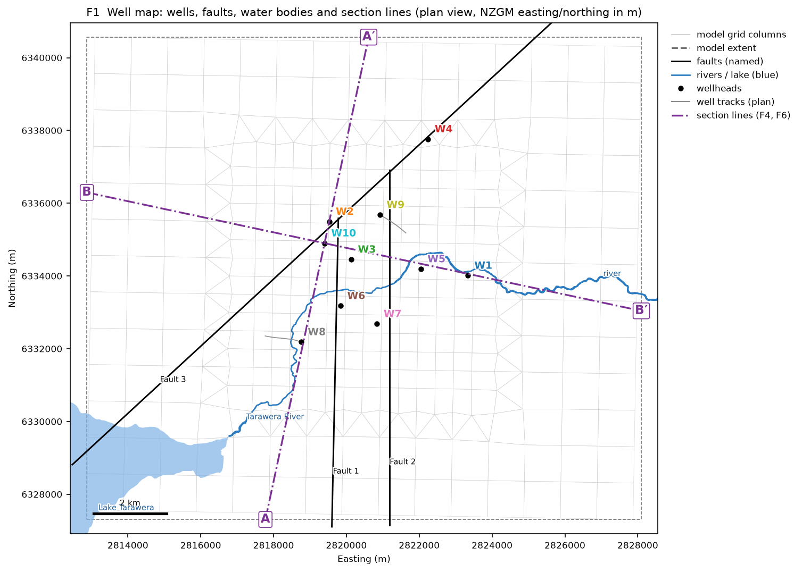
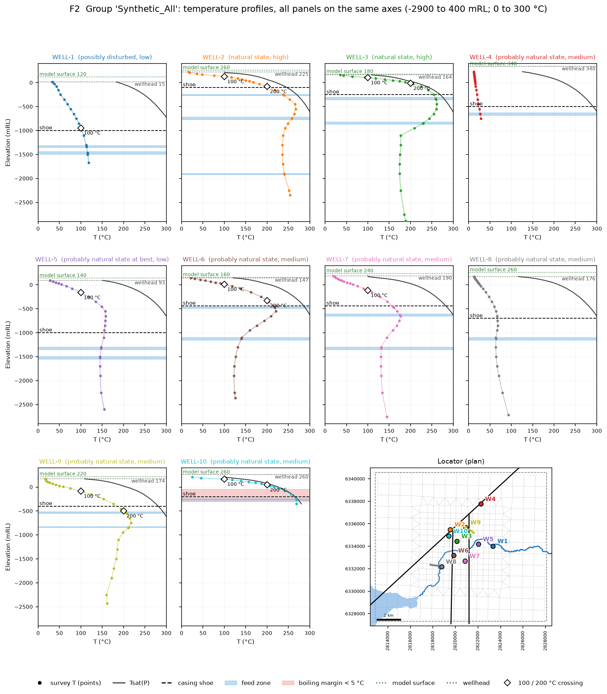
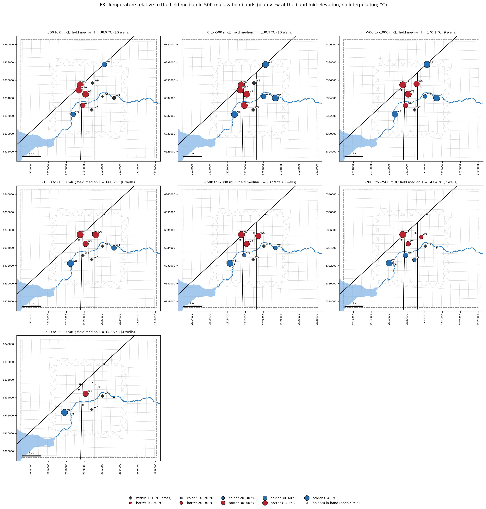
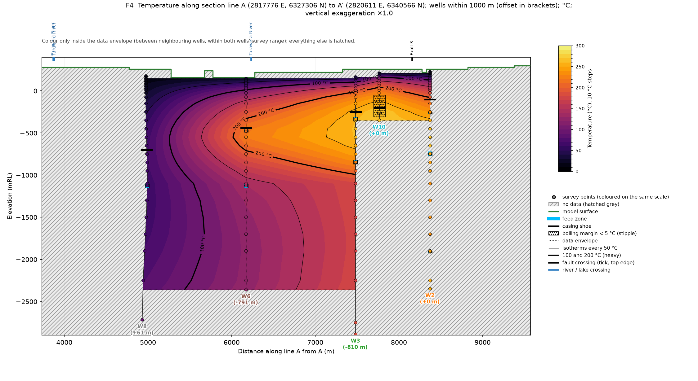
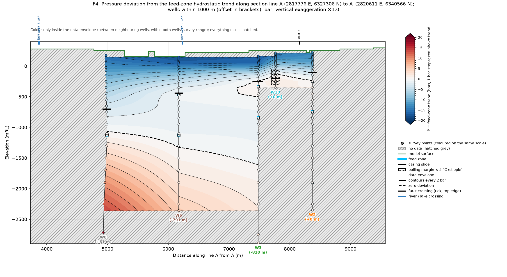
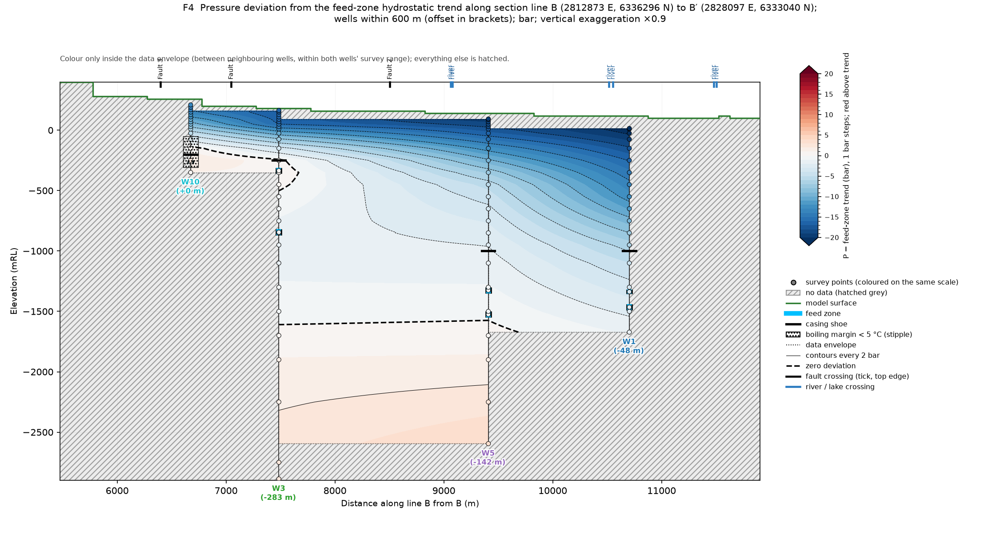

# Natural-state data interpretation for model calibration

Generated by `Scripts/natural_state_analysis.py` from `Baseline/` only. Run date: 2026-11-26

Every statement is tagged with exactly one of [obs] (a measured value or a value computed directly from the data), [interp] (an interpretation), [assumption] (a stated assumption) or [reference model] (a property of the starting model). Elevations are in mRL, pressures in bar, temperatures in °C, enthalpy in kJ/kg, flow in kg/s.

## 1. Key conclusions for calibration

1. **All 10 surveys carry the date 2015-07-29, but production and injection began on 2014-01-01.** The gauge test (not the date) decides: W2, W3 match their first (pre-production) gauge reading to within 0.1 bar, so they represent the natural state [obs]. The verdicts of the other wells are: W1 possibly disturbed (low); W4 probably natural state (medium); W5 probably natural state at best (low); W6 probably natural state (medium); W7 probably natural state (medium); W8 probably natural state (medium); W9 probably natural state (medium); W10 probably natural state (medium) [interp]. The date label conflicts with the gauge test and is a data question, not a reason to downgrade [obs].
   **Action:** use the surveys of all wells as natural-state targets, weighted by the confidence factor (section 6); ask the data owner which date applies.

2. **Hot upflow lies at the W10–W2 corner of the field.** W10 reaches 268.7 °C at -250 mRL (regime upflow) and W2 reaches 266.9 °C at -550 mRL [obs]. Both lie within 125 m (W2) and 226 m (W10) of Fault 3 [obs]. A deep hot upflow here, possibly along that fault, is the simplest explanation [interp].
   **Action:** put the deep heat and mass input beneath these two wells; check that the model reaches about 270 °C at -250 to -550 mRL there.

3. **A lateral outflow layer lies at about -450 to -750 mRL.** W2, W3, W5, W6, W7, W9 have a temperature inversion of at least 10 °C: the hottest water sits at -750 to -450 mRL and cooler water lies below it (largest inversion 98.1 °C at W6) [obs]. The outflow spreads away from the upflow to the south, east and north-east [interp].
   **Action:** make the layer around -450 to -750 mRL permeable laterally and weight the temperature points in it at their table values.

4. **A conductive cap overlies the hot zone.** Shallow gradients are 336 to 692 °C/km in the wells that reach 200 °C, and the 200 °C level lies at 46 to -496 mRL [obs]. With an assumed conductivity of 2 W/m/K the gradients imply a conductive flux of about 0.7 to 1.4 W/m2 [assumption]. The cap is a low-permeability layer above about -300 to 0 mRL near the upflow [interp].
   **Action:** give the cap a low vertical permeability and compare the modelled shallow gradient with the table values; do not copy the flux as a boundary condition.

5. **Cold water occupies the north-east and south-west margins.** W4, W8 stay below 100 °C over their whole survey (Tmax 29.0, 93.1 °C) [obs]. W4 lies 50 m from Fault 3 and W8 235 m from the Tarawera River [obs]. They are possibly cold recharge or downflow zones associated with the fault and the river respectively [interp].
   **Action:** allow cold water to enter at these margins, and test whether the cold downflow reaches the full surveyed depth.

6. **Formation pressure is defined only at feed zones, and deep pressures agree across the field.** The trend through the gauge-verified feed zones is P = 32.76 -0.0877 z; the tolerance is 3.0 bar (the larger of 3 bar and twice the 0.70 bar RMS residual) [obs]. All feed-zone pressures except W1 lie within it [obs]. The wellbore column in cased intervals is steeper than a column of water in the hot wells (ratio up to 1.55), so shallow wellbore pressure is not reservoir pressure [obs].
   **Action:** use `weight_P` at feed zones only; ignore shallow wellbore pressure; treat the cold-well hydrostatic ratio as a datum or convention question (section 4).

7. **W10 is near boiling at shallow depth.** Its minimum boiling margin is 2.65 °C at -150 mRL, above the 1 °C two-phase threshold, so its regime is upflow [obs]. The temperature follows boiling-point-for-depth over about 188 m (margin below 5 °C) [interp]. Its gauge starts after its first flow, so it has no pre-production gauge test [obs].
   **Action:** the model must reproduce boiling-point-for-depth here; keep the model from boiling more than the data allow.

8. **Confidence differs between wells, so the factor changes relative weights.** Confidence counts: medium 6, low 2, high 2. Mean temperature weight ranges from 0.29 to 0.66 [obs].
   **Action:** use the `weight` and `weight_P` columns as given; revisit them if the gauge questions in section 7 are resolved.

## 2. The data

### 2.1 What exists

Roles assigned to every file under `Baseline/` (full table: `../Additional_Output/input_inventory.csv`):

| role | path (below Baseline/Teaching_Model_3D) |
|---|---|
| out_of_scope | Data/Area_data.json |
| well_data_dat | Data/Data_dat |
| well_data_json | Data/Data_json |
| well_groups | Data/Groups_data.json |
| mapping | Data/Mapping |
| reference_other | Data/Plotting |
| out_of_scope | Models/TE14515/FutureScenarios |
| reference_results | Models/TE14515/NaturalState/TE14515_NS_000.dat |
| reference_results | Models/TE14515/NaturalState/TE14515_NS_000.incon |
| reference_other | Models/TE14515/NaturalState/currentNSSetup.json |
| out_of_scope | Models/TE14515/Production |
| reference_other | Models/TE14515/currentGeomSetup.json |
| reference_other | Models/TE14515/gTE14515.auxjson |
| geometry_dat | Models/TE14515/gTE14515.dat |
| reference_bc | Models/TE14515/gTE14515_boundary_conditions.json |
| reference_rock | Models/TE14515/gTE14515_dict_rocktype.json |
| well_blocks_json | Models/TE14515/gTE14515_wells.json |
| out_of_scope | Parameters |

[obs] The reference model files (rock types, boundary conditions, natural-state results, set-up) and production, injection and forecast files were not used as evidence. [assumption] Production and injection records inside the well files were used only to test whether the surveys represent the natural state.

### 2.2 How the data were checked

[obs] 87 of 105 cross-checks passed (`../Additional_Output/data_crosscheck.csv`). The plain-column files reproduce every JSON survey point and transient value exactly; the time axis of the transient files is years since 2014-01-01 [obs]. Surveys lie within the well tracks, and every feed zone lies within a slotted interval [obs]. The model block of each survey point agrees with the well-to-block file, and a point-in-polygon search reproduces the same columns for all wells [obs].

Items that did not pass cleanly:

- WELL-4: casing/liner design consistent with the track (INCONSISTENT). design 340 to -3251 mRL; track 340 to -750 mRL; source: Synthetic data [obs]

Irregular file names: Wel10_-250.0_transient_pressure.dat; Wel10_downhole_pressure.dat; Wel10_downhole_temperature.dat; Wel10_production_mass_flow.dat; Wel10_transient_enthalpy.dat (prefix `Wel` instead of `Well`; matched to WELL-10 by content) [obs].

### 2.3 Provenance labels

[obs] The casing and liner design carries the source label 'Synthetic data' for every well. The survey records have an empty Source and Comment field and StableFlag true. Feed-zone Source fields hold the unit label 'Text'. Quality tags found: HIGH, LOW, MEDIUM, Synthetic.

Feed-zone quality mapping to the `weight_P` factor: HIGH = 1, MEDIUM = 0.8, LOW = 0.5, Synthetic = 0.5. 'Synthetic' is not a quality grade and takes the lowest factor [assumption].

### 2.4 Is each survey the natural state?

[obs] First production in the field: 2014-01-01. First injection: 2014-01-01. Tolerance for feed-zone pressure against the verified trend: 3.0 bar. Injectate temperature from the enthalpy of 335.0 kJ/kg (IF97 Region 1 at the feed-zone pressure): W4 78.3 °C, W5 77.0 °C, W8 77.5 °C.

| well | gauge mRL | survey P at gauge | first gauge date | first gauge P | survey minus first | own first flow | verdict | confidence |
|---|---|---|---|---|---|---|---|---|
| WELL-1 |  |  |  |  |  |  | possibly disturbed | low |
| WELL-2 | -750 | 98.20 | 2014-01-01 | 98.3 | -0.10 | 2014-01-01 | natural state | high |
| WELL-3 | -550 | 80.70 | 2014-01-01 | 80.8 | -0.10 | 2014-01-01 | natural state | high |
| WELL-4 |  |  |  |  |  | 2014-01-01 | probably natural state | medium |
| WELL-5 |  |  |  |  |  | 2014-01-01 | probably natural state at best | low |
| WELL-6 |  |  |  |  |  |  | probably natural state | medium |
| WELL-7 |  |  |  |  |  |  | probably natural state | medium |
| WELL-8 |  |  |  |  |  | 2014-01-01 | probably natural state | medium |
| WELL-9 | -675 | 91.25 | 2014-01-01 | 89.2 | 2.05 | 2014-01-01 | probably natural state | medium |
| WELL-10 | -250 | 56.70 | 2020-01-01 | 48.7 | 8.00 | 2019-12-01 | probably natural state | medium |

Reason for each verdict:

- WELL-1: possibly disturbed, low. feed-zone pressures are off the verified trend by up to 3.3 bar (> 3.0 bar). [obs]
- WELL-2: natural state, high. survey P at the gauge elevation (-750 mRL) matches the first gauge reading (2014-01-01) to 0.10 bar (precision 0.1 bar), and the gauge starts no later than the first flow of the well (2014-01-01). [obs]
- WELL-3: natural state, high. survey P at the gauge elevation (-550 mRL) matches the first gauge reading (2014-01-01) to 0.10 bar (precision 0.1 bar), and the gauge starts no later than the first flow of the well (2014-01-01). [obs]
- WELL-4: probably natural state, medium. injector, but no isothermal section within 5 degC of the injectate temperature (78.3 degC) and the feed-zone temperature (27.3 degC) is not hotter than the injectate: evidence against an injection-affected survey; no gauge; feed-zone pressures lie on the verified trend (max deviation 1.5 bar <= 3.0 bar). [obs]
- WELL-5: probably natural state at best, low. injector; formation at the feed zones (147.3 degC) is hotter than the injectate (77.0 degC from h = 335.0 kJ/kg), so injection cooling could be hidden; no isothermal section near the injectate temperature. [obs]
- WELL-6: probably natural state, medium. no gauge; feed-zone pressures lie on the verified trend (max deviation 0.9 bar <= 3.0 bar). [obs]
- WELL-7: probably natural state, medium. no gauge; feed-zone pressures lie on the verified trend (max deviation 2.0 bar <= 3.0 bar). [obs]
- WELL-8: probably natural state, medium. injector, but no isothermal section within 5 degC of the injectate temperature (77.5 degC) and the feed-zone temperature (63.9 degC) is not hotter than the injectate: evidence against an injection-affected survey; no gauge; feed-zone pressures lie on the verified trend (max deviation 0.6 bar <= 3.0 bar). [obs]
- WELL-9: probably natural state, medium. gauge test misses by 2.05 bar (> 0.1 bar; recorded as a data question) but feed-zone pressures lie on the verified trend (max deviation 1.0 bar <= 3.0 bar). [obs]
- WELL-10: probably natural state, medium. no pre-production gauge reading (gauge starts 2020-01-01, after the first flow of the well 2019-12-01); feed-zone pressures lie on the verified trend (max deviation 1.9 bar <= 3.0 bar). [obs]

[interp] W2 and W3 match the January 2014 gauge reading, not the reading of 2015 (W2 had already fallen by about 9 bar). So the surveys represent the pre-production state although they are labelled July 2015. W1 is flagged possibly disturbed only because its feed zone lies 3.3 bar from the trend, just above the 3.0 bar tolerance; it has no gauge, no production and no injection, so the miss is more likely a lateral pressure difference or its datum (section 7).

[obs] Model surface and wellhead: the wellhead lies below the model surface of its column in 8 wells, by up to 105 m (W1); survey points above the model surface: 0 (`../Additional_Output/well_geometry_check.csv`).

## 3. Temperature structure

| well | Tmax | at mRL | T at TD | TD mRL | inversion | top mRL | base mRL | shallow grad °C/km | deep grad °C/km | 100 °C mRL | 200 °C mRL | min margin | regime |
|---|---|---|---|---|---|---|---|---|---|---|---|---|---|
| WELL-1 | 118.6 | -1672 | 118.6 | -1672 |  |  |  | 73 |  | -946 |  | 150.4 | conductive |
| WELL-2 | 266.9 | -550 | 253.7 | -2348 | 30.9 | -550 | -1500 | 622 |  | 128 | -81 | 23.8 | outflow |
| WELL-3 | 261.4 | -450 | 188.2 | -2887 | 86.9 | -450 | -1700 | 680 | 12 | 104 | -14 | 12.2 | outflow |
| WELL-4 | 29.0 | -750 | 29.0 | -750 |  |  |  | 14 |  |  |  | 113.8 | recharge/downflow |
| WELL-5 | 158.0 | -650 | 154.7 | -2595 | 13.3 | -650 | -1700 | 295 | 11 | -160 |  | 123.6 | outflow |
| WELL-6 | 220.5 | -550 | 126.1 | -2359 | 98.1 | -550 | -1900 | 490 | 7 | 13 | -329 | 70.0 | outflow |
| WELL-7 | 176.7 | -650 | 144.7 | -2762 | 46.0 | -650 | -1700 | 293 | 14 | -114 |  | 97.1 | outflow |
| WELL-8 | 93.1 | -2716 | 93.1 | -2716 | 4.5 | -850 | -1300 | 85 | 21 |  |  | 104.1 | recharge/downflow |
| WELL-9 | 217.7 | -750 | 161.6 | -2427 | 57.7 | -750 | -2250 | 336 |  | -84 | -496 | 87.8 | outflow |
| WELL-10 | 268.7 | -250 | 268.5 | -350 |  |  |  | 692 |  | 165 | 46 | 2.6 | upflow |

[obs] The table is computed from `NS_calibration_targets.csv` (definitions of section 4.4). Blank deep gradients mean fewer than three points or a span under 300 m below the deeper of the inversion base and the deepest feed zone.

[obs] Isothermal sections of at least 300 m in open hole occur in: W2 (6 points), W3 (6 points), W5 (7 points), W6 (5 points), W7 (6 points), W8 (8 points).
[interp] Open-hole isothermal sections in W5 and W8 lie across or below the feed zones, so internal flow in the wellbore may have flattened them; they carry the reduced weight of 0.5.

[interp] The hot wells are the ones closest to Fault 3 (W2 125 m, W10 226 m). W6 (113 m from Fault 1) is hot but cooler. The data cannot decide whether the faults control the upflow; a deeper well beside W10 (it stops at -350 mRL in a 268.5 °C isothermal section) would decide it.

Individual profiles with feed zones, shoe, pressure and verdict: [W1](figures/profile_WELL-1.png), [W2](figures/profile_WELL-2.png), [W3](figures/profile_WELL-3.png), [W4](figures/profile_WELL-4.png), [W5](figures/profile_WELL-5.png), [W6](figures/profile_WELL-6.png), [W7](figures/profile_WELL-7.png), [W8](figures/profile_WELL-8.png), [W9](figures/profile_WELL-9.png), [W10](figures/profile_WELL-10.png) (F2, claim type obs).

[obs] Section line A (2817776 E, 6327306 N) to A′ (2820611 E, 6340566 N), through the two hottest wells (W10 and W2); included wells within 1000 m with offsets: W8 (+61 m), W6 (-791 m), W3 (-810 m), W10 (+0 m), W2 (+0 m).

[obs] Section line B (2812873 E, 6336296 N) to B′ (2828097 E, 6333040 N), through the hottest well (W10), perpendicular to A; included wells within 600 m with offsets: W10 (+0 m), W3 (-283 m), W5 (-142 m), W1 (-48 m).

![Interpolated companion: temperature on line A, [interp] linear interpolation, not data.](../Additional_Output/figures/section_A_interpolated.png)

![Interpolated companion: temperature on line B, [interp] linear interpolation, not data.](../Additional_Output/figures/section_B_interpolated.png)

![Interpolated companion: plan views of temperature relative to the field median, [interp] not data.](../Additional_Output/figures/maps_temperature_interpolated.png)

[interp] The interpolated figures show colours between wells for orientation only; no value is quoted from them.

## 4. Pressure structure

Temperature and pressure at common elevations (interpolated within each survey; blank where the elevation lies outside it). Pressure deviation from the feed-zone trend in brackets.

| well | 0 mRL | -500 mRL | -1000 mRL | -1500 mRL | -2000 mRL |
|---|---|---|---|---|---|
| WELL-1 | 35.0 °C / 12.3 bar (-20.5) | 72.7 °C / 63.5 bar (-13.1) | 102.3 °C / 114.4 bar (-6.0) | 116.2 °C / 162.0 bar (-2.3) |  |
| WELL-2 | 171.8 °C / 24.1 bar (-8.7) | 266.1 °C / 77.5 bar (+0.9) | 241.1 °C / 120.0 bar (-0.4) | 236.0 °C / 164.5 bar (+0.2) | 243.3 °C / 208.6 bar (+0.5) |
| WELL-3 | 192.8 °C / 20.2 bar (-12.6) | 261.0 °C / 76.6 bar (+0.0) | 198.4 °C / 119.1 bar (-1.3) | 175.6 °C / 163.9 bar (-0.4) | 175.1 °C / 209.4 bar (+1.3) |
| WELL-4 | 15.3 °C / 24.5 bar (-8.3) | 24.1 °C / 76.3 bar (-0.3) |  |  |  |
| WELL-5 | 57.9 °C / 15.4 bar (-17.3) | 152.9 °C / 71.7 bar (-4.9) | 154.5 °C / 118.6 bar (-1.9) | 144.8 °C / 164.0 bar (-0.3) | 145.9 °C / 209.7 bar (+1.6) |
| WELL-6 | 106.3 °C / 18.6 bar (-14.2) | 218.8 °C / 75.7 bar (-0.9) | 153.6 °C / 119.1 bar (-1.3) | 126.7 °C / 165.1 bar (+0.8) | 122.8 °C / 211.4 bar (+3.3) |
| WELL-7 | 68.3 °C / 18.9 bar (-13.9) | 163.5 °C / 73.3 bar (-3.3) | 153.9 °C / 118.9 bar (-1.5) | 130.9 °C / 164.8 bar (+0.5) | 132.0 °C / 211.1 bar (+3.0) |
| WELL-8 | 26.7 °C / 19.8 bar (-13.0) | 61.9 °C / 71.3 bar (-5.2) | 66.0 °C / 119.8 bar (-0.6) | 64.5 °C / 169.2 bar (+4.9) | 73.1 °C / 218.4 bar (+10.3) |
| WELL-9 | 63.6 °C / 18.3 bar (-14.5) | 200.5 °C / 75.6 bar (-1.0) | 195.2 °C / 119.3 bar (-1.1) | 182.5 °C / 163.9 bar (-0.4) | 168.5 °C / 209.4 bar (+1.3) |
| WELL-10 | 219.1 °C / 26.3 bar (-6.4) |  |  |  |  |

[obs] Values are from `../Additional_Output/T_P_at_common_elevations.csv`.

### Hydrostatic checks (single-phase intervals, IF97 Region 1, g = 9.80665 m/s2)

| group | band | windows | median ratio | min | max |
|---|---|---|---|---|---|
| all wells | cased | 9 | 1.175 | 1.020 | 1.551 |
| cold wells (Tmax < 100 degC) | cased | 2 | 1.034 | 1.020 | 1.048 |
| all wells | open | 17 | 1.020 | 0.996 | 1.120 |
| cold wells (Tmax < 100 degC) | open | 2 | 1.008 | 0.996 | 1.020 |
| all wells | all | 26 | 1.039 | 0.996 | 1.551 |

[obs] Ratio = measured pressure difference / pressure difference integrated through IF97 liquid density over the measured temperature. The rounding uncertainty of a window is below 0.003. Cold-well (Tmax < 100 °C: W4, W8) median ratio: 1.034 (cased), 1.008 (open). This is the field-wide component; it is a possible datum or convention issue, not physical overpressure [interp].

| well | band | windows | length m | median ratio | cold component | excess above component |
|---|---|---|---|---|---|---|
| WELL-1 | cased | 1 | 1015 | 1.063 | 1.034 | 0.029 |
| WELL-1 | open | 2 | 672 | 1.013 | 1.008 | 0.005 |
| WELL-2 | cased | 1 | 440 | 1.348 | 1.034 | 0.314 |
| WELL-2 | open | 3 | 2098 | 1.092 | 1.008 | 0.084 |
| WELL-3 | cased | 1 | 400 | 1.551 | 1.034 | 0.516 |
| WELL-3 | open | 2 | 2637 | 1.055 | 1.008 | 0.047 |
| WELL-4 | cased | 1 | 980 | 1.020 | 1.034 | -0.014 |
| WELL-5 | cased | 1 | 1093 | 1.131 | 1.034 | 0.097 |
| WELL-5 | open | 2 | 1595 | 1.002 | 1.008 | -0.005 |
| WELL-6 | cased | 1 | 587 | 1.296 | 1.034 | 0.262 |
| WELL-6 | open | 2 | 1919 | 1.005 | 1.008 | -0.003 |
| WELL-7 | cased | 1 | 590 | 1.175 | 1.034 | 0.140 |
| WELL-7 | open | 2 | 2322 | 1.015 | 1.008 | 0.007 |
| WELL-8 | cased | 1 | 876 | 1.048 | 1.034 | 0.014 |
| WELL-8 | open | 2 | 2016 | 1.008 | 1.008 | 0.000 |
| WELL-9 | cased | 1 | 570 | 1.206 | 1.034 | 0.172 |
| WELL-9 | open | 2 | 2027 | 1.049 | 1.008 | 0.041 |

[obs] In the cased band the hot wells have implied densities up to 1341 kg/m3, heavier than any liquid water, with the largest excess at W3. A datum offset cannot change a gradient. A gravity or unit convention would act at every depth, but the open-hole ratios are near 1 (median 1.020). Two-phase fluid would make the column lighter, not heavier, and rounding is below 0.003.
[interp] What is left is that the shallow pressure of the hot wells (steep temperature gradient, cap) is not a static wellbore column in equilibrium with the survey temperature; it cannot be used as formation pressure. It is not used for `weight_P`.

![Interpolated companion: pressure deviation on line A, [interp] not data.](../Additional_Output/figures/section_A_P_interpolated.png)

![Interpolated companion: pressure deviation on line B, [interp] not data.](../Additional_Output/figures/section_B_P_interpolated.png)

![Interpolated companion: pressure deviation in plan views, [interp] not data.](../Additional_Output/figures/maps_pressure_interpolated.png)

Feed-zone pressure targets (survey values at the feed-zone mid elevation):

| well | feedzone | mid_mRL | quality | T_degC | P_bar | boiling_margin_degC | block | P_minus_trend_bar |
|---|---|---|---|---|---|---|---|---|
| WELL-1 | 1 | -1337.5 | MEDIUM | 113.2 | 146.7 | 227.2 | arg63 | -3.3 |
| WELL-1 | 2 | -1465.0 | MEDIUM | 115.5 | 158.7 | 231.2 | arg64 | -2.5 |
| WELL-2 | 1 | -260.0 | LOW | 239.7 | 55.9 | 31.3 | ajf54 | 0.3 |
| WELL-2 | 2 | -745.0 | HIGH | 258.0 | 97.8 | 51.4 | ajf59 | -0.3 |
| WELL-2 | 3 | -1910.0 | MEDIUM | 240.3 | 200.7 | 125.7 | ajf66 | 0.5 |
| WELL-3 | 1 | -335.0 | HIGH | 259.1 | 62.8 | 19.5 | asd55 | 0.7 |
| WELL-3 | 2 | -845.0 | MEDIUM | 229.8 | 105.6 | 85.2 | asd60 | -1.2 |
| WELL-4 | 1 | -655.0 | MEDIUM | 27.3 | 91.7 | 277.4 | aop58 | 1.5 |
| WELL-5 | 1 | -1325.0 | MEDIUM | 147.3 | 148.1 | 193.8 | arc63 | -0.8 |
| WELL-5 | 2 | -1525.0 | MEDIUM | 144.8 | 166.3 | 205.7 | arc64 | -0.2 |
| WELL-6 | 1 | -475.0 | HIGH | 218.0 | 73.5 | 71.2 | aph56 | -0.9 |
| WELL-6 | 2 | -1125.0 | HIGH | 139.8 | 130.5 | 191.4 | aph62 | -0.9 |
| WELL-7 | 1 | -630.0 | HIGH | 175.1 | 86.0 | 125.0 | apk58 | -2.0 |
| WELL-7 | 2 | -1325.0 | HIGH | 131.3 | 148.7 | 210.2 | apk63 | -0.2 |
| WELL-8 | 1 | -1125.0 | HIGH | 63.9 | 132.0 | 268.1 | ana62 | 0.6 |
| WELL-9 | 1 | -535.0 | LOW | 205.4 | 78.9 | 88.6 | ajj57 | -0.8 |
| WELL-9 | 2 | -837.5 | MEDIUM | 211.6 | 105.2 | 103.2 | ajq60 | -1.0 |
| WELL-10 | 1 | -262.5 | Synthetic | 268.7 | 57.7 | 4.3 | arz54 | 1.9 |

[obs] The deep pressure of the field is connected: at the deepest common elevation the neighbouring wells on line A differ by W8–W6 7.0 bar at -2000 mRL, W6–W3 2.0 bar at -2000 mRL, W3–W10 -1.7 bar at -250 mRL, W10–W2 1.7 bar at -250 mRL (`../Additional_Output/pressure_connections.csv`).
[interp] Differences of a few bar between wells of unlike temperature are consistent with different water-column densities; a continuous permeable connection at depth is the simplest explanation.

## 5. Conceptual model

| No. | Element | Supporting observation | Claim type | Arrow |
|---|---|---|---|---|
| 1 | Deep hot upflow | W10 Tmax 268.7 degC at -250 mRL; W2 Tmax 266.9 degC at -550 mRL; W10 regime upflow (no inversion, shallow gradient 692 degC/km). [obs] The two hottest wells lie in the same corner of the field; the upflow itself is inferred from their temperature and the absence of an inversion at W10. | interp | dashed |
| 2 | Lateral outflow along the section line | W2 inversion 30.9 degC from -550 to -1500 mRL; W3 inversion 86.9 degC from -450 to -1700 mRL; W6 inversion 98.1 degC from -550 to -1900 mRL. [obs] Hottest water at the top of the inversion, cooler water below it. | mixed | solid |
| 3 | Lateral outflow away from the section line (direction inferred) | W5 Tmax 158.0 degC at -650 mRL with inversion 13.3 degC; W7 Tmax 176.7 degC at -650 mRL with inversion 46.0 degC; W9 Tmax 217.7 degC at -750 mRL with inversion 57.7 degC. [obs] Each well off the line shows the same hot-over-cool profile; the flow direction is not measured. | interp | dashed |
| 4 | Cold recharge or downflow | W4 Tmax 29.0 degC, T at TD 29.0 degC at -750 mRL; W8 Tmax 93.1 degC, T at TD 93.1 degC at -2716 mRL. [obs] Whole surveyed column below 100 degC. | mixed | solid |
| 5 | Cap (conductive gradient, low permeability) | W6: surface 160 mRL, 200 degC at -329 mRL, shallow gradient 490 degC/km; W3: surface 180 mRL, 200 degC at -14 mRL, shallow gradient 680 degC/km; W10: surface 260 mRL, 200 degC at 46 mRL, shallow gradient 692 degC/km; W2: surface 260 mRL, 200 degC at -81 mRL, shallow gradient 622 degC/km. [obs] Steep, near-linear temperature rise from the surface to the 200 degC level. | mixed | solid |
| 6 | Near-boiling zone (not two-phase: margin above 1 degC) | W10 minimum margin 2.65 degC at -150 mRL. [obs] Temperature follows boiling-point-for-depth to within 5 degC. | obs | solid |

| 7 | Pressure connection between wells | W8–W6 +7.0 bar at -2000 mRL; W6–W3 +2.0 bar at -2000 mRL; W3–W10 -1.7 bar at -250 mRL; W10–W2 +1.7 bar at -250 mRL | obs | dashed line |

Relation to faults and surface water, and what would decide between explanations:

- The hottest wells (W10, W2) are nearest Fault 3 and the coldest (W4) is also close to Fault 3 (50 m) [obs]. Fault 3 may carry hot upflow in the south-west of its trace and cold recharge in the north-east, or the fault may have no role [interp].
- Decisive observation: a temperature survey of a well drilled on Fault 3 between W2 and W4, or a deeper W10 [interp].
- W1 (96 m from the river) is conductive with 73 °C/km and a wellhead 105 m below the model surface [obs]. It shows no outflow, so the outflow does not reach the east of the field at the depth of its survey [interp].
- Pressure connection and the deep cooler water below the outflow (inversion bases at -2250 to -1300 mRL) can be explained by deep cold downflow or by a deep lateral cool flow; one deep well in the north-west would decide it [interp].

## 6. Recommended calibration set-up

**Targets.** `NS_calibration_targets.csv` holds 266 survey points in 10 wells; `feedzones.csv` holds 18 feed zones; `T_P_at_layer_centres.csv` holds 232 layer-centre values without extrapolation [obs].

| location category | points | mean weight | max weight |
|---|---|---|---|
| behind casing | 131 | 0.37 | 0.50 |
| feed zone | 32 | 0.78 | 1.00 |
| open hole | 56 | 0.64 | 0.80 |
| open hole within an isothermal section (possible internal flow) | 28 | 0.41 | 0.50 |
| within 30 m of the wellhead | 19 | 0.22 | 0.30 |

[assumption] Weights are the defaults of the specification (location factor times confidence factor; temperature weight 0 above the model surface, 0.3 near the wellhead or in the top block, 1.0 at feed zones, 0.5 behind casing or in open-hole isothermal sections, 0.8 elsewhere in open hole). No departure from the defaults was made. `weight_P` is non-zero only at feed zones.

Feed-zone weights:

| well | feedzone | quality | ns_confidence | weight_T | weight_P |
|---|---|---|---|---|---|
| WELL-1 | 1 | MEDIUM | low | 0.500 | 0.400 |
| WELL-1 | 2 | MEDIUM | low | 0.500 | 0.400 |
| WELL-2 | 1 | LOW | high | 1.000 | 0.500 |
| WELL-2 | 2 | HIGH | high | 1.000 | 1.000 |
| WELL-2 | 3 | MEDIUM | high | 1.000 | 0.800 |
| WELL-3 | 1 | HIGH | high | 1.000 | 1.000 |
| WELL-3 | 2 | MEDIUM | high | 1.000 | 0.800 |
| WELL-4 | 1 | MEDIUM | medium | 0.750 | 0.600 |
| WELL-5 | 1 | MEDIUM | low | 0.500 | 0.400 |
| WELL-5 | 2 | MEDIUM | low | 0.500 | 0.400 |
| WELL-6 | 1 | HIGH | medium | 0.750 | 0.750 |
| WELL-6 | 2 | HIGH | medium | 0.750 | 0.750 |
| WELL-7 | 1 | HIGH | medium | 0.750 | 0.750 |
| WELL-7 | 2 | HIGH | medium | 0.750 | 0.750 |
| WELL-8 | 1 | HIGH | medium | 0.750 | 0.750 |
| WELL-9 | 1 | LOW | medium | 0.750 | 0.375 |
| WELL-9 | 2 | MEDIUM | medium | 0.750 | 0.600 |
| WELL-10 | 1 | Synthetic | medium | 0.750 | 0.375 |

**Heat and mass.** Deep hot upflow beneath the W10–W2 corner [interp]; the observed temperature there is about 269 °C [obs]. Heat is lost by the conductive cap and by lateral outflow, and cold water enters at the margins (elements 1 to 4) [interp]. Natural discharge locations are not observed in the data; the Tarawera River and the lake are the candidates [interp].

**Permeability structure implied.** A low-permeability cap above the 200 °C level; a laterally permeable layer at the outflow depth; permeable vertical paths beneath the hot wells, possibly Fault 3; cold-water access near the north-east and south-west margins [interp].

**Boundary requirements.** A top boundary at the model surface with the water level near the surface (computed water levels in `well_summary.csv`, column `water_level_mRL`: 6 wells extrapolate above the top survey point, the others lie within the survey); a heat/mass source at the base under the hot wells; open or cold-water sides near W4 and W8 [interp].

## 7. Data quality issues and open questions

1. **Survey date label.** All surveys are dated 2015-07-29, after production began (2014-01-01); the gauge test shows W2, W3 are pre-production [obs]. Resolve which date applies; it controls every confidence factor.

2. **W9 gauge miss.** The survey is 2.05 bar above the first gauge reading; its feed zones lie on the trend, so confidence is medium [obs]. Check the gauge elevation or the first reading.

3. **W1 datum.** Wellhead 15 mRL is 105 m below the model surface of its column and the survey pressure at the wellhead is 10.8 bar, which puts the water level at 113 mRL, above the wellhead [obs]. A wellhead or datum error is possible; its feed-zone pressure is 3.3 bar off the trend, so it is rated possibly disturbed, low.

4. **Shallow hydrostatic ratios above the density of water** in the cased band of the hot wells (up to 1.55), and a cold-well component of 1.034; cause not determined [obs].

5. **W10 gauge and flow.** The gauge starts 2020-01-01, after the well began to flow (2019-12-01); it has no pre-production test [obs].

6. **W4 design.** The liner is listed to -3251 mRL but the track and survey end at -750 mRL; the survey starts at 230 mRL, below the wellhead at 340 mRL [obs].

7. **Water levels** are extrapolations above the shallowest survey point by up to 98 m and are uncertain [obs].

8. **Irregular file names** (`Wel10_*`) and the feed-zone quality tag 'Synthetic' for WELL-10 [obs].

## 8. Output file index

`Output/Calibration_Input/`:

- `NS_data_interpretation.md`
- `NS_calibration_targets.csv`
- `feedzones.csv`
- `T_P_at_layer_centres.csv`
- `well_summary.csv`
- `figures_index.csv`
- `figures/ (F1 to F7: well_map, profile_<well>, profile_panels_<group>, maps_temperature_bands, maps_pressure_bands, section_A, section_A_P, section_B, section_B_P, PT_state, conceptual_model, gauge_check)`

`Output/Additional_Output/`:

- `input_inventory.csv`
- `pressure_consistency_check.csv`
- `hydrostatic_check.csv`
- `hydrostatic_by_well_band.csv`
- `hydrostatic_summary.csv`
- `well_geometry_check.csv`
- `T_P_at_elevation_bands.csv`
- `T_P_at_common_elevations.csv`
- `pressure_connections.csv`
- `data_crosscheck.csv`
- `conceptual_model_key.csv`
- `section_offsets.csv`
- `weights_summary.csv`
- `analysis_parameters.csv`
- `report_numbers.csv`
- `run_console_log.txt`
- `acceptance_check.txt`
- `process_log.md`
- `figures/ (interpolated companions: section_A_interpolated, section_A_P_interpolated, section_B_interpolated, section_B_P_interpolated, maps_temperature_interpolated, maps_pressure_interpolated)`

