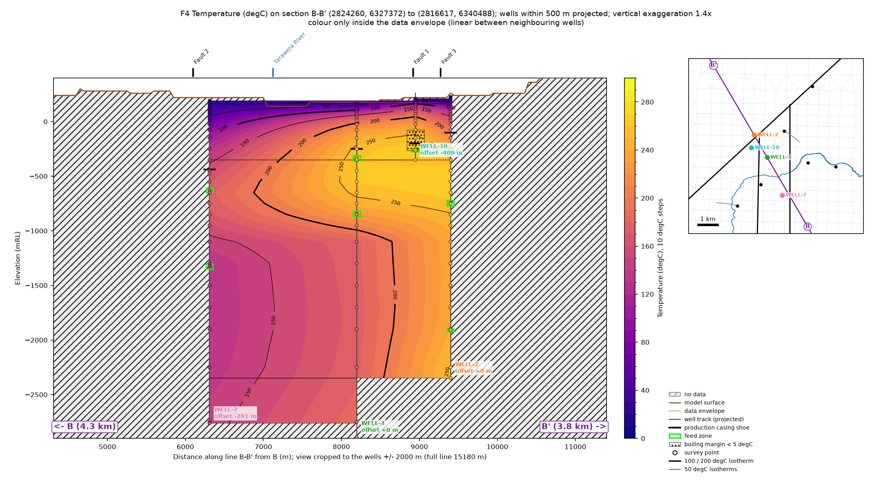
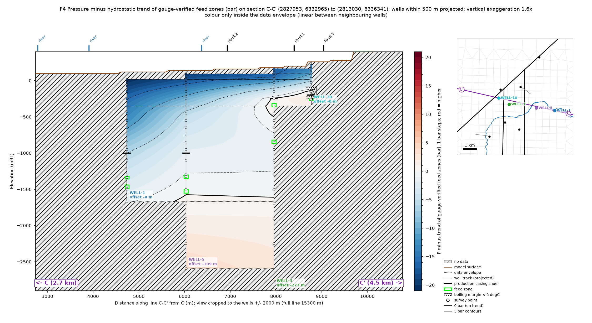

# Natural-state data interpretation for model calibration

Generated by `Scripts/natural_state_analysis.py` on 2026-11-26 from `Baseline/` only.

Claim tags: [obs] observation, [interp] interpretation, [assumption] stated assumption, [reference model] description of the starting model. Units: mRL, bar, degC, kJ/kg, kg/s.

## 1. Key conclusions for calibration

1. **The surveys represent the pre-production natural state, although they are labelled 2015-07-29.** WELL-2: survey 98.20 bar at the gauge (-750.0 mRL) against the first reading 98.3 bar on 2014-01-01, a difference of -0.10 bar; by 2015-01-01 the gauge had already fallen by 9.1 bar. WELL-3: survey 80.70 bar at the gauge (-550.0 mRL) against the first reading 80.8 bar on 2014-01-01, a difference of -0.10 bar; by 2015-01-01 the gauge had already fallen by 8.2 bar. A survey run on the labelled date would therefore have read several bar lower [obs]. The label is a data question, not a reason to downgrade [interp].
   **Action:** use every survey as a natural-state target with the weights in `NS_calibration_targets.csv`; ask the data owner for the true survey dates.
2. **The upflow is beneath WELL-2 and WELL-10 in the west of the field, near Fault 1 and Fault 3.** WELL-2 reaches 266.9 degC at -550.0 mRL and 253.7 degC at TD (-2348.0 mRL); WELL-10 reaches 268.7 degC at -250.0 mRL and 268.5 degC at TD (-350.0 mRL) [obs]. WELL-10 has no inversion and a boiling margin as low as 2.65 degC at -150.0 mRL [obs]. WELL-2 is 250 m from Fault 1 and 125 m from Fault 3; WELL-10 is 365 m from Fault 1 and 226 m from Fault 3 [obs]. That the faults (or their intersection) carry the upflow is an interpretation [interp].
   **Action:** put the deep heat and mass source under columns `ajf` (WELL-2), `arz` (WELL-10) and test whether a source along the Fault 1 / Fault 3 intersection reproduces the near-boiling top of WELL-10.
3. **Hot water flows out laterally at about -750 to -450 mRL, away from the upflow.** Temperature inversions start at -450.0 mRL in WELL-3 (86.9 degC), -650.0 mRL in WELL-5 (13.3 degC), -550.0 mRL in WELL-6 (98.1 degC), -650.0 mRL in WELL-7 (46.0 degC), -750.0 mRL in WELL-9 (57.7 degC) [obs]; Tmax falls with distance from the upflow [obs]. This is a lateral outflow tongue [interp].
   **Action:** give the model a laterally permeable layer at the inversion-top elevations, connecting the upflow to WELL-3, WELL-5, WELL-6, WELL-7, WELL-9, with lower vertical permeability below it so that the inversions survive.
4. **Cooler water lies beneath the outflow.** Below the inversion bases the profiles are cool and nearly isothermal, with low gradients (WELL-3 12.1 degC/km, WELL-5 10.9 degC/km, WELL-6 7.1 degC/km, WELL-7 14.1 degC/km); 38 open-hole survey points lie in isothermal sections [obs]. Cool lateral inflow at depth, or internal flow in the open hole, would explain this [interp]; the data cannot separate the two (a repeat log at a different date, or a static log after a long shut-in, would).
   **Action:** allow cool lateral inflow at depth below the outflow (side boundary or deep permeable unit); the isothermal open-hole points already carry the reduced weight 0.5.
5. **A conductive cap overlies the hot area.** Shallow gradients are 622.2 degC/km in WELL-2, 680.4 degC/km in WELL-3, 489.8 degC/km in WELL-6, 336.1 degC/km in WELL-9, 691.7 degC/km in WELL-10 [obs]; the cap (shallowest liquid point to 90 % of Tmax) is 453.5 m thick in WELL-2, 271.6 m thick in WELL-3, 466.8 m thick in WELL-6, 636.8 m thick in WELL-9, 265.6 m thick in WELL-10 [interp].
   **Action:** use low-permeability cap layers from the surface down to the cap bases in `Additional_Output/cap_intervals.csv`; the shallow temperatures there constrain the cap conductivity.
6. **The margins are cold recharge areas.** WELL-4 (Tmax 29.0 degC), WELL-8 (Tmax 93.1 degC) [obs]. The low gradients point to downflow of cold water [interp].
   **Action:** keep the north-east and south-west margins open to cold recharge (atmospheric top boundary, permeable near-surface layers) and use these wells' temperatures to tune the recharge.
7. **Deep pressures form one connected system.** The feed-zone pressures of WELL-2, WELL-3 define P = 32.76 -0.08767 z bar (z in mRL), an implied density of 894.0 kg/m3, RMS 0.70 bar [obs]. All other feed zones lie within 1.99 bar of it except WELL-1 (-3.32 bar at -1337.5 mRL) [obs].
   **Action:** calibrate feed-zone pressures (`weight_P`) as one pressure system; treat the WELL-1 deficit as either an eastern lateral gradient or early interference, and do not force it.
8. **Shallow pressure gradients in the hot wells are steeper than any water column.** The steepest window (WELL-3, 150.0 to -250.0 mRL) gives a measured/IF97 ratio of 1.5522 (implied density 1340.9 kg/m3), while open-hole windows give a field median of 1.0195 [obs]. A datum offset cannot change a gradient, a convention would act at every depth, two-phase fluid would be lighter and rounding is below 0.01 [obs]. The excess is a data question [interp].
   **Action:** do not use pressures between feed zones as targets (the targets table already sets `weight_P` to 0 there); ask whether the shallow pressures were measured or derived.
9. **Natural-state confidence varies between wells, so it changes relative weights.** high: WELL-2, WELL-3; medium: WELL-4, WELL-6, WELL-7, WELL-8, WELL-9, WELL-10; low: WELL-1, WELL-5 [obs].
   **Action:** use `weight` and `weight_P` as written; they already carry the confidence factors.

## 2. The data

### Inventory

Every file under `Baseline/` was assigned a role (`../Additional_Output/input_inventory.csv`). Data read: per-well JSON files, the plain-column `.dat` copies (cross-check only), the well list, the mapping file, the grid file (geometry sections only) and the well-to-block file. Reference-model files were classified but not used as evidence; production history workbooks, forecast and production set-ups are out of scope [obs].

| role | path | note |
|---|---|---|
| well_data_json | `Baseline/Teaching_Model_3D/Data/Data_json` | directory (10 files): per-well data: track, design, feed zones, surveys, transients, flows |
| well_data_dat | `Baseline/Teaching_Model_3D/Data/Data_dat` | directory (38 files): plain-column copies of well data (cross-check only) |
| well_groups | `Baseline/Teaching_Model_3D/Data/Groups_data.json` | well list and groupings |
| mapping | `Baseline/Teaching_Model_3D/Data/Mapping/Mapping.json` | polylines of faults, rivers and lake |
| geometry_dat | `Baseline/Teaching_Model_3D/Models/TE14515/gTE14515.dat` | MULgraph grid file: vertices, grid, layers, surface, well tracks (geometry only) |
| well_blocks_json | `Baseline/Teaching_Model_3D/Models/TE14515/gTE14515_wells.json` | well-to-block intersections (authority for block assignment) |
| reference_rock | `Baseline/Teaching_Model_3D/Models/TE14515/NaturalState/TE14515_NS_000.dat` | [reference model] TOUGH2 natural-state input: rock types and permeabilities; also holds generators (heat/mass sources) - reference only, not read |
| reference_rock | `Baseline/Teaching_Model_3D/Models/TE14515/gTE14515_dict_rocktype.json` | [reference model] rock-type dictionary (reference only) |
| reference_bc | `Baseline/Teaching_Model_3D/Models/TE14515/gTE14515_boundary_conditions.json` | [reference model] boundary conditions (reference only, not read) |
| reference_results | `Baseline/Teaching_Model_3D/Models/TE14515/NaturalState/TE14515_NS_000.incon` | [reference model] initial conditions / natural-state results (reference only, not read) |
| reference_other | `Baseline/Teaching_Model_3D/Data/Plotting` | directory (9 files): plotting configuration with hard-coded paths from another machine (not read) |
| reference_other | `Baseline/Teaching_Model_3D/Models/TE14515/NaturalState/currentNSSetup.json` | [reference model] set-up / configuration file (reference only, not read) |
| reference_other | `Baseline/Teaching_Model_3D/Models/TE14515/currentGeomSetup.json` | [reference model] set-up / configuration file (reference only, not read) |
| reference_other | `Baseline/Teaching_Model_3D/Models/TE14515/gTE14515.auxjson` | [reference model] scene/plotting features with hard-coded source paths (not read) |
| out_of_scope | `Baseline/Teaching_Model_3D/Data/Area_data.json` | field-total steam flow and power output (production; not read) |
| out_of_scope | `Baseline/Teaching_Model_3D/Models/TE14515/FutureScenarios/000/currentFSSetup.json` | production / injection / forecast model input (not read) |
| out_of_scope | `Baseline/Teaching_Model_3D/Models/TE14515/Production/currentPRSetup.json` | production / injection / forecast model input (not read) |
| out_of_scope | `Baseline/Teaching_Model_3D/Parameters/ProductionHistory` | directory (4 files): production / injection / forecast model input (not read) |

### Checks

- 134 integrity checks, 3 issues (`../Additional_Output/integrity_checks.csv`) [obs]:
  - WELL-4, survey_starts_at_wellhead: first survey point 230.0 mRL is 110.0 m below the wellhead 340.0 mRL [obs]
  - WELL-4, design_bottom_at_TD: design bottom -3251, track TD -750.0 [obs]
  - WELL-10, survey_starts_at_wellhead: first survey point 210.0 mRL is 50.0 m below the wellhead 260.0 mRL [obs]
- All 38 plain-column files match the JSON values exactly (largest difference 0.000) [obs]. The transient files count time in years from 2014-01-01, in nominal monthly steps of 1/12 year (largest offset from exact dates 0.004 year) [obs]; production rates are negative in the `.dat` files and positive in the JSON [obs].
- Irregular file name: Wel10_-250.0_transient_pressure.dat: prefix 'Wel10' does not follow the 'Well<N>' pattern of the other files (matched to WELL-10 by content; AUT2 name WEL10) [obs].
- Irregular file name: Wel10_downhole_pressure.dat: prefix 'Wel10' does not follow the 'Well<N>' pattern of the other files (matched to WELL-10 by content; AUT2 name WEL10) [obs].
- Irregular file name: Wel10_downhole_temperature.dat: prefix 'Wel10' does not follow the 'Well<N>' pattern of the other files (matched to WELL-10 by content; AUT2 name WEL10) [obs].
- Irregular file name: Wel10_production_mass_flow.dat: prefix 'Wel10' does not follow the 'Well<N>' pattern of the other files (matched to WELL-10 by content; AUT2 name WEL10) [obs].
- Irregular file name: Wel10_transient_enthalpy.dat: prefix 'Wel10' does not follow the 'Well<N>' pattern of the other files (matched to WELL-10 by content; AUT2 name WEL10) [obs].
- Survey-point and feed-zone blocks are taken from the well-to-block file; the wellhead column found by point-in-polygon agrees with it for 10 of 10 wells, and the wellhead (first track point) equals the grid file's well track for 10 of 10 wells (`../Additional_Output/well_geometry_check.csv`) [obs].
- Every wellhead lies at or below the model surface of its column; WELL-1 is 105.0 m below it [obs]. No survey point lies above the model surface, and no survey point falls in the top block of its column [obs].
- IAPWS-IF97 was verified against the IF97 tables (largest Tsat error 0.0043 K; Tsat(1.01325 bar) = 99.97 degC, Tsat(100 bar) = 311.00 degC) [obs].

### Provenance labels

- Non-empty `Source` fields: 'Synthetic data' (casing design of every well) [obs]. All survey, transient and flow `Source` and `Comment` fields are empty, so the data carry no provenance beyond this label [obs].
- Every survey carries `StableFlag` = True [obs].
- Feed-zone quality tags found: HIGH, LOW, MEDIUM, Synthetic. Mapping for `weight_P`: HIGH -> 1.0 (highest tag in the dataset); LOW -> 0.5 (lowest tag in the dataset); MEDIUM -> 0.8 (intermediate tag); Synthetic -> 0.5 (not a quality grade -> lowest factor) [obs].
- Track units are labelled `masl` and feed-zone units `m`; both were read as elevations in mRL [obs].

### Natural-state timing verdict

First production anywhere in the field: 2014-01-01; first injection: 2014-01-01; all surveys are labelled 2015-07-29 [obs]. A gauge reading dated on the day production started is treated as pre-production [assumption]. Reading precision: 0.1 bar (values are reported to one decimal) [obs]. Pressure trend of gauge-verified feed zones: P = 32.76 -0.08767 z bar, RMS 0.70 bar; tolerance = max(3 bar, 2 x RMS = 1.39 bar) = 3.00 bar [obs]. Injectate temperature: median injectate enthalpy 335.0 kJ/kg converted with IF97 Region 1 at 10.0 bar [assumption] gives 79.8 degC; an isothermal section within 10 degC of this would mark injection [assumption].

| well | kind | gauge (mRL) | survey - first reading (bar) | max feed-zone residual (bar) | verdict | confidence | reason |
|---|---|---|---|---|---|---|---|
| WELL-1 | no flow record |  |  | 3.32 | possibly disturbed | low | feed-zone pressures off the verified trend by up to 3.32 bar (tolerance 3.0 bar) |
| WELL-2 | producer | -750.0 | -0.10 | 0.49 | natural state | high | survey P at the gauge (-750.0 mRL) 98.20 bar vs first gauge reading 98.3 bar on 2014-01-01 (difference -0.10 bar, within the 0.1 bar reading precision) |
| WELL-3 | producer | -550.0 | -0.10 | 1.24 | natural state | high | survey P at the gauge (-550.0 mRL) 80.70 bar vs first gauge reading 80.8 bar on 2014-01-01 (difference -0.10 bar, within the 0.1 bar reading precision) |
| WELL-4 | injector |  |  | 1.52 | probably natural state | medium | no pressure gauge; feed-zone pressures within 1.52 bar of the verified trend (tolerance 3.0 bar); injector with feed zones colder (27.3 degC) than the injectate (79.8 degC) and no isothermal section near the injectate temperature: evidence against an injection-affected survey |
| WELL-5 | injector |  |  | 0.82 | probably natural state at best | low | injector; feed-zone formation temperature 147.3 degC is hotter than the injectate (79.8 degC), so injection cooling could be hidden |
| WELL-6 | no flow record |  |  | 0.90 | probably natural state | medium | no pressure gauge; feed-zone pressures within 0.90 bar of the verified trend (tolerance 3.0 bar) |
| WELL-7 | no flow record |  |  | 1.99 | probably natural state | medium | no pressure gauge; feed-zone pressures within 1.99 bar of the verified trend (tolerance 3.0 bar) |
| WELL-8 | injector |  |  | 0.61 | probably natural state | medium | no pressure gauge; feed-zone pressures within 0.61 bar of the verified trend (tolerance 3.0 bar); injector with feed zones colder (63.9 degC) than the injectate (79.8 degC) and no isothermal section near the injectate temperature: evidence against an injection-affected survey |
| WELL-9 | producer | -675.0 | 2.05 | 0.98 | probably natural state | medium | gauge test misses: survey 91.25 bar vs first reading 89.2 bar (difference 2.05 bar); feed-zone pressures within 0.98 bar of the verified trend (tolerance 3.0 bar) |
| WELL-10 | producer | -250.0 | 8.00 | 1.93 | probably natural state | medium | gauge series starts after field production began; feed-zone pressures within 1.93 bar of the verified trend (tolerance 3.0 bar) |

- WELL-9: the survey matches the first gauge reading at -651.2 mRL, not at the stated gauge elevation -675.0 mRL. If the gauge depth were along-hole (wellhead minus measured depth), its elevation would be -655.4 mRL, where the survey reads 89.57 bar against 89.2 bar [obs]. A gauge depth recorded along hole in this deviated well would explain the miss [interp]; the verdict stays at the rubric value.
- WELL-10: the gauge series starts 2020-01-01, after field production started (2014-01-01), so it cannot test the survey [obs].
- WELL-1: the deeper feed-zone pressures are below the trend by up to 3.32 bar (tolerance 3.00 bar), so the rubric gives 'possibly disturbed' [obs]. The well has no flow record; interference from field production or a natural east-west pressure gradient could each explain it [interp]. A gauge reading in this well before production would decide.

*F7 Gauge check: transient pressure against date for each gauged well, with the survey pressure at the gauge elevation, the first-reading precision band and the production start dates; claim type obs.*

## 3. Temperature structure

Per-well characteristics (definitions in CLAUDE.md 4.4; `well_summary.csv`) [obs]; the regime is rule-based [interp]:

| well | Tmax (degC) | at (mRL) | T at TD (degC) | TD (mRL) | inversion (degC) | inv. top (mRL) | inv. base (mRL) | shallow grad. (degC/km) | deep grad. (degC/km) | 100 degC (mRL) | 200 degC (mRL) | min boiling margin (degC) | regime |
|---|---|---|---|---|---|---|---|---|---|---|---|---|---|
| WELL-1 | 118.6 | -1672.0 | 118.6 | -1672.0 |  |  |  | 73.2 |  | -945.9 |  | 150.36 | conductive |
| WELL-2 | 266.9 | -550.0 | 253.7 | -2348.0 | 30.9 | -550.0 | -1500.0 | 622.2 |  | 128.2 | -81.0 | 23.76 | outflow |
| WELL-3 | 261.4 | -450.0 | 188.2 | -2887.0 | 86.9 | -450.0 | -1700.0 | 680.4 | 12.1 | 104.5 | -13.7 | 12.18 | outflow |
| WELL-4 | 29.0 | -750.0 | 29.0 | -750.0 |  |  |  | 13.9 |  |  |  | 113.77 | recharge/downflow |
| WELL-5 | 158.0 | -650.0 | 154.7 | -2595.0 | 13.3 | -650.0 | -1700.0 | 295.2 | 10.9 | -159.9 |  | 123.58 | outflow |
| WELL-6 | 220.5 | -550.0 | 126.1 | -2359.0 | 98.1 | -550.0 | -1900.0 | 489.8 | 7.1 | 13.0 | -328.5 | 69.98 | outflow |
| WELL-7 | 176.7 | -650.0 | 144.7 | -2762.0 | 46.0 | -650.0 | -1700.0 | 292.8 | 14.1 | -113.7 |  | 97.06 | outflow |
| WELL-8 | 93.1 | -2716.1 | 93.1 | -2716.1 | 4.5 | -850.0 | -1300.0 | 84.6 | 21.4 |  |  | 104.11 | recharge/downflow |
| WELL-9 | 217.7 | -750.0 | 161.6 | -2427.1 | 57.7 | -750.0 | -2250.0 | 336.1 |  | -84.1 | -496.1 | 87.77 | outflow |
| WELL-10 | 268.7 | -250.0 | 268.5 | -350.0 |  |  |  | 691.7 |  | 164.7 | 45.6 | 2.65 | upflow |

- WELL-1 (conductive): temperature still rising at TD; conductive above the deepest point [interp].
- WELL-2 (outflow): T at TD 253.7 degC is within 10 % of the field Tmax: the rule gives outflow because of the shallower inversion, but the deep reheating suggests the well lies above the upflow; treated as an upflow well in the conceptual model [interp].
- WELL-3 (outflow): temperature rises again slowly below the inversion base (12.1 degC/km) [interp].
- WELL-4 (recharge/downflow): injector, but feed zones colder than the injectate: cold profile is natural [interp].
- WELL-5 (outflow): temperature rises again slowly below the inversion base (10.9 degC/km) [interp].
- WELL-6 (outflow): temperature rises again slowly below the inversion base (7.1 degC/km) [interp].
- WELL-7 (outflow): temperature rises again slowly below the inversion base (14.1 degC/km) [interp].
- WELL-8 (recharge/downflow): injector, but feed zones colder than the injectate: cold profile is natural [interp].
- WELL-10 (upflow): shallow well (TD -350.0 mRL): upflow inferred from a hot, near-boiling, isothermal base; the well does not reach the deep upflow; near boiling (min margin 2.65 degC at -150.0 mRL) [interp].

Wellbore effects [interp]: the inversions start below the production casing shoe in every outflow well, within the open hole; internal flow between feed zones could flatten the open-hole profile (hence the reduced weight on isothermal sections), but it cannot create an inversion of tens of degC sustained over hundreds of metres below the deepest feed zone, so the inversions are taken as formation features.

*F2 Temperature profiles of all wells on identical axes (400 to -2900 mRL, 0 to 300 degC), with Tsat(P), shoe, feed zones, surface and near-boiling intervals; claim type obs.*

Individual well profiles (F2, temperature and pressure): [WELL-1](figures/profile_WELL-1.png), [WELL-2](figures/profile_WELL-2.png), [WELL-3](figures/profile_WELL-3.png), [WELL-4](figures/profile_WELL-4.png), [WELL-5](figures/profile_WELL-5.png), [WELL-6](figures/profile_WELL-6.png), [WELL-7](figures/profile_WELL-7.png), [WELL-8](figures/profile_WELL-8.png), [WELL-9](figures/profile_WELL-9.png), [WELL-10](figures/profile_WELL-10.png).

*F3 Band-mean temperature minus the field median in 500 m bands from 500 to -3000 mRL, at each track's mid-band position; claim type obs.*

*F4 Temperature section A-A' from (2817815, 6327488) to (2820583, 6340435), through the two hottest wells (WELL-10, WELL-2); colour only inside the data envelope; vertical exaggeration 1.5; claim type mixed.*

*F4 Temperature section B-B' from (2824260, 6327372) to (2816617, 6340488), through WELL-2 and WELL-3; captures 4 wells within 500 m; colour only inside the data envelope; vertical exaggeration 1.4; claim type mixed.*

*F4 Temperature section C-C' from (2827953, 6332965) to (2813030, 6336341), through WELL-1 and WELL-10; captures 4 wells within 500 m; colour only inside the data envelope; vertical exaggeration 1.6; claim type mixed.*

*F5 P-T state of every survey point against the IF97 saturation curve; claim type obs.*

Interpolated companions (whole-field picture, not data; no value is quoted from them) [interp]:

[[interp] Temperature on line A-A', linear Delaunay interpolation](../Additional_Output/figures/section_A_interpolated.png)

[[interp] Temperature on line B-B', linear Delaunay interpolation](../Additional_Output/figures/section_B_interpolated.png)

[[interp] Temperature on line C-C', linear Delaunay interpolation](../Additional_Output/figures/section_C_interpolated.png)

[[interp] Band temperature deviation, linear Delaunay interpolation](../Additional_Output/figures/maps_temperature_interpolated.png)

## 4. Pressure structure

Pressure at common elevations (interpolation within each survey only; `../Additional_Output/T_P_at_common_elevations.csv`) [obs]:

| well | P at -250 mRL, bar (minus trend) | P at -500 mRL, bar (minus trend) | P at -1000 mRL, bar (minus trend) | P at -1500 mRL, bar (minus trend) | P at -2000 mRL, bar (minus trend) |
|---|---|---|---|---|---|
| WELL-1 | 38.6 (-16.1) | 63.5 (-13.1) | 114.4 (-6.0) | 162.0 (-2.3) |  |
| WELL-2 | 55.0 (+0.3) | 77.5 (+0.9) | 120.0 (-0.4) | 164.5 (+0.2) | 208.6 (+0.5) |
| WELL-3 | 55.0 (+0.3) | 76.6 (+0.0) | 119.1 (-1.3) | 163.9 (-0.4) | 209.4 (+1.3) |
| WELL-4 | 51.1 (-3.6) | 76.3 (-0.3) |  |  |  |
| WELL-5 | 44.9 (-9.8) | 71.7 (-4.9) | 118.6 (-1.9) | 164.0 (-0.3) | 209.7 (+1.6) |
| WELL-6 | 49.9 (-4.8) | 75.7 (-0.9) | 119.1 (-1.3) | 165.1 (+0.8) | 211.4 (+3.3) |
| WELL-7 | 46.9 (-7.8) | 73.3 (-3.3) | 118.9 (-1.5) | 164.8 (+0.5) | 211.1 (+3.0) |
| WELL-8 | 46.1 (-8.6) | 71.3 (-5.2) | 119.8 (-0.6) | 169.2 (+4.9) | 218.4 (+10.3) |
| WELL-9 | 49.3 (-5.4) | 75.6 (-1.0) | 119.3 (-1.1) | 163.9 (-0.4) | 209.4 (+1.3) |
| WELL-10 | 56.7 (+2.0) |  |  |  |  |

At -1000 mRL every well with data is within 6.0 bar of the gauge-verified trend (WELL-1 the largest) [obs]. The deviations grow above and below that level: the trend is a straight line through hot-well feed zones between -1910.0 and -260.0 mRL, while each well column follows its own temperature, so the cold WELL-8 is 10.3 bar above the trend at -2000 mRL and the shallow wellbore pressures lie far below its upward extrapolation [obs]. Only feed-zone pressures are used as targets [interp].

Water levels from the three shallowest liquid-filled points [obs]: WELL-1 112.9 mRL, WELL-2 210.5 mRL, WELL-3 163.9 mRL, WELL-4 250.8 mRL, WELL-5 127.0 mRL, WELL-6 156.9 mRL, WELL-7 160.5 mRL, WELL-8 183.7 mRL, WELL-9 175.4 mRL, WELL-10 197.5 mRL. WELL-1 needs an extrapolation of more than 50 m above its top survey point (`water_level_extrapolation_m`), so treat its water level as uncertain [interp].

Hydrostatic check (CLAUDE.md 4.3; `../Additional_Output/hydrostatic_check.csv`, `hydrostatic_summary.csv`) [obs]:

| well | band | windows | median ratio measured/IF97 | min | max | excess over cold-well median |
|---|---|---|---|---|---|---|
| WELL-1 | open | 1 | 1.0077 | 1.0077 | 1.0077 | -0.0006 |
| WELL-2 | open | 3 | 1.0921 | 1.0884 | 1.1622 | 0.0838 |
| WELL-3 | cased | 1 | 1.5522 | 1.5522 | 1.5522 |  |
| WELL-3 | open | 1 | 1.0198 | 1.0198 | 1.0198 | 0.0115 |
| WELL-5 | open | 2 | 1.0005 | 0.9997 | 1.0013 | -0.0077 |
| WELL-6 | open | 2 | 1.0036 | 0.9973 | 1.0099 | -0.0047 |
| WELL-7 | open | 2 | 1.0136 | 1.0005 | 1.0267 | 0.0053 |
| WELL-8 | open | 2 | 1.0083 | 0.9970 | 1.0195 | 0.0000 |
| WELL-9 | open | 2 | 1.0392 | 1.0230 | 1.0554 | 0.0309 |
| WELL-10 | cased | 1 | 1.3944 | 1.3944 | 1.3944 |  |
| FIELD | cased | 2 | 1.4733 | 1.3944 | 1.5522 |  |
| FIELD | open | 15 | 1.0195 | 0.9970 | 1.1622 | 0.0112 |

- Cold wells (Tmax < 100 degC): WELL-4, WELL-8. Their median ratio is 1.0083 in open hole and 1.0200 over all windows; no cold-well window lies wholly behind casing, so the cased-band component is undefined [obs]. This field-wide component is attributed to a datum, gravity or density convention, not to physical overpressure [interp].
- 9 windows span a casing shoe (the window rule closes only at a feature once 300 m long, and a short remnant joins the window above); they have no band and count only in the overall statistics [obs].
- Open-hole windows range from 0.9970 to 1.1622 (field median 1.0195); WELL-2 has the largest open-hole excess over the cold-well component. The windows that start in the shallow part of the hot wells reach 1.5522 [obs]. Checks: a datum offset cannot change a gradient; a convention would act at every depth and in the cold wells too; two-phase fluid would lower the ratio; the rounding uncertainty of the ratio is at most 0.0070 [obs]. No wellbore explanation is left; dynamic overpressure from upflow through the cap would raise formation gradients but cannot be measured inside a static well column, so the shallow pressures are a data question [interp].

*F3 Band-mean pressure minus the trend of gauge-verified feed zones in 500 m bands from 500 to -3000 mRL; claim type mixed (the trend is derived).*

*F4 Pressure-minus-trend section A-A' (same line and ends as the temperature section), vertical exaggeration 1.5; claim type mixed.*

*F4 Pressure-minus-trend section B-B' (same line and ends as the temperature section), vertical exaggeration 1.4; claim type mixed.*

*F4 Pressure-minus-trend section C-C' (same line and ends as the temperature section), vertical exaggeration 1.6; claim type mixed.*

Interpolated companions [interp]:

[[interp] Pressure minus trend on line A-A', linear Delaunay interpolation](../Additional_Output/figures/section_A_P_interpolated.png)

[[interp] Pressure minus trend on line B-B', linear Delaunay interpolation](../Additional_Output/figures/section_B_P_interpolated.png)

[[interp] Pressure minus trend on line C-C', linear Delaunay interpolation](../Additional_Output/figures/section_C_P_interpolated.png)

[[interp] Band pressure deviation, linear Delaunay interpolation](../Additional_Output/figures/maps_pressure_interpolated.png)

## 5. Conceptual model

*F6 Conceptual model from the data alone: plan view and section B-B' (the F4 line with the most wells); numbers key to the table below; solid = measured feature, dashed = inferred; claim type interp.*

The same elements on the other section lines: [line A](../Additional_Output/figures/conceptual_model_section_A.png), [line C](../Additional_Output/figures/conceptual_model_section_C.png) [interp].

| no | element | location | supporting observation | claim type |
|---|---|---|---|---|
| 1 | Deep hot upflow | beneath WELL-2 and WELL-10 | WELL-2: Tmax 266.9 degC at -550.0 mRL, T at TD 253.7 degC at -2348.0 mRL, regime outflow; WELL-10: Tmax 268.7 degC at -250.0 mRL, T at TD 268.5 degC at -350.0 mRL, regime upflow | [interp] |
| 2 | Lateral outflow | away from the upflow towards WELL-3, WELL-5, WELL-6, WELL-7, WELL-9 | WELL-3: inversion 86.9 degC below -450.0 mRL; WELL-5: inversion 13.3 degC below -650.0 mRL; WELL-6: inversion 98.1 degC below -550.0 mRL; WELL-7: inversion 46.0 degC below -650.0 mRL; WELL-9: inversion 57.7 degC below -750.0 mRL | [interp] |
| 3 | Cooler water beneath the outflow (lateral inflow / downflow at depth) | below the inversion bases of WELL-3, WELL-5, WELL-6, WELL-7, WELL-9 | WELL-3: 174.5 degC at -1700.0 mRL; WELL-5: 144.7 degC at -1700.0 mRL; WELL-6: 122.4 degC at -1900.0 mRL; WELL-7: 130.7 degC at -1700.0 mRL; WELL-9: 160.0 degC at -2250.0 mRL | [interp] |
| 4 | Cold recharge / downflow | WELL-4, WELL-8 | WELL-4: Tmax 29.0 degC, shallow gradient 13.9 degC/km; WELL-8: Tmax 93.1 degC, shallow gradient 84.6 degC/km | [interp] |
| 5 | Cap (low permeability, conductive gradient) | WELL-2, WELL-3, WELL-6, WELL-9, WELL-10 | WELL-2: shallow gradient 622.2 degC/km, cap 190.0 to -263.5 mRL; WELL-3: shallow gradient 680.4 degC/km, cap 150.0 to -121.6 mRL; WELL-6: shallow gradient 489.8 degC/km, cap 147.0 to -319.8 mRL; WELL-9: shallow gradient 336.1 degC/km, cap 170.0 to -466.8 mRL; WELL-10: shallow gradient 691.7 degC/km, cap 190.0 to -75.6 mRL | [interp] |
| 6 | Near-boiling zone | WELL-10 | WELL-10: boiling margin < 5 degC from -75.0 to -262.5 mRL (min 2.65 degC) | [obs] |
| 7 | Isotherms 100 and 200 degC | all wells | z_100C_mRL and z_200C_mRL in well_summary.csv | [obs] |
| 8 | Pressure connection between wells | field-wide at depth | 16 of 22 neighbouring-well pairs have both pressures within 3.0 bar of the gauge-verified trend at the comparison elevation; feed-zone residuals in feedzones.csv | [interp] |

Relation to mapped features [interp]: the upflow wells sit close to Fault 1 and Fault 3 (distances in `../Additional_Output/well_geometry_check.csv`), the outflow runs south-east and east across Fault 2 towards the river corridor, and the conductive eastern well WELL-1 lies next to the river. Whether Fault 2 is a barrier cannot be decided from these data: the outflow wells on either side of it share one pressure trend, which argues against a strong barrier; a pressure-interference test across Fault 2 would decide.

## 6. Recommended calibration set-up

**Targets and weights.**

- Temperature: all 266 survey points in `NS_calibration_targets.csv`, weight = location factor x natural-state confidence factor (defaults of CLAUDE.md 5.5, no departure) [obs].
- Pressure: the 18 feed zones in `feedzones.csv` (`weight_P` = quality factor x confidence factor); `weight_P` is zero away from feed zones [obs].
- Layer-centre values for direct block comparison: `T_P_at_layer_centres.csv` (interpolation only) [obs].

| weight rule | points |
|---|---|
| behind casing (0.5) x high confidence (1.0) | 23 |
| behind casing (0.5) x low confidence (0.5) | 25 |
| behind casing (0.5) x medium confidence (0.75) | 83 |
| feed zone 1 (1.0) x high confidence (1.0) | 4 |
| feed zone 1 (1.0) x low confidence (0.5) | 3 |
| feed zone 1 (1.0) x medium confidence (0.75) | 11 |
| feed zone 2 (1.0) x high confidence (1.0) | 4 |
| feed zone 2 (1.0) x low confidence (0.5) | 3 |
| feed zone 2 (1.0) x medium confidence (0.75) | 5 |
| feed zone 3 (1.0) x high confidence (1.0) | 2 |
| open hole (0.8) x high confidence (1.0) | 16 |
| open hole (0.8) x low confidence (0.5) | 6 |
| open hole (0.8) x medium confidence (0.75) | 34 |
| open hole, isothermal section (0.5) x high confidence (1.0) | 10 |
| open hole, isothermal section (0.5) x low confidence (0.5) | 3 |
| open hole, isothermal section (0.5) x medium confidence (0.75) | 15 |
| within 30 m of wellhead (0.3) x high confidence (1.0) | 4 |
| within 30 m of wellhead (0.3) x low confidence (0.5) | 5 |
| within 30 m of wellhead (0.3) x medium confidence (0.75) | 10 |

**Where heat and mass enter and leave** [interp]:

- Enter: deep upflow beneath WELL-2 (column `ajf`), WELL-10 (column `arz`); cold recharge from the surface near WELL-4 (column `aop`), WELL-8 (column `ana`); cool lateral inflow at depth beneath the outflow.
- Leave: lateral outflow towards WELL-3, WELL-5, WELL-6, WELL-7, WELL-9 and beyond; conductive loss through the cap.

**Permeability structure the data imply** [interp]: a permeable vertical path at the upflow; a laterally permeable outflow layer near the inversion tops; a low-permeability cap above it; lower vertical permeability between the outflow layer and the cooler water below; permeable feed zones at the elevations in `feedzones.csv`.

**Boundary requirements** [interp]: an atmospheric top boundary that admits cold recharge at the margins; a basal heat and mass source confined to the upflow area; side boundaries that can supply cool water at depth and accept the lateral outflow; a pressure datum consistent with the feed-zone trend (implied density 894.0 kg/m3).

[reference model] The starting model's rock types, boundary conditions and results were catalogued in the inventory but not read; no property of the reference model is used above.

## 7. Data quality issues and open questions

Ranked by effect on calibration:

1. Survey dates: every survey is labelled 2015-07-29, after production started, but the gauge test shows pre-production pressures [obs]. Confirm the true dates.
2. WELL-1 feed-zone pressures sit 3.32 bar below the verified trend [obs]; interference or a natural gradient [interp]. This lowers its confidence and weight.
3. Shallow pressure gradients in the hot wells exceed any water column (section 4) [obs]; confirm whether shallow pressures were measured or derived.
4. WELL-9 gauge elevation: the first reading matches the survey 23.8 m above the stated gauge elevation, consistent with an along-hole depth [interp]. Confirm the gauge elevation.
5. Field-wide hydrostatic component: cold-well ratio 1.0083 (open hole) to 1.0200 (all windows) [obs]; check the pressure datum and units with the data owner.
6. WELL-4: survey_starts_at_wellhead - first survey point 230.0 mRL is 110.0 m below the wellhead 340.0 mRL [obs].
7. WELL-4: design_bottom_at_TD - design bottom -3251, track TD -750.0 [obs].
8. WELL-10: survey_starts_at_wellhead - first survey point 210.0 mRL is 50.0 m below the wellhead 260.0 mRL [obs].
1. Wellheads lie below the model surface by up to 105.0 m (WELL-1) [obs]; the model topography is smoother than the wellhead elevations [interp].
1. WELL-5: injector whose feed zones are hotter than the injectate, so injection cooling could be hidden; low confidence by rule [obs].
1. Feed-zone quality tag 'Synthetic' (WELL-10) is not a quality grade and gets the lowest pressure factor [obs].
1. All provenance fields except the casing-design source are empty; the casing-design source reads 'Synthetic data' [obs].

## 8. Output file index

`Output/Calibration_Input/`:

- `NS_calibration_targets.csv`
- `NS_data_interpretation.md`
- `T_P_at_layer_centres.csv`
- `feedzones.csv`
- `figures_index.csv`
- `well_summary.csv`
- `figures/`: `well_map.png`, `profile_WELL-1.png`, `profile_WELL-2.png`, `profile_WELL-3.png`, `profile_WELL-4.png`, `profile_WELL-5.png`, `profile_WELL-6.png`, `profile_WELL-7.png`, `profile_WELL-8.png`, `profile_WELL-9.png`, `profile_WELL-10.png`, `profile_panels_All.png`, `maps_temperature_bands.png`, `maps_pressure_bands.png`, `section_A.png`, `section_A_P.png`, `section_B.png`, `section_B_P.png`, `section_C.png`, `section_C_P.png`, `PT_state.png`, `conceptual_model.png`, `gauge_check.png`

`Output/Additional_Output/`:

- `T_P_at_common_elevations.csv`
- `T_P_at_elevation_bands.csv`
- `acceptance_check.txt`
- `cap_intervals.csv`
- `conceptual_model_elements.csv`
- `dat_json_crosscheck.csv`
- `hydrostatic_check.csv`
- `hydrostatic_summary.csv`
- `input_inventory.csv`
- `integrity_checks.csv`
- `parameters_used.csv`
- `pressure_connections.csv`
- `pressure_consistency_check.csv`
- `process_log.md`
- `provenance_fields.csv`
- `run_console_log.txt`
- `section_lines.csv`
- `well_geometry_check.csv`
- `figures/`: `section_A_interpolated.png`, `section_A_P_interpolated.png`, `section_B_interpolated.png`, `section_B_P_interpolated.png`, `section_C_interpolated.png`, `section_C_P_interpolated.png`, `maps_temperature_interpolated.png`, `maps_pressure_interpolated.png`, `conceptual_model_section_A.png`, `conceptual_model_section_C.png`

