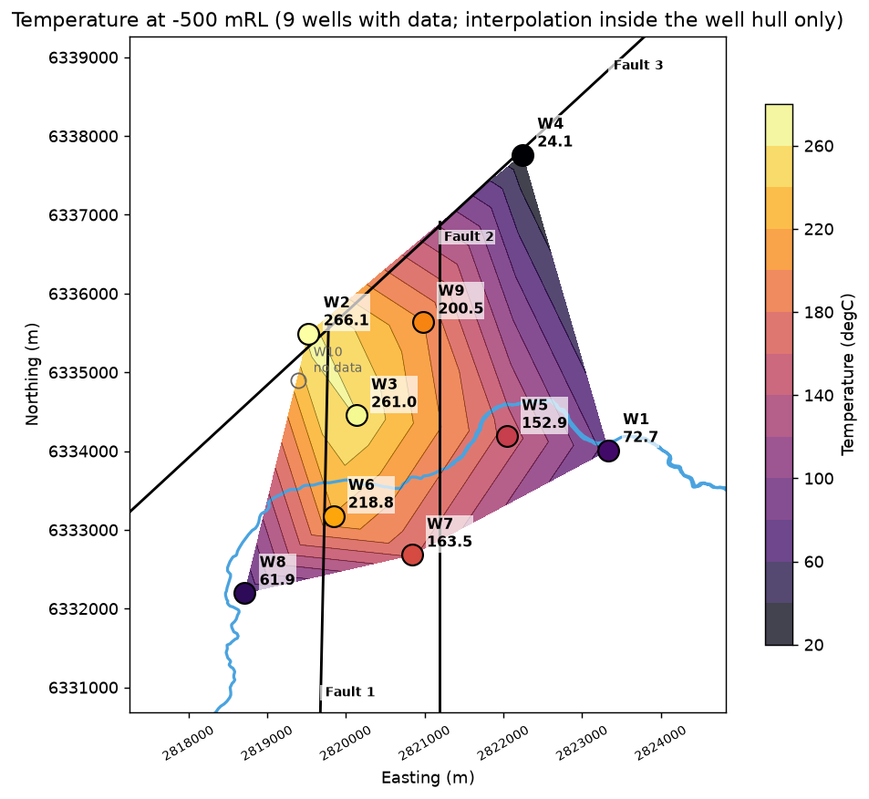
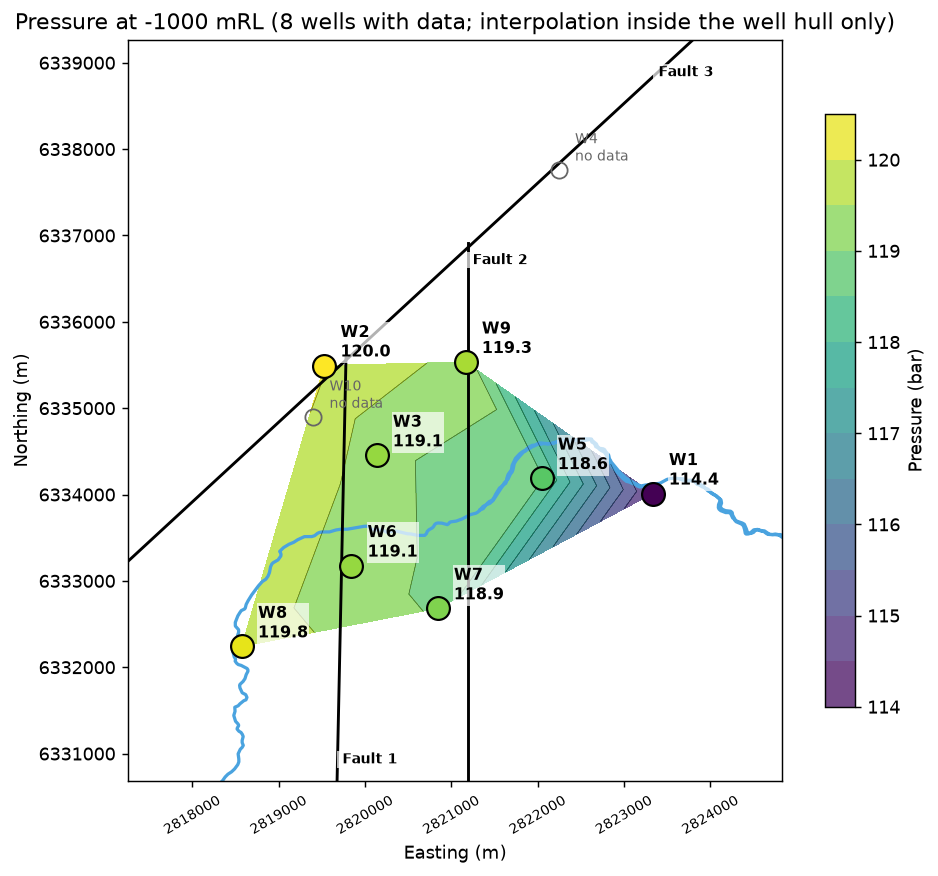
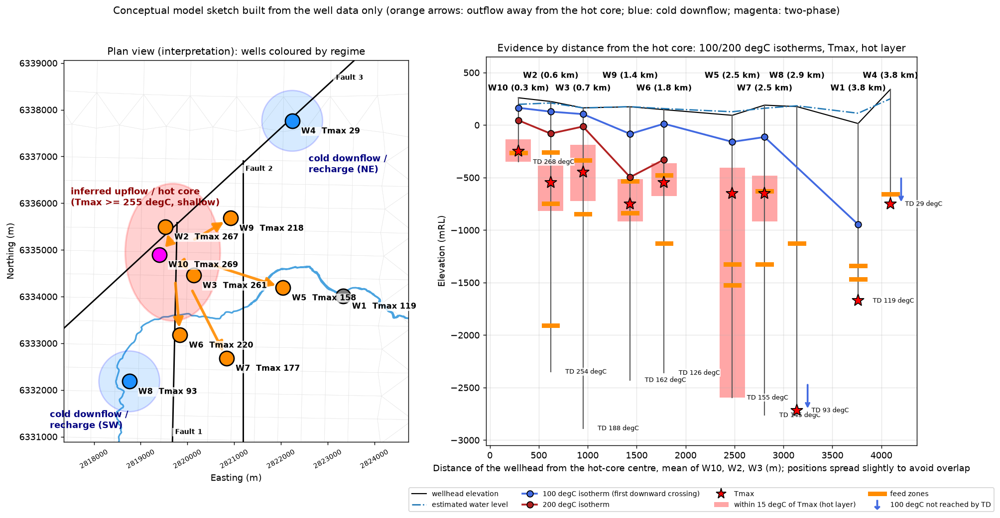

# Natural-state data interpretation for model calibration

Study area: the ten-well synthetic teaching dataset in `Baseline/` (all well files are labelled 'Synthetic data'). Everything below is generated by `Scripts/natural_state_analysis.py`; every number is in a file of `Output/`. Claims are labelled **[observation]** (read directly from the data), **[interpretation]** (inference from the data), **[assumption]** (a value not in the data) or **[reference model]** (a property of the starting model; never evidence). Units: mRL, bar, degC, kJ/kg, kg/s.

## 1. Key conclusions for calibration

1. **The surveys can be used as natural-state targets.** [observation] The T and P surveys of all 10 wells carry one date label (29/07/2015). The gauge test gives W2 and W3 a match to the first gauge reading within the reading precision (survey minus first gauge -0.10 and -0.10 bar; both gauge series start on the first day of production in the field). The other 8 wells are 'probably natural state' (feed-zone pressures within 2.9 bar of the trend; W9 survey is 2.05 bar above its first gauge value and W10's gauge starts years after field production began). **Action:** use all wells, with the confidence factors in `NS_calibration_targets.csv` (high W2, W3; low W5; the rest medium).
2. **Pressure targets belong at feed zones only.** [observation] 18 feed zones carry a formation-pressure estimate (`feedzones.csv`); they agree with each other across the field within 2.9 bar at equal elevation. Between feed zones the surveyed pressure follows the well column (pivot at the dominant feed zone, `well_summary.csv`). **Action:** `weight_P` is non-zero only at feed-zone survey points; do not fit shallow wellbore pressures (about 1 bar at the top of several wells).
3. **The pressure gradients are steeper than an IF97 liquid column and this is the largest unresolved data problem.** [observation] Cold wells (Tmax < 100 degC; W4, W8) give a measured-to-IF97 pressure-change ratio of 1.040 in the cased band and 1.009 in the open band (medians). The hot wells exceed this: the cased windows reach 1.551 (W3) and the open windows reach 1.192 (W2); a ratio above 1 means an implied density above that of water at the measured temperature. Datum offsets, a gravity/unit convention, two-phase fluid and rounding cannot explain the hot-well excess (section 4c). **Action:** compare model and data at feed zones with a pressure tolerance of several bar, and do not trust boiling margins at the shallow hot wells until the pressure convention is confirmed.
4. **A hot core with a thin cap sits at W2, W3, W10.** [observation] Tmax is 266.9 degC (W2), 261.4 degC (W3), 268.7 degC (W10) at only -550 to -250 mRL; the 200 degC isotherm is at -81.0 mRL (W2), -13.7 mRL (W3), 45.6 mRL (W10), and the 100 degC isotherm is only 96.8 m, 59.5 m, 95.3 m below the wellheads. [interpretation] This is the upflow zone, closest to Fault 3 (W2 125 m, W10 226 m). **Action:** the model needs a deep hot source (>= 253.7 degC, still rising at the bottom of W2) under or near these wells and a low-permeability cap above it.
5. **Lateral outflow leaves the hot core at about -450 to -750 mRL.** [observation] W2, W3, W5, W6, W7, W9 have their temperature maximum between -750 and -450 mRL and a temperature inversion of 13.3 to 98.1 degC below it; Tmax falls with distance from the core (W2 266.9, W3 261.4, W6 220.5, W9 217.7, W7 176.7, W5 158.0 degC). [interpretation] A permeable lateral layer carries hot water south (W6, W7), east (W5) and north-east (W9). **Action:** give the model a laterally permeable horizon at these elevations; the feed zones of the wells (`feedzones.csv`) mark where it is permeable.
6. **Boiling-point-for-depth conditions are seen only at W10.** [observation] The boiling margin falls to 2.6 degC at -150 mRL (4 survey points below 5 degC between -75 and -262.5 mRL), at the feed zone the margin is 4.3 degC. [interpretation] A two-phase or boiling zone is possible above the upflow; it depends on the pressure convention in conclusion 3: if the surveyed pressures are too high, the true Tsat is lower and every margin in the hot sections is smaller than listed. **Action:** allow a boiling zone near W10 and treat the smallest margins of W3 (12.2 degC) and W2 (23.8 degC) as upper bounds until the pressure convention is confirmed.
7. **Cold downflow or recharge at both margins.** [observation] W4 (north-east) reaches only 29.0 degC at -750 mRL (shallow gradient 13.9 degC/km) and W8 (south-west) stays at 61.9 to 66.0 degC between -500 and -1500 mRL. W8's shallow gradient (84.6 degC/km) is close to W1's (73.2 degC/km), so its cooling appears only below -550 mRL, whereas W4 is cold from the surface. [interpretation] Cold or cool water descends or enters laterally at the margins. **Action:** model cold recharge on the NE and SW flanks and a low basal heat input there; with an assumed rock conductivity of 2.0 W/m/K [assumption] the shallow gradients of W4 and W1 correspond to 27.7 and 146.4 mW/m2.
8. **Deep pressures are connected across the field.** [observation] At -1500 mRL nine wells lie within 7.2 bar (162.0 to 169.2 bar; 3.1 bar without the cold W8). [interpretation] No lateral pressure barrier separates the wells at depth; W8's higher deep pressure is what a colder, denser column gives. **Action:** give the deep model high lateral permeability or a common deep pressure datum; fit the 18 feed-zone pressures jointly.
9. **Geometry issues to fix before calibration.** [observation] 8 wellheads lie below the model surface of their column (W1 by 105 m, W2 by 35 m, W3 by 16 m, W5 by 47 m, W6 by 13 m, W7 by 50 m, W8 by 84 m, W9 by 46 m); the W4 liner is designed to -3251 mRL but the track ends at -750 mRL; the W1 water level extrapolates 97.9 m above its top survey point. All survey points and feed zones fall in the block given by the well-to-block file (own point-in-polygon search agrees at every survey point).

## 2. The data

### 2a. What exists (`input_inventory.csv`)

| role | rows | items |
|---|---|---|
| geometry_dat | 1 | gTE14515.dat |
| mapping | 1 | Mapping |
| out_of_scope | 8 | Area_data.json; FutureScenarios; Make_up_json; Production; ProductionHistory; Reports |
| reference_bc | 1 | gTE14515_boundary_conditions.json |
| reference_other | 4 | Plotting; currentGeomSetup.json; currentNSSetup.json; gTE14515.auxjson |
| reference_results | 1 | TE14515_NS_000.incon |
| reference_rock | 2 | TE14515_NS_000.dat; gTE14515_dict_rocktype.json |
| well_blocks_json | 1 | gTE14515_wells.json |
| well_data_dat | 1 | Data_dat |
| well_data_json | 1 | Data_json |
| well_groups | 1 | Groups_data.json |

The ten per-well JSON files hold the track, casing/liner design, feed zones, one T and one P survey, and (for producers and injectors) flow, enthalpy and transient-pressure records. `Data_dat` holds plain-column copies, `Mapping.json` three faults ('Fault 1', 'Fault 2', 'Fault 3'), 'Lake Tarawera', 'Tarawera River' and 'river'. The reference model files (rock types, boundary conditions, incons, set-up and plotting files) are not evidence. The production history, forecast set-up and field-total flow file are out of scope. No role in section 2.2 of the instructions is empty; `Data/Make_up_json` is an empty directory and `Plotting` holds hard-coded paths of other machines.

### 2b. How the data were checked

- **JSON versus plain-column files:** 38 of 38 files match their JSON series exactly (largest value difference 0.000). Irregular names: 5 files use the prefix 'Wel' instead of 'Well' (Wel10; the others have the regular form 'WellN_...'); they were matched to the well by content as well as by name. The plain-column time axes are years since 01/01/2014 (reference date found by matching the series against the JSON dates); flow files in `Data_dat` are stored with a negative sign for production and positive for injection. [observation]
- **Track, survey, design and block file (`integrity_checks.csv`):** 161 checks pass, 2 notes, 2 issues. Every survey point and feed zone lies inside its track; every feed zone lies in the slotted/open interval; the JSON tracks equal the grid-file tracks. Issues: W4 liner bottom (-3251 mRL) versus track bottom (-750 mRL); W10's feed-zone tag 'Synthetic' is not a quality grade. Notes: the W4 and W10 surveys start 110 m and 50 m below the wellhead.
- **Model blocks:** the grid file was parsed (vertex lines have the two coordinates run together, so they were read with a fixed pattern instead of whitespace; the other sections by whitespace). Layers tile the grid without gaps. For every survey point my own point-in-polygon and layer search gives the same block as the well-to-block file, which is used as the authority.
- **Thermodynamics:** IAPWS-IF97 Region 4 (Tsat, Psat) and Region 1 (liquid density, enthalpy) are implemented in the script and validated against the verification tables (`if97_validation.csv`; the script stops if any equivalent error exceeds 0.1 K). Tsat is left blank above the critical pressure (220.64 bar); the deepest survey points of W2, W3, W5, W6, W7, W8 and W9 exceed it.

### 2c. Provenance and quality labels (`provenance_labels.csv`)

- Casing/liner design: Source = 'Synthetic data' in all ten wells. The group file has one area, 'Synthetic', with all ten wells.
- Survey `Source` and `Comment` fields are empty; every survey has `StableFlag` = True (a label only: the data do not show how stability was judged, so it is not treated as evidence of thermal recovery). Flow, enthalpy and transient-pressure `Source`/`Comment` fields are empty. Feed-zone `Source` is only a unit label ('Text').
- Survey date label in all wells: 29/07/2015. Feed-zone quality tags found and their factors for `weight_P`:

| tag | wells | factor | mapping |
|---|---|---|---|
| HIGH | W2, W3, W6, W7, W8 | 1.0 | highest quality grade in the dataset |
| MEDIUM | W1, W2, W3, W4, W5, W9 | 0.8 | intermediate quality grade |
| LOW | W2, W9 | 0.5 | lowest quality grade in the dataset |
| Synthetic | W10 | 0.5 | not a quality grade (treated like the lowest grade) |

### 2d. Do the surveys represent the natural state? (`pressure_consistency_check.csv`)

**Rule used.** The survey pressure interpolated to the gauge elevation is compared with the first transient value. A match within the reading precision decides 'natural state', whatever the date label says. Wells without a gauge are compared at their feed zones with the mean pressure of the wells that passed (here W2, W3) at the same elevation (limit 3 bar). Injectors: the injectate temperature is derived from the median injection enthalpy with IF97 Region 1 (liquid at 10 bar); a feed-zone temperature colder than the injectate with no isothermal section near it argues against an injection-affected survey, a hotter formation could hide cooling and lowers the confidence one step. Confidence: high = match to the pre-/start-of-production gauge; medium = probable; low = probable but injection cooling could be hidden.

| well | role | first flow | gauge elev | survey P at gauge | first gauge | first gauge P | survey - first | max FZ residual | verdict | confidence |
|---|---|---|---|---|---|---|---|---|---|---|
| W1 | none |  | - | - |  | - | - | 2.92 | probably natural state | medium |
| W2 | production | 2014-01-01 | -750 | 98.20 | 2014-01-01 | 98.3 | -0.10 | 0.82 | natural state | high |
| W3 | production | 2014-01-01 | -550 | 80.70 | 2014-01-01 | 80.8 | -0.10 | 0.77 | natural state | high |
| W4 | injection | 2014-01-01 | - | - |  | - | - | 1.93 | probably natural state | medium |
| W5 | injection | 2014-01-01 | - | - |  | - | - | 0.39 | probably natural state | low |
| W6 | none |  | - | - |  | - | - | 1.49 | probably natural state | medium |
| W7 | none |  | - | - |  | - | - | 1.70 | probably natural state | medium |
| W8 | injection | 2014-01-01 | - | - |  | - | - | 1.32 | probably natural state | medium |
| W9 | production | 2014-01-01 | -675 | 91.25 | 2014-01-01 | 89.2 | 2.05 | 0.98 | probably natural state | medium |
| W10 | production | 2019-12-01 | -250 | 56.70 | 2020-01-01 | 48.7 | 8.00 | 1.56 | probably natural state | medium |

[observation] The gauge series of W2, W3 and W9 start on the day the first production record starts (also the first production anywhere in the field). W10's gauge starts 2191 days after field production began and 31 days after the well's own first flow, so it cannot be a pre-production reference. W10's own first flow (2019-12-01) is years later than the survey label.
**Date label versus gauge (data question).** Interpolating each gauge series to the survey date (29/07/2015) gives 88.3, 71.6 and 76.6 bar for W2, W3 and W9, so the gauge values are 9.9, 9.1 and 14.7 bar below the surveyed pressures. A survey taken on that date under production would sit at the gauge level, so the date label conflicts with the pre-production match. As instructed this is reported as a data question and does not lower the verdict.
**W9.** The survey exceeds its first gauge value by 2.05 bar. Production or injection would lower, not raise, the survey pressure relative to the gauge, and the first gauge value is already at the production start at the largest flow rate in the field; the verdict is therefore 'probably natural state', medium.
**Injectors.** The injectate is 335 kJ/kg, i.e. 79.8 degC. The feed-zone temperatures of W4 (27.3 degC) and W8 (63.9 degC) are colder than the injectate and neither profile has a section near it: evidence against an injection-affected survey. W5's feed zones (147.3, 144.8 degC) are hotter than the injectate, so cooling could be hidden: confidence low.

**Effect on the weights.** The confidence differs between wells (factors 1.0, 0.75, 0.5), so it does change relative weights: the temperature weights of W2 and W3 are twice those of W5 for the same location class. Location weights follow the defaults of the instructions without departure.

## 3. Temperature structure

Definitions (reproducible): inversion = largest drop below a running maximum if >= 3 degC; shallow gradient = least-squares fit over the top 300 m of the liquid-filled survey (liquid begins at the estimated water level); deep gradient = least-squares fit below both the inversion base and the deepest feed zone, blank if that interval is shorter than 300 m (two-point fits are exact slopes); isotherm crossings are the first downward crossings (linear interpolation); regime: two-phase if any boiling margin < 5 degC at P >= 1.5 bar; recharge/downflow if Tmax < 100 degC; outflow if the inversion is >= 10 degC; upflow if Tmax >= 200 degC at the bottom of the well; otherwise conductive.

| well | Tmax degC | at mRL | T at TD degC | TD mRL | inversion degC (top to base mRL) | shallow grad degC/km | deep grad degC/km | z 100C mRL | z 200C mRL | min margin degC | regime |
|---|---|---|---|---|---|---|---|---|---|---|---|
| W1 | 118.6 | -1672 | 118.6 | -1672 | none | 73 | - | -946 | - | 150.4 | conductive |
| W2 | 266.9 | -550 | 253.7 | -2348 | 30.9 (-550 to -1500) | 653 | 21.4 | 128 | -81 | 23.8 | outflow |
| W3 | 261.4 | -450 | 188.2 | -2887 | 86.9 (-450 to -1700) | 836 | 12.1 | 104 | -14 | 12.2 | outflow |
| W4 | 29.0 | -750 | 29.0 | -750 | none | 14 | - | - | - | 113.8 | recharge/downflow |
| W5 | 158.0 | -650 | 154.7 | -2595 | 13.3 (-650 to -1700) | 295 | 10.9 | -160 | - | 123.6 | outflow |
| W6 | 220.5 | -550 | 126.1 | -2359 | 98.1 (-550 to -1900) | 490 | 7.1 | 13 | -329 | 70.0 | outflow |
| W7 | 176.7 | -650 | 144.7 | -2762 | 46.0 (-650 to -1700) | 301 | 14.1 | -114 | - | 80.5 | outflow |
| W8 | 93.1 | -2716 | 93.1 | -2716 | 4.5 (-850 to -1300) | 85 | 21.4 | - | - | 104.1 | recharge/downflow |
| W9 | 217.7 | -750 | 161.6 | -2427 | 57.7 (-750 to -2250) | 319 | - | -84 | -496 | 87.8 | outflow |
| W10 | 268.7 | -250 | 268.5 | -350 | none | 692 | - | 165 | 46 | 2.6 | two-phase |

**Observations.**

- The three hottest wells (W2, W3, W10) reach 261.4 to 268.7 degC between -250 and -550 mRL; the layer within 15 degC of Tmax is 539 m thick at W3 and 473 m at W2 (`well_summary.csv`).
- Depth of the 100 degC isotherm below the wellhead: W1 961 m, W2 97 m, W3 60 m, W5 253 m, W6 134 m, W7 304 m, W9 258 m, W10 95 m. W4, W8 never reach 100 degC within their surveys. The cap (to 100 degC) thickens from 60 m over the hot core to 961 m at W1.
- Shallow gradients range from 14 (W4) to 836 degC/km (W3). With an assumed conductivity of 2.0 W/m/K [assumption, typical rock value; not in the data] these are 28 to 1672 mW/m2 (column `shallow_heat_flux_mW_m2_assumed_k`). [interpretation] Values above a few hundred mW/m2 in the hot wells are probably not a basal conductive flux but the steep cap above a convective zone. The deep gradients are only 7.1 to 21.4 degC/km, i.e. nearly isothermal at depth.
- Isothermal sections of 300 m or more (`isothermal_sections.csv`; range <= 5 degC):

| well | top mRL | bottom mRL | length m | T range degC | location | feed zones inside |
|---|---|---|---|---|---|---|
| W2 | -1100 | -1910 | 810 | 236.0 to 240.3 | open hole | 3 |
| W3 | -1100 | -2250 | 1150 | 174.5 to 177.2 | open hole |  |
| W4 | 230 | -250 | 480 | 12.3 to 19.4 | behind casing |  |
| W5 | -550 | -1100 | 550 | 153.6 to 158.0 | spans the casing shoe |  |
| W5 | -1300 | -2250 | 950 | 144.7 to 147.7 | open hole | 1,2 |
| W6 | -1500 | -2359 | 859 | 122.4 to 126.7 | open hole |  |
| W7 | -1300 | -2250 | 950 | 130.7 to 134.0 | open hole | 2 |
| W8 | -550 | -1700 | 1150 | 63.6 to 68.1 | spans the casing shoe | 1 |

- Inversions against the casing shoe and feed zones:

| well | drop degC | top mRL | base mRL | casing shoe mRL | position | feed zones inside |
|---|---|---|---|---|---|---|
| W2 | 30.9 | -550 | -1500 | -100 | below the shoe (open hole) | 2 |
| W3 | 86.9 | -450 | -1700 | -250 | below the shoe (open hole) | 2 |
| W5 | 13.3 | -650 | -1700 | -1000 | starts behind casing, continues in open hole | 1,2 |
| W6 | 98.1 | -550 | -1900 | -440 | below the shoe (open hole) | 2 |
| W7 | 46.0 | -650 | -1700 | -440 | below the shoe (open hole) | 2 |
| W8 | 4.5 | -850 | -1300 | -700 | below the shoe (open hole) | 1 |
| W9 | 57.7 | -750 | -2250 | -400 | below the shoe (open hole) | 2 |

[observation] Each inversion starts below the casing shoe or straddles it, so the temperatures that define the maximum and the inversion are open-hole values that could be affected by flow in the well. The inversions of W2, W3, W5, W6, W7 and W9 are large and span feed zones, which is what outflow past the feed zones would produce [interpretation], but the data cannot exclude internal flow.

**Wellbore check before interpreting.** [observation] Most of these sections are in open hole; the W3 section (-1100 to -2250 mRL, 174.5 to 177.2 degC) lies below the deepest feed zone and contains none, so flow between feed zones cannot produce it in the usual way. W4's cased section is a cold conductive profile. [interpretation] The deep isothermal sections of W2, W5, W6, W7, W8 are probably formation temperatures homogenised by deep convection or lateral flow, but internal wellbore flow cannot be excluded; open-hole points inside them get location weight 0.5 instead of 0.8. A repeat survey after a long shut-in, or a flow-spinner log, would decide.

**Boiling margin (`boiling_margin_flags.csv`).** Only W10 has intervals below 5 degC: W10 -75 to -262.5 mRL (minimum 2.6 degC at -150 mRL, T 256.8 degC, P 46.5 bar). The next smallest minimum is 12.2 degC (W3). The W10 profile is isothermal at 268.5 to 268.7 degC from its feed zone to the bottom, and its P-T path runs along the saturation curve between {f(BF.z_top_mRL.iloc[0], 0)} and {f(BF.z_bottom_mRL.iloc[0], 1)} mRL (`figures/PT_state.png`, right panel): a boiling-point-for-depth section **[interpretation]** that could be two-phase or a hot liquid at the edge of boiling.

Maps at 0, -500, -1000 and -1500 mRL (`figures/maps_temperature_*.png`) and sections (`figures/section_hottest_wells.png`) show the hot core near W10, W2 and W3 with temperature falling toward W6, W7, W5, W9 and the cold flanks W4 and W8; interpolation is inside the hull of wells with data only.

## 4. Pressure structure

### 4a. Pressure at common elevations (`pressure_at_common_elevations.csv`, bar; interpolation only)

| well | 0 mRL | -250 mRL | -500 mRL | -750 mRL | -1000 mRL | -1500 mRL | -2000 mRL | -2500 mRL |
|---|---|---|---|---|---|---|---|---|
| W1 | 12.3 | 38.6 | 63.5 | 89.0 | 114.4 | 162.0 | - | - |
| W2 | 24.1 | 55.0 | 77.5 | 98.2 | 120.0 | 164.5 | 208.6 | - |
| W3 | 20.2 | 55.0 | 76.6 | 97.4 | 119.1 | 163.9 | 209.4 | 254.2 |
| W4 | 24.5 | 51.1 | 76.3 | 100.5 | - | - | - | - |
| W5 | 15.4 | 44.9 | 71.7 | 95.4 | 118.6 | 164.0 | 209.7 | 255.4 |
| W6 | 18.6 | 49.9 | 75.7 | 97.0 | 119.1 | 165.1 | 211.4 | - |
| W7 | 18.9 | 46.9 | 73.3 | 96.6 | 118.9 | 164.8 | 211.1 | 257.3 |
| W8 | 19.8 | 46.1 | 71.3 | 95.9 | 119.8 | 169.2 | 218.4 | 267.4 |
| W9 | 18.3 | 49.3 | 75.6 | 97.7 | 119.3 | 163.9 | 209.4 | - |
| W10 | 26.3 | 56.7 | - | - | - | - | - | - |

[observation] Shallow pressures differ because the water levels differ: estimated levels (straight line through the shallowest three points with P >= 1.5 bar, solved for atmospheric pressure) range from 113 (W1) to 251 mRL (W4) and lie 3 to 89 m below the model surface of their columns (`well_summary.csv`). The W1 level is extrapolated 98 m above its top survey point and W5's 34 m, so these two are poor. At -1500 mRL the wells lie within 7.2 bar, at -2000 mRL within 9.8 bar and at -2500 mRL within 13.2 bar; W8 (cold) has the highest deep pressure.

### 4b. Feed-zone pressures and pivots (`feedzones.csv`)

Pivot rule: the dominant feed zone is the one with the highest quality factor, then the thicker zone, then the shallower zone; the pivot pressure is the survey pressure at its mid-point.

| well | fz | top mRL | bottom mRL | quality | T degC | P bar | boiling margin degC | block | weight_T | weight_P |  |
|---|---|---|---|---|---|---|---|---|---|---|---|
| W1 | 1 | -1320 | -1355 | MEDIUM | 113.2 | 146.7 | 227.2 | arg63 | 0.75 | 0.60 |  |
| W1 | 2 | -1440 | -1490 | MEDIUM | 115.5 | 158.7 | 231.2 | arg64 | 0.75 | 0.60 | pivot |
| W2 | 1 | -250 | -270 | LOW | 239.7 | 55.9 | 31.3 | ajf54 | 1.00 | 0.50 |  |
| W2 | 2 | -720 | -770 | HIGH | 258.0 | 97.8 | 51.4 | ajf59 | 1.00 | 1.00 | pivot |
| W2 | 3 | -1900 | -1920 | MEDIUM | 240.3 | 200.7 | 125.7 | ajf66 | 1.00 | 0.80 |  |
| W3 | 1 | -310 | -360 | HIGH | 259.1 | 62.8 | 19.5 | asd55 | 1.00 | 1.00 | pivot |
| W3 | 2 | -820 | -870 | MEDIUM | 229.8 | 105.6 | 85.2 | asd60 | 1.00 | 0.80 |  |
| W4 | 1 | -630 | -680 | MEDIUM | 27.3 | 91.7 | 277.4 | aop58 | 0.75 | 0.60 | pivot |
| W5 | 1 | -1300 | -1350 | MEDIUM | 147.3 | 148.1 | 193.8 | arc63 | 0.50 | 0.40 | pivot |
| W5 | 2 | -1500 | -1550 | MEDIUM | 144.8 | 166.3 | 205.7 | arc64 | 0.50 | 0.40 |  |
| W6 | 1 | -460 | -490 | HIGH | 218.0 | 73.5 | 71.2 | aph56 | 0.75 | 0.75 |  |
| W6 | 2 | -1100 | -1150 | HIGH | 139.8 | 130.5 | 191.4 | aph62 | 0.75 | 0.75 | pivot |
| W7 | 1 | -610 | -650 | HIGH | 175.1 | 86.0 | 125.0 | apk58 | 0.75 | 0.75 |  |
| W7 | 2 | -1300 | -1350 | HIGH | 131.3 | 148.7 | 210.2 | apk63 | 0.75 | 0.75 | pivot |
| W8 | 1 | -1100 | -1150 | HIGH | 63.9 | 132.0 | 268.1 | ana62 | 0.75 | 0.75 | pivot |
| W9 | 1 | -520 | -550 | LOW | 205.4 | 78.9 | 88.6 | ajj57 | 0.75 | 0.38 |  |
| W9 | 2 | -830 | -845 | MEDIUM | 211.6 | 105.2 | 103.1 | ajq60 | 0.75 | 0.60 | pivot |
| W10 | 1 | -250 | -275 | Synthetic | 268.7 | 57.7 | 4.3 | arz54 | 0.75 | 0.38 | pivot |

[observation] Feed-zone pressures agree with the trend of the passed wells within 2.92 bar (`pressure_trend_check.csv`); the largest residuals are W1 (-2.92 bar, the only well below the trend by more than 2.5 bar and close to the 3 bar limit) and W4 (1.93 bar, an injector).

### 4c. Hydrostatic checks (`hydrostatic_check.csv`, `hydrostatic_summary.csv`)

Windows are single-phase liquid (boiling margin >= 10 degC and P >= 1.5 bar throughout), non-overlapping, at least 300 m long, cut at feed-zone mid-points where the minimum length allows, and never straddling the casing shoe (a piece shorter than 300 m on one side of the shoe is not tested: 4 such pieces, listed in `run_console_log.txt`). g = 9.80665 m/s2. Each reading is rounded to 0.1 bar, so a window's pressure change is uncertain by up to 0.1 bar: at most 0.003 in the ratio and 3.1 kg/m3 in the implied density.

| scope | band | windows | length m | median ratio | min | max | length-weighted ratio | cold-well component | excess over it |
|---|---|---|---|---|---|---|---|---|---|
| all wells | cased | 8 | 5861 | 1.153 | 1.032 | 1.551 | 1.147 |  |  |
| cold wells (Tmax<100 degC) | cased | 2 | 1606 | 1.040 | 1.032 | 1.048 | 1.041 |  |  |
| warm/hot wells | cased | 6 | 4255 | 1.191 | 1.063 | 1.551 | 1.189 |  |  |
| all wells | open | 17 | 15436 | 1.019 | 0.997 | 1.192 | 1.030 |  |  |
| cold wells (Tmax<100 degC) | open | 2 | 2016 | 1.009 | 0.998 | 1.019 | 1.015 |  |  |
| warm/hot wells | open | 15 | 13420 | 1.020 | 0.997 | 1.192 | 1.033 |  |  |
| W1 | cased | 1 | 1015 | 1.063 | 1.063 | 1.063 | 1.063 | 1.040 | 0.023 |
| W1 | open | 2 | 672 | 1.013 | 1.007 | 1.018 | 1.013 | 1.009 | 0.004 |
| W2 | open | 3 | 2248 | 1.092 | 1.088 | 1.192 | 1.119 | 1.009 | 0.110 |
| W3 | cased | 1 | 400 | 1.551 | 1.551 | 1.551 | 1.551 | 1.040 | 0.511 |
| W3 | open | 2 | 2637 | 1.054 | 1.020 | 1.088 | 1.034 | 1.009 | 0.025 |
| W4 | cased | 1 | 730 | 1.032 | 1.032 | 1.032 | 1.032 | 1.040 | -0.008 |
| W5 | cased | 1 | 1093 | 1.132 | 1.132 | 1.132 | 1.132 | 1.040 | 0.091 |
| W5 | open | 2 | 1595 | 1.003 | 1.001 | 1.004 | 1.002 | 1.009 | -0.007 |
| W6 | cased | 1 | 587 | 1.296 | 1.296 | 1.296 | 1.296 | 1.040 | 0.256 |
| W6 | open | 2 | 1919 | 1.005 | 0.997 | 1.012 | 1.003 | 1.009 | -0.006 |
| W7 | cased | 1 | 590 | 1.175 | 1.175 | 1.175 | 1.175 | 1.040 | 0.134 |
| W7 | open | 2 | 2322 | 1.014 | 1.000 | 1.028 | 1.011 | 1.009 | 0.002 |
| W8 | cased | 1 | 876 | 1.048 | 1.048 | 1.048 | 1.048 | 1.040 | 0.008 |
| W8 | open | 2 | 2016 | 1.009 | 0.998 | 1.019 | 1.015 | 1.009 | 0.006 |
| W9 | cased | 1 | 570 | 1.207 | 1.207 | 1.207 | 1.207 | 1.040 | 0.166 |
| W9 | open | 2 | 2027 | 1.049 | 1.023 | 1.074 | 1.034 | 1.009 | 0.025 |

[observation] The field-wide component, the median ratio of the cold wells, is **1.040 (cased)** and **1.009 (open)**. The open-band component rests on W8 alone (W4's open piece is only 250 m long). The implied density of the cold-well cased windows is 1032 to 1039 kg/m3 against about 995 kg/m3 for IF97 water at those temperatures. Per-well excess above the component: cased W1 0.023, W3 0.511, W4 -0.008, W5 0.091, W6 0.256, W7 0.134, W8 0.008, W9 0.166; open W1 0.004, W2 0.110, W3 0.025, W5 -0.007, W6 -0.006, W7 0.002, W8 0.006, W9 0.025.

**Checks before calling the gradient impossible.**

- *Datum offset:* adds the same pressure at every depth, cannot change a gradient. The shallowest survey pressures are 1.0 bar (atmospheric) at W2, W7 and W10, so there is no sign of an absolute offset.
- *Gravity or unit convention:* would scale every gradient by one constant at every depth in every well. The open-hole ratios of W5, W6 and W7 are 1.002, 1.003 and 1.011 while the cased ratios of the same wells are 1.132, 1.296 and 1.175, so one constant cannot explain the data; it could at most explain the small cold-well component.
- *Two-phase fluid:* makes the column lighter, so it lowers the ratio; it cannot explain a ratio above 1.
- *Rounding:* at most the uncertainties quoted above; far smaller than the excess.

[interpretation] What remains: (a) a field-wide component of 0.009 to 0.040 that may be a convention or fluid-density difference (e.g. dissolved solids; not testable here), and (b) an excess of up to 0.551 in the hot cased sections that no listed convention explains. In the cased band it rises broadly with the shallow temperature gradient (W3 836, W6 490, W9 319, W7 301, W5 295 degC/km, against W1 73, W8 85, W4 14 degC/km) and it is nearly absent in the deep open hole of W5, W6, W7, W8 (ratios within about 1.5 per cent of 1). A static single-phase column cannot be denser than pure water at the measured temperature (ratio 1) apart from a few per cent for dissolved solids, so the shallow hot-well pressures are probably formation-type values (vertical flow, or values taken from a model) rather than static well-column pressures; the data cannot decide. A shut-in, thermally recovered pressure survey in W3 or W6 would decide.

## 5. Conceptual model

Sketch built from the well data only (`figures/conceptual_model.png`). Each feature lists its supporting observation, the relation to the mapped faults and surface water (`well_geometry_check.csv`), and what would decide an alternative.

| well | nearest fault and distance | nearest water body and distance | wellhead minus model surface m | max deviation m |
|---|---|---|---|---|
| W1 | Fault 2 2141 m | river 96 m | -105 | 0 |
| W2 | Fault 3 125 m | Tarawera River 1906 m | -35 | 0 |
| W3 | Fault 1 378 m | Tarawera River 828 m | -16 | 0 |
| W4 | Fault 3 50 m | river 3126 m | 0 | 0 |
| W5 | Fault 2 855 m | river 345 m | -47 | 0 |
| W6 | Fault 1 113 m | Tarawera River 424 m | -13 | 0 |
| W7 | Fault 2 349 m | Tarawera River 858 m | -50 | 0 |
| W8 | Fault 1 950 m | Tarawera River 235 m | -84 | 1000 |
| W9 | Fault 2 269 m | river 1488 m | -46 | 868 |
| W10 | Fault 3 226 m | Tarawera River 1336 m | 0 | 0 |

1. **Upflow** (interpretation, medium confidence). Supported by the highest temperatures at the shallowest depths (W10 268.7, W2 266.9, W3 261.4 degC), the shallowest 200 degC isotherm (W10 45.6 mRL), a cap of only 60 to 97 m above 100 degC, and a temperature at the bottom of W2 that is still rising (253.7 degC at -2348 mRL; deep gradient 21.4 degC/km). W2 and W10 lie 125 m and 226 m from Fault 3. *Alternatives:* upflow in the matrix between Fault 3 and Fault 1, or on Fault 1 (W3 at 378 m, W6 at 113 m). The data cannot say whether the faults are permeable, because no well is closer than 50 m to one. *Decisive:* a deep temperature log in W10 (it stops at -350 mRL) and in W2 below -2348 mRL, and a fault-zone well.
2. **Lateral outflow** (interpretation). W2, W3, W5, W6, W7, W9 show a temperature maximum at -750 to -450 mRL, deepening away from the core (W3 -450, W2 -550, W6 -550, W7 -650, W5 -650, W9 -750 mRL), with cooler water below (86.9 degC inversion at W3). Directions: south to W6 and W7, east to W5, north-east to W9 (plan view arrows). The layer within 15 degC of Tmax is W2 473 m, W3 539 m, W6 312 m, W7 435 m, W9 402 m thick (W5 is nearly isothermal over 2188 m). *Alternative:* the inversions are cold water entering from below rather than hot water leaving laterally; temperature alone cannot separate them. *Decisive:* chemistry or isotopes along the outflow path, or a deeper temperature log in W1 and W5. W1 (the most distant hot well) shows no inversion, so the outflow does not reach it at the surveyed depths.
3. **Cap.** [interpretation] The conductive cap is 60 to 961 m thick to 100 degC and thickens away from the core; the near-surface temperature of 12.3 degC at the top of W4 matches ordinary ground temperature. The cap is the zone with steep gradients (14 to 836 degC/km) and sits above the first feed zones (the shallowest feed-zone top is at -250 mRL in W2 and W10).
4. **Cold downflow / recharge** (interpretation; W4 and W8 differ in detail). W4 (Fault 3 at 50 m, the highest ground, wellhead 340 mRL) and W8 (Tarawera River at 235 m, wellhead 176 mRL) reach no more than 29.0 and 93.1 degC. W8 is nearly isothermal at 63.6 to 68.1 degC from -550 to -1700 mRL, with a 4.5 degC inversion and a rise to 93.1 degC at the bottom, which fits lateral cool inflow at that depth as well as downflow. *Alternative for W4:* a cold, low-permeability flank with conduction only (W4's gradient is 13.9 degC/km, far below the conductive values of the other wells). *Decisive:* a temperature log of W4 below -750 mRL, or the chemistry of its water.
5. **Two-phase zone** (interpretation, low confidence). Only W10, in the depth range -75 to -262.5 mRL, with the pressure caveat of section 4c.
6. **Pressure connection** (interpretation). Pressures at -1500 mRL agree within 7.2 bar and the feed-zone pressures lie on one trend (residuals <= 2.9 bar), so the feed zones, from -250 to -1920 mRL, appear to be in one pressure system; the shallow water levels differ by up to 138 m, broadly following the model surface elevation (120 to 340 mRL).
7. **Surface water.** [observation] The Tarawera River is within a kilometre of W3, W6, W7, W8 and the other 'river' is within 350 m of W5 and about 100 m of W1; Lake Tarawera is more than three kilometres from every well. [interpretation] The data do not show river-water cooling in the hot wells (W3 and W6 are hot). Only W8, next to the river, is cold, but W4, far from any water, is cold too, so surface water is not the only cause.

## 6. Recommended calibration set-up

### 6a. Targets and weights

| well | sum of T weights | mean T weight | sum of P weights | confidence | points | points in feed zones |
|---|---|---|---|---|---|---|
| W1 | 8.47 | 0.446 | 1.20 | medium | 19 | 2 |
| W2 | 21.80 | 0.661 | 4.60 | high | 33 | 6 |
| W3 | 18.70 | 0.623 | 3.60 | high | 30 | 4 |
| W4 | 9.45 | 0.430 | 1.20 | medium | 22 | 2 |
| W5 | 7.35 | 0.283 | 1.60 | low | 26 | 4 |
| W6 | 12.90 | 0.461 | 2.25 | medium | 28 | 3 |
| W7 | 15.22 | 0.476 | 3.00 | medium | 32 | 4 |
| W8 | 11.85 | 0.409 | 1.50 | medium | 29 | 2 |
| W9 | 14.62 | 0.487 | 1.35 | medium | 30 | 3 |
| W10 | 7.35 | 0.432 | 0.75 | medium | 17 | 2 |

- Temperature: all 266 survey points (`NS_calibration_targets.csv`) with location weight times confidence factor: feed zone 1.0, open hole 0.8, open hole in an isothermal section >= 300 m 0.5, behind casing 0.5, within 30 m of the wellhead or in the top block of the column 0.3, above the model surface 0 (no point is above the surface because every wellhead is at or below it). The temperature weights add to 127.73.
- Pressure: only the 32 survey points inside feed zones have `weight_P` (quality factor times confidence); 18 feed-zone mid-point pressures are in `feedzones.csv`. Use the pivot pressures as the primary constraint on each well. No shallow wellbore pressure is a target.
- Pressure tolerance: use several bar (section 4c) and treat the cased-band ratios as a data question, not as overpressure.
- Layer-centre values for comparison with block temperatures and pressures are in `T_P_at_layer_centres.csv` (no extrapolation; blocks from the well-to-block file).

### 6b. Heat and mass

- **Heat in:** a deep source under the W10-W2-W3 area able to supply liquid at 254 to 269 degC [interpretation]. The margins need a low basal heat input: with the assumed conductivity the W1, W4 and W8 shallow gradients are 146.4, 27.7 and 169.2 mW/m2 [assumption].
- **[reference model]** (for comparison only): uniform basal heat flux 0.1 W/m2 in the boundary-condition file, 398 base heat sources totalling 15.6 MW (14.6 to 91.5 kW per block), atmosphere 12.3 degC, rain 1000 mm/year. These are the starting values of the model, not data. The shallow gradients of the margin wells ({pw('WELL-4', 'shallow_heat_flux_mW_m2_assumed_k', 0)} to {pw('WELL-8', 'shallow_heat_flux_mW_m2_assumed_k', 0)} mW/m2 with the assumed conductivity) bracket the uniform value, so the margins do not demand a change; the hot core needs a much larger, localised input.
- **Mass out:** lateral outflow from the hot core at about -450 to -750 mRL toward the south, east and north-east. **Mass in:** meteoric recharge, the cold flanks W4 and W8, and a deep hot upflow; the mass rates are not constrained by the natural-state data.

### 6c. Permeability structure implied

- A low-permeability cap over the hot core, 60 to 100 m thick to 100 degC and thickening outward [interpretation].
- Permeable feed zones: shallow ones at -250 to -870 mRL (W2, W3, W4, W6, W7, W9 and W10) and deep ones at -1100 to -1550 mRL (W1, W5, W6, W7 and W8), plus the W2 zone at -1910 mRL. Lateral permeability at these elevations is what the model must provide (the elevations are observations; their permeability is an inference).
- Vertical permeability high enough for upflow under the hot core and for cold downflow at the NE and SW margins [interpretation].
- High lateral permeability at depth, from the common deep pressure (conclusion 8).

### 6d. Boundary requirements

- Top: atmospheric pressure and ground temperature near 12 degC (the shallowest temperatures are 12.3 degC at W4 and 12.8 degC at W8); water table 3 to 89 m below the model surface.
- Sides: open to cold recharge at the NE and SW margins; no lateral pressure barrier at depth within the well field.
- Base: concentrated heat and mass input under W10/W2/W3; low heat input on the margins.

## 7. Data quality issues and open questions (ranked by effect on calibration)

1. **Pressure gradients exceed the IF97 column.** Cold-well component 1.040 (cased) and 1.009 (open); hot cased windows up to 1.551. Affects every pressure comparison and the boiling margins of the hot wells. Ask the data provider how the pressures were measured or produced; a shut-in survey in W3 or W6 would settle it.
2. **Date label versus pre-production match.** Surveys are labelled 29/07/2015. W2 and W3 match the pre-production gauge within 0.1 bar, yet the surveys of W2, W3 and W9 sit 9.1 to 14.7 bar above the gauge interpolated to the labelled date, and W10's first flow is years after the label. The natural-state use does not depend on the label; confirm the survey date.
3. **W10 is the hottest well and the most uncertain.** Its survey stops at -350 mRL, its feed-zone tag is 'Synthetic', its gauge starts 2191 days after field production began, and its margin to boiling is 2.6 degC. Weighted as medium confidence and quality factor 0.5.
4. **W9 survey above its first gauge value.** 2.05 bar; verdict probably natural state, medium.
5. **Wellhead below the model surface.** W1 105 m, W2 35 m, W3 16 m, W5 47 m, W6 13 m, W7 50 m, W8 84 m, W9 46 m. The block file starts at the wellhead, so the model cells above it have no data; the top-block weight rule uses the model surface.
6. **Extrapolated water levels.** W1 98 m and W5 34 m above the top survey point; W1 has 10.8 bar at its top point.
7. **Isothermal open-hole sections.** Up to 1150 m long (W3, W8); wellbore flow versus formation convection not decidable from one survey. Weighted 0.5.
8. **W4 design versus track.** Liner bottom -3251 mRL against the track bottom -750 mRL; the track (and the grid file) were used.
9. **Injector surveys.** W5's formation is hotter than the injectate, so injection cooling could be hidden (confidence low); W4 and W8 show no injection signature.
10. **W1 feed-zone residual.** -2.92 bar against the trend, close to the 3 bar limit; lateral gradient or minor disturbance cannot be separated.
11. **Empty provenance fields and irregular names.** Source/Comment fields are empty, StableFlag is True everywhere, and {len(irregular)} plain-column files use the prefix 'Wel10'; no effect on the numbers.

**Open questions that observations could answer:** a shut-in pressure and temperature survey (pressure convention, wellbore effects); a deep log in W10 and below -2348 mRL in W2 (upflow depth and temperature); a W4 log below -750 mRL (cold downflow or conductive flank); a fault-crossing well (permeability of Faults 1 to 3).

## 8. Output file index

| file | content |
|---|---|
| Scripts/natural_state_analysis.py | regenerates everything, including this report and the input inventory |
| Output/input_inventory.csv | role of every file under Baseline/ |
| Output/NS_calibration_targets.csv | one row per survey point: block, weights, weight_P |
| Output/feedzones.csv | T, P, margin, block, weights at each feed zone |
| Output/T_P_at_layer_centres.csv | interpolated T, P at model layer centres |
| Output/well_summary.csv | per-well characteristics, regime, verdict; extra columns for heat flux, cap depth, hot layer |
| Output/pressure_consistency_check.csv | natural-state gauge test and reasons |
| Output/pressure_trend_check.csv | feed-zone pressure against the trend of the passed wells |
| Output/hydrostatic_check.csv, hydrostatic_summary.csv | windows and ratio statistics by band |
| Output/well_geometry_check.csv | wellhead, surface, deviation, distances to faults and water |
| Output/isothermal_sections.csv, boiling_margin_flags.csv | isothermal sections and intervals with margin < 5 degC |
| Output/TP_at_common_elevations.csv, temperature_at_common_elevations.csv, pressure_at_common_elevations.csv | interpolated values at common elevations |
| Output/dat_json_crosscheck.csv, integrity_checks.csv, provenance_labels.csv | source cross-checks and labels |
| Output/if97_validation.csv, analysis_parameters.csv, reference_model_summary.csv, report_derived_numbers.csv | validation, parameters, reference-model description, numbers derived for this report |
| Output/run_console_log.txt, acceptance_check.txt, process_log.md | console log, acceptance check, process log |
| Output/figures/well_map.png | grid, faults, water bodies, wells |
| Output/figures/profile_WELL-*.png | T and P with Tsat, casing, feed zones, water level, pivot (one per well) |
| Output/figures/maps_temperature_*.png, maps_pressure_*.png | maps at 0, -500, -1000, -1500 mRL |
| Output/figures/section_hottest_wells.png, section_pressure_hottest_wells.png | sections through the four hottest wells |
| Output/figures/PT_state.png | P-T state against the saturation curve |
| Output/figures/conceptual_model.png | conceptual sketch |

