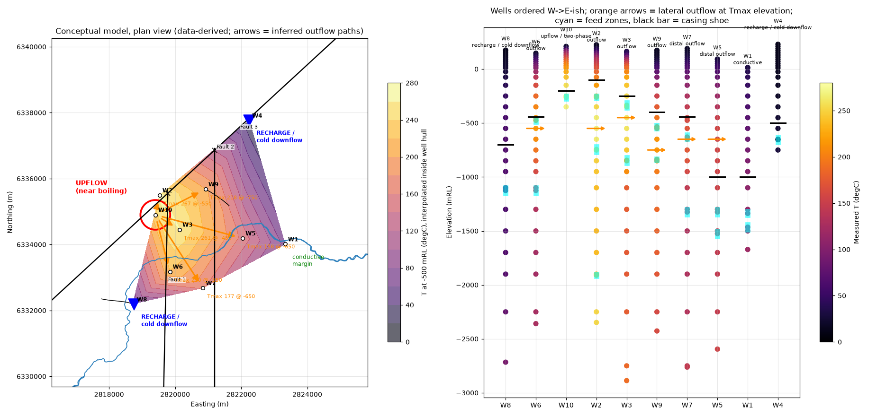

# Natural-state data interpretation: TE14515 (Teaching_Model_3D)

Generated by `Scripts/natural_state_analysis.py` on 2026-11-24 13:30. Every number below is read from a file in `Output/` (file named in brackets). **Observation** = what the data show; **Interpretation** = an inference, with its confidence. Units: mRL (metres relative to sea level, positive up), bar (absolute), °C, kJ/kg, kg/s. Content about the reference model TE14515 is labelled **[reference model]** and is never used as evidence.

## 1. Key conclusions for calibration

1. **The upflow is at WELL-10 / WELL-2, next to the Fault 1 x Fault 3 intersection.** Observation: WELL-10 is the hottest well (268.7 °C at -250 mRL) and the only one near boiling: boiling margin 2.6-4.3 °C from -75 to -262.5 mRL; the profile is isothermal below its feed zone. WELL-2 is 259 m from the mapped Fault 1 x Fault 3 intersection; WELL-10 is 365 m from Fault 1 and 226 m from Fault 3 (758 m from the intersection). WELL-2 reheats with depth, to 253.7 °C at TD (-2348 mRL), the hottest deep temperature in the field. Action: put the deep hot mass input under the F1 x F3 intersection (WELL-2/WELL-10 blocks), with enthalpy of at least that of liquid at 269 °C (about 1178 kJ/kg from IF97 at the WELL-10 feed-zone pressure). [well_summary.csv, well_geometry_check.csv, NS_calibration_targets.csv]
2. **A hot outflow layer spreads east, south-east and south at about -250 to -750 mRL.** Observation: every well except WELL-10 (upflow), the recharge wells and the eastern margin well WELL-1 has a temperature inversion, and Tmax falls with distance from WELL-10: W2 266.9 °C at -550 mRL (0.6 km), W3 261.4 °C at -450 mRL (0.9 km), W9 217.7 °C at -750 mRL (1.7 km), W6 220.5 °C at -550 mRL (1.8 km), W7 176.7 °C at -650 mRL (2.6 km), W5 158.0 °C at -650 mRL (2.7 km). Below the inversions the temperature drops to 122.4-236.0 °C. Interpretation (high confidence): lateral outflow of hot fluid above cooler water. Action: the model needs a laterally permeable layer at about -250 to -750 mRL that connects the upflow to WELL-3, WELL-6, WELL-9, WELL-7 and WELL-5, and lower vertical permeability below it, so that the cool water under the outflow stays cool. [well_summary.csv, figures/section_hot_axis_*.png]
3. **Cold recharge or downflow comes in at WELL-4 (north-east, on Fault 3) and WELL-8 (south-west).** Observation: WELL-4 reaches only 29.0 °C at TD (-750 mRL), with a gradient of 14-20 °C/km, and is 50 m from Fault 3. WELL-8 reaches only 93.1 °C at -2716 mRL. Action: the model needs cold water (12-29 °C in WELL-4, 64-68 °C at -550 to -950 mRL in WELL-8) entering at depth from the north-east along Fault 3 and from the south-west. A purely conductive base would make these wells far too hot. [well_summary.csv]
4. **The cap is thin and highly conductive over the hot zone.** Observation: in the wells with Tmax >= 200 °C the 100 °C isotherm is at -84 to 165 mRL, and the shallow gradients are 319-860 °C/km. That is a conductive heat loss of 0.6-1.7 W/m2, assuming k = 2.0 W/m/K. Action: the model needs a low-permeability layer from the surface down to about -100 to -250 mRL above the outflow. The shallow temperatures must be matched by conduction through it, not by through-flow. [well_summary.csv]
5. **The deep pressures are connected across the field.** Observation: all 18 feed-zone pressures lie within 2.2 bar of a single pressure-elevation curve (RMS 1.1 bar). The largest positive residuals are in the recharge wells (WELL-4 +2.0, WELL-8 +1.8 bar), and the most negative are in the eastern margin well WELL-1 (-2.2 bar). Interpretation (medium confidence): a single connected reservoir, with a small head gradient from the recharge sides towards the east, where the river is. Action: use the feed-zone pressures as the pressure targets (feedzones.csv), with a tolerance of about 1-2 bar. [feedzones.csv, figures/feedzone_pressure_vs_elevation.png]
6. **Above about -450 mRL the survey pressures are not a static column (data problem, high impact).** Observation: the measured pressure gradient is steeper than an IF97 static column of the measured temperature profile in every well. The median ratio is 1.030-1.070 in the cold wells and 1.17-1.41 in the hot wells, and in 22 windows the gradient is steeper than a column of cold water (implied density up to 1363 kg/m3). Below -450 mRL most windows are within a few percent of the IF97 static column. Checks: a datum offset cannot change a gradient; a gravity or unit convention would act at every depth; two-phase fluid would make the column lighter, not heavier; the 0.1 bar rounding is below 0.5 % over 300 m. Action: give zero weight to pressures that are not at feed zones (column weight_P), and ask the data provider how the shallow pressures were obtained. [hydrostatic_check.csv, hydrostatic_band_summary.csv]
7. **The surveys represent the pre-production natural state, even though every survey is dated 29/07/2015.** Observation: at the gauge elevation, the survey pressure differs from the first (01/01/2014) gauge reading by -0.1 bar at WELL-2 and -0.1 bar at WELL-3. The 01/01/2015 readings are already 9.1 bar and 8.2 bar lower than the first. WELL-9 differs by +2.0 bar. Action: calibrate the natural state against all surveys, with the confidence multipliers in section 6. [pressure_consistency_check.csv]
8. **The model surface is above several wellheads.** Observation: the wellhead is below the model surface of its column at WELL-1 (-105 m), WELL-8 (-84 m), WELL-7 (-50 m), WELL-5 (-47 m) and WELL-9 (-46 m). No survey point is above the model surface. Action: correct SURFA for these columns, or accept that the top-layer model temperatures sit tens of metres above the real ground surface. [well_geometry_check.csv]
9. **[reference model] The starting model has no deep mass upflow.** It has 398 basal HEAT generators totalling 15.6 MW and 398 near-surface rain MASS generators. None of its MASS generators is in the deepest three layers. Conclusions 1 to 3 imply a hot mass upflow and cold lateral inflow. The starting model includes neither. [key_numbers.json]

## 2. The data

**Inventory.** There are 10 wells (Groups_data.json). Each has one temperature survey and one pressure survey at the same 266 elevations in total, plus a well track, the casing and liner design, and feed zones (HIGH: 7, LOW: 2, MEDIUM: 8, Synthetic: 1). WELL-2, 3, 9 and 10 have production rates, enthalpy and pressure gauge series. WELL-4, 5 and 8 have injection rates at 334.9 kJ/kg. WELL-1, 6 and 7 have no flow data. WELL-8 and WELL-9 are deviated, with offsets at TD of 1000 m and 868 m.

**Checks** (data_integrity_check.csv, 82 checks):
- JSON and dat files match exactly for every temperature, pressure and transient-pressure value (difference 0), and the T and P elevations are identical in each well.
- Every survey point lies within the well track. Every feed zone lies within the track and the slotted liner, below the casing shoe. Every feed-zone block computed here matches the block in `gTE14515_wells.json` (feedzones.csv).
- **WELL-4: design_matches_track = INCONSISTENT.** design 340 to -3251 mRL vs track 340 to -750 mRL. Treat the track TD as correct, since the survey ends there.
- The first survey point is well below the wellhead at WELL-4 (110 m) and WELL-10 (50 m).
- IAPWS-IF97 (Region 4 saturation, Region 1 density and enthalpy) is implemented in the script and validated against the IF97 verification tables. All 18 checks passed, including Tsat(1.01325 bar) = 99.97 °C and Tsat(100 bar) = 311.00 °C. The script stops if any Tsat error exceeds 0.1 K (run_console_log.txt).

**Natural-state timing** (pressure_consistency_check.csv, figures/natural_state_pressure_test.png). All surveys are dated 29/07/2015. Production and injection began on 01/01/2014.

| Well | Role | Gauge elev. (mRL) | Survey P at gauge (bar) | First gauge P (bar, date) | Survey minus first (bar) | Verdict | Confidence | Weight multiplier |
|---|---|---|---|---|---|---|---|---|
| WELL-1 | observation/unused | - | - | - | - | probably natural state | medium | 0.8 |
| WELL-2 | producer | -750 | 98.2 | 98.3 (01/01/2014) | -0.1 | natural state | high | 1.0 |
| WELL-3 | producer | -550 | 80.7 | 80.8 (01/01/2014) | -0.1 | natural state | high | 1.0 |
| WELL-4 | injector | - | - | - | - | probably natural state | medium | 0.8 |
| WELL-5 | injector | - | - | - | - | probably natural state | medium | 0.8 |
| WELL-6 | observation/unused | - | - | - | - | probably natural state | medium | 0.8 |
| WELL-7 | observation/unused | - | - | - | - | probably natural state | medium | 0.8 |
| WELL-8 | injector | - | - | - | - | probably natural state | medium | 0.8 |
| WELL-9 | producer | -675 | 91.2 | 89.2 (01/01/2014) | +2.0 | probably natural state | medium | 0.8 |
| WELL-10 | producer | -250 | 56.7 | 48.7 (01/01/2020) | +8.0 | probably natural state | medium | 0.8 |

Reasons for each verdict (well_summary.csv `ns_verdict`):
- WELL-1: no pressure gauge and no flow history. Survey dated 29/07/2015 (after production start 01/01/2014) but producer surveys with the same date match the pre-production gauges.
- WELL-2: survey P at gauge (98.2 bar) is within 0.1 bar of the first (01/01/2014, pre-production) gauge value; the 2015 gauge value is 9.0 bar lower than the survey.
- WELL-3: survey P at gauge (80.7 bar) is within 0.1 bar of the first (01/01/2014, pre-production) gauge value; the 2015 gauge value is 8.1 bar lower than the survey.
- WELL-4: no pressure gauge. Injection of 334.9 kJ/kg water (about 80 °C) since 01/01/2014; survey dated 29/07/2015. Profile shows no isothermal ~80 °C injectate column; producer surveys with the same date match pre-production gauges, so the survey date is probably not the measurement date.
- WELL-5: no pressure gauge. Injection of 334.9 kJ/kg water (about 80 °C) since 01/01/2014; survey dated 29/07/2015. Profile shows no isothermal ~80 °C injectate column; producer surveys with the same date match pre-production gauges, so the survey date is probably not the measurement date.
- WELL-6: no pressure gauge and no flow history. Survey dated 29/07/2015 (after production start 01/01/2014) but producer surveys with the same date match the pre-production gauges.
- WELL-7: no pressure gauge and no flow history. Survey dated 29/07/2015 (after production start 01/01/2014) but producer surveys with the same date match the pre-production gauges.
- WELL-8: no pressure gauge. Injection of 334.9 kJ/kg water (about 80 °C) since 01/01/2014; survey dated 29/07/2015. Profile shows no isothermal ~80 °C injectate column; producer surveys with the same date match pre-production gauges, so the survey date is probably not the measurement date.
- WELL-9: survey P at gauge differs by +2.0 bar from the first (2014) gauge value; much closer to 2014 than to the 2015 value (+13.6 bar), but the offset exceeds the 0.1 bar reading precision (deviated well: gauge depth reference uncertain).
- WELL-10: gauge series starts 01/01/2020, after 6 years of field production; survey is +8.0 bar above the 2020 gauge value, which is the right sign and the same order as the 2014-2020 drawdown at the other gauges (14.2-17.6 bar). Cannot be confirmed directly; near-boiling profile adds uncertainty.
- **Injectors.** If WELL-4, 5 or 8 had been surveyed while injecting, the open hole would show an isothermal column near the injectate temperature (about 80 °C). WELL-4 reads 29 °C or less, far colder than the injectate, so it is not an injection profile. WELL-5 is isothermal at about 155-158 °C behind casing, above any injectate temperature. WELL-8 has an isothermal section at 67-68 °C from -650 to -950 mRL, around the casing shoe at -700 mRL. This is the only feature that could be cooled injectate. Its points remain in the targets at the WELL-8 confidence, and it is listed in section 7.

## 3. Temperature structure

Per-well characteristics (well_summary.csv; profiles in figures/profile_WELL-*.png). Gradients are least-squares fits. The shallow gradient uses the top 250 m of the liquid-filled survey; the deep gradient uses the interval given in the CSV. Isotherms are the first downward crossing.

| Well | Tmax (°C) @ mRL | T at TD (°C) @ mRL | Inversion (°C), range mRL | Shallow grad. (°C/km) | Deep grad. (°C/km) | z100 (mRL) | z200 (mRL) | Min boiling margin (°C) @ mRL | Water level / pivot | Regime |
|---|---|---|---|---|---|---|---|---|---|---|
| WELL-1 | 118.6 @ -1672 | 118.6 @ -1672 | none | 89 | 17 | -946 | n/a | 150.4 @ 15 | WL 115 mRL; pivot 146.7 bar @ -1338 (MEDIUM) | conductive |
| WELL-2 | 266.9 @ -550 | 253.7 @ -2348 | 30.9, -550 to -1500 | 692 | 23 | 128 | -81 | 23.8 @ -450 | WL 211 mRL; pivot 97.8 bar @ -745 (HIGH) | outflow (hot tongue over cooler water); deep reheating |
| WELL-3 | 261.4 @ -450 | 188.2 @ -2887 | 86.9, -450 to -1700 | 860 | 12 | 104 | -14 | 12.2 @ -150 | WL 164 mRL; pivot 62.8 bar @ -335 (HIGH) | outflow (hot tongue over cooler water); deep reheating |
| WELL-4 | 29.0 @ -750 | 29.0 @ -750 | none | 14 | 20 | n/a | n/a | 113.8 @ 230 | WL 244 mRL; pivot 91.7 bar @ -655 (MEDIUM) | recharge / cold downflow |
| WELL-5 | 158.0 @ -650 | 154.7 @ -2595 | 13.3, -650 to -1700 | 295 | 11 | -160 | n/a | 123.6 @ 93 | WL 133 mRL; pivot 148.1 bar @ -1325 (MEDIUM) | distal outflow (weak inversion) |
| WELL-6 | 220.5 @ -550 | 126.1 @ -2359 | 98.1, -550 to -1900 | 540 | 7 | 13 | -329 | 70.0 @ -450 | WL 157 mRL; pivot 73.5 bar @ -475 (HIGH) | outflow (hot tongue over cooler water) |
| WELL-7 | 176.7 @ -650 | 144.7 @ -2762 | 46.0, -650 to -1700 | 301 | 14 | -114 | n/a | 80.5 @ 170 | WL 161 mRL; pivot 86.0 bar @ -630 (HIGH) | distal outflow (cooler tongue over cooler water); deep reheating |
| WELL-8 | 93.1 @ -2716 | 93.1 @ -2716 | none | 83 | 21 | n/a | n/a | 104.1 @ 176 | WL 184 mRL; pivot 132.0 bar @ -1125 (HIGH) | recharge / cold downflow |
| WELL-9 | 217.7 @ -750 | 161.6 @ -2427 | 57.7, -750 to -2250 | 319 | n/a | -84 | -496 | 87.8 @ -550 | WL 175 mRL; pivot 105.2 bar @ -838 (MEDIUM) | outflow (hot tongue over cooler water) |
| WELL-10 | 268.7 @ -250 | 268.5 @ -350 | none | 792 | n/a | 165 | 46 | 2.6 @ -150 | WL 199 mRL; pivot 57.7 bar @ -262 (Synthetic) | upflow / two-phase (near-boiling) |

**Reading the profiles against the wellbore** (all wells; see section 7 for the open questions):
- **Behind casing** (150 of 266 points), no internal flow is possible. The steep shallow gradients and the 100 °C isotherms are behind casing in every well with Tmax >= 200 °C, and so is the 200 °C isotherm except W9 200 °C at -496 mRL (shoe -400). These are taken as conductive formation temperatures.
- **Inversions.** Distance from the inversion maximum to the nearest feed zone: W3 90 m, W6 60 m, W7 0 m, W9 80 m, W5 650 m (behind casing). In WELL-5 the maximum is behind casing, where no internal flow is possible. In all five the cooling continues to or below the deepest feed zone, where a static well has no internal flow. In WELL-3 the minimum (174.5 °C at -1700 mRL) is about 800 m below its deepest feed zone. Interpretation (high confidence): the inversions are formation features (lateral outflow), not wellbore artefacts.
- **WELL-2 isothermal section.** Between -1100 and -1900 mRL, in open hole between feed zones 2 (-720 to -770 mRL) and 3 (-1900 to -1920 mRL), the temperature is 237.8-240.0 °C. This is the signature of internal upflow from FZ3 to FZ2 inside the wellbore. Interpretation (medium confidence): the formation between these depths may be cooler than measured. The points are down-weighted to 0.4.
- **Two-phase or boiling-point-for-depth.** Only WELL-10 comes within 5 °C of boiling (4 points, -75 to -262.5 mRL, behind casing and at the feed zone). Interpretation (medium confidence): a two-phase or near-boiling zone at the top of the upflow, from about -75 to -265 mRL. The next-closest well is WELL-3, with a minimum margin of 12.2 °C at -150 mRL. Boiling margins at every point are in NS_calibration_targets.csv and figures/PT_state_vs_saturation.png.
- **Recharge wells.** WELL-4 stays at 12.3-29.0 °C over its 980 m survey. WELL-8 stays at 64-68 °C from -550 to -950 mRL, then warms conductively at 21 °C/km below its feed zone. Both show cold water moving down or sideways. Neither is a conductive profile.
- **WELL-1 (east)** is monotonic, with a shallow gradient of 89 °C/km and 118.6 °C at TD. It is conductive, at the edge of the field. Its wellhead pressure is 10.8 bar at 15 mRL, which makes it artesian (equivalent water level 115 mRL). It is 96 m from the river.

**Temperature at common elevations** (T_P_at_common_elevations.csv; maps in figures/maps_temperature_by_elevation.png; interpolation only, no extrapolation):

| Well | 0 mRL | -250 mRL | -500 mRL | -750 mRL | -1000 mRL | -1500 mRL | -2000 mRL |
|---|---|---|---|---|---|---|---|
| WELL-1 | 35.0 | 52.4 | 72.7 | 89.8 | 102.3 | 116.2 | - |
| WELL-2 | 171.8 | 238.2 | 266.1 | 257.7 | 241.1 | 236.0 | 243.3 |
| WELL-3 | 192.8 | 254.7 | 261.0 | 243.7 | 198.4 | 175.6 | 175.1 |
| WELL-4 | 15.3 | 19.4 | 24.1 | 29.0 | - | - | - |
| WELL-5 | 57.9 | 118.3 | 152.9 | 157.1 | 154.5 | 144.8 | 145.9 |
| WELL-6 | 106.3 | 186.1 | 218.8 | 193.6 | 153.6 | 126.7 | 122.8 |
| WELL-7 | 68.3 | 129.1 | 163.5 | 173.7 | 153.9 | 130.9 | 132.0 |
| WELL-8 | 26.7 | 48.0 | 61.9 | 67.8 | 66.0 | 64.5 | 73.1 |
| WELL-9 | 63.6 | 153.0 | 200.5 | 217.7 | 195.2 | 182.5 | 168.5 |
| WELL-10 | 219.1 | 268.7 | - | - | - | - | - |

## 4. Pressure structure

Measured pressure is a formation pressure only at feed zones. The feed-zone values below are the pressure targets. Elsewhere, P follows whatever is in the wellbore (see conclusion 6).

| Well | FZ | Mid (mRL) | Quality | T (°C) | P (bar) | Tsat (°C) | Boiling margin (°C) | h liquid (kJ/kg) | Block | Residual to field curve (bar) |
|---|---|---|---|---|---|---|---|---|---|---|
| WELL-1 | 1 | -1337.5 | MEDIUM | 113.2 | 146.7 | 340.4 | 227.2 | 485 | arg63 | -2.22 |
| WELL-1 | 2 | -1465.0 | MEDIUM | 115.5 | 158.7 | 346.7 | 231.2 | 496 | arg64 | -1.54 |
| WELL-2 | 1 | -260.0 | LOW | 239.7 | 55.9 | 271.0 | 31.3 | 1036 | ajf54 | -0.54 |
| WELL-2 | 2 | -745.0 | HIGH | 258.0 | 97.8 | 309.4 | 51.4 | 1124 | ajf59 | +0.44 |
| WELL-2 | 3 | -1910.0 | MEDIUM | 240.3 | 200.7 | 366.0 | 125.7 | 1042 | ajf66 | +0.32 |
| WELL-3 | 1 | -335.0 | HIGH | 259.1 | 62.8 | 278.6 | 19.5 | 1130 | asd55 | +0.10 |
| WELL-3 | 2 | -845.0 | MEDIUM | 229.8 | 105.6 | 315.0 | 85.2 | 991 | asd60 | -0.34 |
| WELL-4 | 1 | -655.0 | MEDIUM | 27.3 | 91.7 | 304.7 | 277.4 | 123 | aop58 | +2.02 |
| WELL-5 | 1 | -1325.0 | MEDIUM | 147.3 | 148.1 | 341.1 | 193.8 | 630 | arc63 | +0.29 |
| WELL-5 | 2 | -1525.0 | MEDIUM | 144.8 | 166.3 | 350.5 | 205.7 | 620 | arc64 | +0.70 |
| WELL-6 | 1 | -475.0 | HIGH | 218.0 | 73.5 | 289.2 | 71.2 | 936 | aph56 | -0.94 |
| WELL-6 | 2 | -1125.0 | HIGH | 139.8 | 130.5 | 331.2 | 191.4 | 597 | aph62 | +0.27 |
| WELL-7 | 1 | -630.0 | HIGH | 175.1 | 86.0 | 300.1 | 125.0 | 746 | apk58 | -1.55 |
| WELL-7 | 2 | -1325.0 | HIGH | 131.3 | 148.7 | 341.5 | 210.2 | 562 | apk63 | +0.89 |
| WELL-8 | 1 | -1125.0 | HIGH | 63.9 | 132.0 | 332.0 | 268.1 | 278 | ana62 | +1.77 |
| WELL-9 | 1 | -535.0 | LOW | 205.4 | 78.9 | 294.0 | 88.6 | 879 | ajj57 | -0.60 |
| WELL-9 | 2 | -837.5 | MEDIUM | 211.6 | 105.2 | 314.7 | 103.1 | 908 | ajq60 | -0.10 |
| WELL-10 | 1 | -262.5 | Synthetic | 268.7 | 57.7 | 273.0 | 4.3 | 1178 | arz54 | +1.05 |

**Pressure at common elevations**, as the deviation from the median of the wells at that elevation (T_P_at_common_elevations.csv; maps in figures/maps_pressure_by_elevation.png):

| Well | 0 mRL | -250 mRL | -500 mRL | -750 mRL | -1000 mRL | -1500 mRL | -2000 mRL |
|---|---|---|---|---|---|---|---|
| WELL-1 | 12.3 (-7.0) | 38.6 (-11.0) | 63.5 (-12.1) | 89.0 (-8.0) | 114.4 (-4.7) | 162.0 (-2.2) | - |
| WELL-2 | 24.1 (+4.7) | 55.0 (+5.4) | 77.5 (+1.9) | 98.2 (+1.2) | 120.0 (+0.9) | 164.5 (+0.2) | 208.6 (-1.1) |
| WELL-3 | 20.2 (+0.8) | 55.0 (+5.4) | 76.6 (+1.0) | 97.4 (+0.4) | 119.1 (+0.0) | 163.9 (-0.3) | 209.4 (-0.3) |
| WELL-4 | 24.5 (+5.1) | 51.1 (+1.5) | 76.3 (+0.7) | 100.5 (+3.5) | - | - | - |
| WELL-5 | 15.4 (-3.9) | 44.9 (-4.7) | 71.7 (-3.9) | 95.4 (-1.6) | 118.6 (-0.6) | 164.0 (-0.2) | 209.7 (+0.0) |
| WELL-6 | 18.6 (-0.7) | 49.9 (+0.3) | 75.7 (+0.1) | 97.0 (+0.0) | 119.1 (+0.0) | 165.1 (+0.8) | 211.4 (+1.7) |
| WELL-7 | 18.9 (-0.4) | 46.9 (-2.7) | 73.3 (-2.3) | 96.6 (-0.4) | 118.9 (-0.2) | 164.8 (+0.6) | 211.1 (+1.4) |
| WELL-8 | 19.8 (+0.4) | 46.1 (-3.5) | 71.3 (-4.2) | 95.9 (-1.1) | 119.8 (+0.7) | 169.2 (+5.0) | 218.4 (+8.7) |
| WELL-9 | 18.3 (-1.0) | 49.3 (-0.3) | 75.6 (+0.0) | 97.7 (+0.7) | 119.3 (+0.2) | 163.9 (-0.3) | 209.4 (-0.2) |
| WELL-10 | 26.3 (+7.0) | 56.7 (+7.1) | - | - | - | - | - |

- Observation: at 0 and -250 mRL the upflow wells have the highest pressures relative to the median (mean deviation WELL-10 +7.0, WELL-2 +5.1, WELL-3 +3.1 bar), and WELL-1 the lowest (-9.0 bar). Wells within 2 bar of the median: 5/10 at 0 mRL, 3/10 at -250 mRL, 5/9 at -500 mRL, 7/9 at -750 mRL, 7/8 at -1000 mRL, 6/8 at -1500 mRL, 6/7 at -2000 mRL. WELL-1 is the most persistent low (-8.0 bar at -750 mRL). WELL-8 is high below its feed zone. Interpretation: the shallow contrast partly reflects conclusion 6, so do not use it as a target.
- The pivot pressure in section 3 is the pressure at the dominant feed zone. Each well has only one survey, so a pivot point cannot be located by intersecting profiles.
- Observation: below the feed zone of WELL-8 the pressure rises above the median (+8.7 bar at -2000 mRL). Below its only feed zone (-1100 to -1150 mRL) the pressure follows WELL-8's own cold, dense column, so this is a wellbore effect, not formation pressure.

**Hydrostatic checks** (hydrostatic_check.csv, hydrostatic_band_summary.csv, figures/hydrostatic_ratio_by_window.png). The tests use only single-phase liquid intervals: P >= 1.5 bar, boiling margin >= 10 °C, windows >= 300 m. The measured dP is compared with dP integrated through IF97 Region 1 density over the measured T profile, with g = 9.80665.

| Well | Shallow windows: median ratio | Deep windows: median ratio (min-max) |
|---|---|---|
| WELL-1 | 1.070 | 1.024 (1.006-1.085) |
| WELL-2 | 1.292 | 1.083 (1.078-1.100) |
| WELL-3 | 1.414 | 1.024 (1.012-1.065) |
| WELL-4 | 1.030 | 0.992 (0.992-0.992) |
| WELL-5 | 1.223 | 1.003 (0.998-1.048) |
| WELL-6 | 1.310 | 1.000 (0.997-1.005) |
| WELL-7 | 1.174 | 1.001 (1.000-1.075) |
| WELL-8 | 1.059 | 1.018 (0.994-1.025) |
| WELL-9 | 1.209 | 1.025 (1.020-1.065) |

- **Field-wide component.** The cold wells WELL-1, WELL-4 and WELL-8 have no hot column and no boiling. Their full-run median ratio is 1.0253, equivalent to g = 10.05 m/s2. A uniform g = 10 m/s2 convention would give 1.0197. Split by depth, the cold-well medians are 1.0545 in the shallow windows and 1.0181 in the deep windows. Report: a possible datum or convention issue of about 2.5 % in the cold wells, not physical overpressure. It is not uniform with depth, so a single gravity constant does not explain it.
- **Well-specific component.** The shallow excess grows with temperature, from 1.030-1.070 in the cold wells to 1.41 in WELL-3. WELL-2 also has a deep excess (1.083), possibly from flow inside the wellbore through the isothermal section (section 3). WELL-5, 6 and 7 below -450 mRL agree with the IF97 static column to within 0.3 %. This confirms that the density calculation and the units are right where the column is static.
- Interpretation (low confidence): the shallow pressures in the hot wells behave like formation pressures with upward flow through a low-permeability cap, or like synthetic block pressures. They are not readings in a static wellbore. Either way, they are not reliable targets.

## 5. Conceptual model (from the data alone)

Cross-sections: figures/section_hot_axis_W2-W10-W3-W6-W7.png (NW-SE through the hottest wells), figures/section_west_east_W8-W6-W3-W5-W1.png and figures/section_north_W2-W9-W4.png. Well map: figures/well_map_grid_faults_water.png.

| Feature | Where / depth | Supporting observation | Relation to mapped features | Confidence |
|---|---|---|---|---|
| Upflow | WELL-10 and WELL-2, from depth up to about -250 mRL | WELL-10 268.7 °C, boiling margin 2.6 °C, isothermal below FZ; WELL-2 reheats to 253.7 °C at -2348 mRL | W2 259 m from the Fault 1 x Fault 3 intersection; W10 365 m from F1 and 226 m from F3 | high for location; medium for depth extent (W10 TD only -350 mRL) |
| Two-phase zone | WELL-10, about -75 to -265 mRL | boiling margin < 5 °C at 4 points | top of the upflow | medium |
| Outflow | -250 to -750 mRL towards E/SE/S (W3, W6, W9, W7, W5) | inversions; Tmax falls and deepens with distance from W10 (W3 -450, W6 -550, W7 -650, W9 -750 mRL) | flows away from F1 x F3 and reaches WELL-5, east of Fault 2 (158 °C at -650 mRL), so Fault 2 is not a barrier to it; the shallow HIGH feed zones lie in this layer | high |
| Cool water below outflow | below about -1000 mRL under W3, W6, W7, W9 | T at -1500 mRL: W3 176, W6 127, W7 131, W9 182 °C; feed zones below -1000 mRL (excluding WELL-8) are at 113-240 °C | not tied to a mapped feature | medium |
| Recharge / downflow | NE (WELL-4) and SW (WELL-8) | W4 at most 29 °C; W8 at most 93 °C, with an isothermal section; both have positive FZ pressure residuals | W4 is 50 m from Fault 3 (cold water down or along F3 to the NE); W8 is 3247 m from the lake shore, the nearest well to the lake | medium |
| Conductive margin / discharge | E (WELL-1; WELL-5 is distal outflow) | W1 conductive, artesian (10.8 bar at the wellhead), lowest FZ pressure residuals | W1 is 96 m and W5 345 m from the river: likely the discharge area | medium |
| Cap | surface to about -100/-250 mRL over the hot zone | gradients 319-860 °C/km behind casing; 100 °C isotherm at -84 to 165 mRL | thickness from wellhead to the 240 °C isotherm: W3 306 m, W10 329 m, W2 487 m | medium |
| Deep pressure connection | whole field, -260 to -1910 mRL | FZ residuals within 2.2 bar of one curve | no pressure offset > 2.2 bar across Fault 1 or Fault 2 | medium |

## 6. Recommended calibration set-up

**Targets** (NS_calibration_targets.csv, feedzones.csv, T_P_at_layer_centres.csv).
- Temperature: use all 266 survey points with the `weight` column. If the model compares at block centres, use T_P_at_layer_centres.csv instead (232 rows, interpolated, never extrapolated).
- Pressure: use only the 18 feed-zone pressures (`weight_P` > 0 in NS_calibration_targets.csv, or feedzones.csv `target_weight`). Give all other pressures zero weight (see conclusion 6).
- Enthalpy: no natural-state enthalpy data exist. Production enthalpy is out of scope.

**Weighting scheme.** Weight = location weight x natural-state confidence multiplier.

| Location class | Weight | Reason | Points |
|---|---|---|---|
| feed zone | 1.0 | formation T and P are measured directly | 32 |
| open hole | 0.8 | close to formation, but internal flow is possible | 80 |
| open hole, possible internal flow | 0.4 | isothermal open hole between feed zones (WELL-2) | 4 |
| behind casing | 0.5 | conductive formation T; no formation pressure | 131 |
| near wellhead / top layer | 0.3 | within 30 m of the wellhead or in the top model block; atmospheric/air effects | 19 |
| above model surface | 0.0 | no model block | 0 |

Confidence multipliers: high 1.0 (WELL-2, WELL-3), medium 0.8 (all others), from section 2. For feed-zone pressures (feedzones.csv `target_weight`), the quality tag (HIGH 1.0, MEDIUM 0.8, LOW or Synthetic 0.5) is multiplied by the same confidence.

**Where heat and mass enter and leave** (interpretation from sections 3-5):
- **In:** a hot liquid upflow at the base, under the WELL-2/WELL-10 columns (ajf, arz), next to the F1 x F3 intersection. Enthalpy at least 1178 kJ/kg. The mass rate is not constrained by these data; tune it to match the outflow temperatures. Cold water enters laterally or from above at the NE (WELL-4 / Fault 3) and SW (WELL-8) margins.
- **Out:** conduction through the cap over the hot zone (about 0.6-1.7 W/m2, assuming k = 2.0 W/m/K), and lateral outflow to the east and south-east, towards the river near WELL-5 and WELL-1. WELL-1's artesian head suggests the river reach is a discharge boundary.

**Permeability structure the data imply** (interpretation; these are not values from the reference model):
- A vertical high-permeability conduit at the F1 x F3 intersection (WELL-10, WELL-2), from the base up to about -250 mRL.
- A laterally continuous permeable layer at about -250 to -750 mRL, which holds the HIGH feed zones at W3 -335, W6 -475, W7 -630, W2 -745 mRL.
- Low vertical permeability between the outflow layer and the cooler water below. Without it the inversions (up to 98 °C in WELL-6) would not survive.
- A second permeable horizon at about -1100 to -1550 mRL that carries cooler water (HIGH feed zones at W6 -1125, W8 -1125, W7 -1325 mRL).
- A low-permeability cap from the surface to about -100/-250 mRL (240 °C reached 306 m below the wellhead at W3, 240 °C reached 329 m below the wellhead at W10, 240 °C reached 487 m below the wellhead at W2).
- Fault 3 to the NE of the intersection is a path for cold water, not hot (WELL-4).

**Boundary requirements.**
- Top: atmospheric, with rain recharge. The model surface must be lowered at WELL-1 and WELL-8 (section 1, item 8).
- Base: localised hot mass input at F1 x F3, plus background conductive heat elsewhere. A uniform basal heat flux cannot make a 98 °C inversion or a near-boiling well 600 m deep.
- Sides: recharge or open boundaries at the NE and SW, and a discharge or open boundary to the east (river).
- **[reference model]** Default heat flux 0.1 W/m2; rain 1000.0 mm/yr with infiltration 0.1; lake wet columns aab, aaq, aar, aas, aat. The deep mass upflow is missing.

## 7. Data quality issues and open questions (ranked by impact on calibration)

1. **Shallow super-hydrostatic pressures** (section 4). These decide whether shallow P can be a target and how permeable the cap must be. Ask the provider whether these are measured wellbore pressures or derived formation pressures. Until then, only feed-zone P are used.
2. **Survey date 29/07/2015 for all wells.** The pressures say pre-production. If the surveys really are from mid-2015, the producer-area pressures would be 8-12 bar too low for the natural state. Confirm the date.
3. **Model surface above wellheads** by up to 105 m (WELL-1). This biases the top-layer temperature and pressure comparisons. Fix SURFA.
4. **WELL-2 isothermal section** (-1100 to -1900 mRL), a possible wellbore internal flow. The deep temperature there may not be formation temperature; it is down-weighted.
5. **WELL-10 depth and tag.** WELL-10 ends at -350 mRL and its feed-zone quality is 'Synthetic'. The depth extent of the upflow is constrained only by WELL-2's deep reheating.
6. **WELL-9 offset of +2.0 bar** at the gauge. Check the gauge depth reference (measured depth or elevation) on this deviated well.
7. **WELL-8 isothermal 67-68 °C** around its casing shoe. Is it injection or natural downflow? Medium confidence is kept.
8. **WELL-4 design** lists the liner to -3251 mRL, but the track ends at -750 mRL. The survey starts 110 m below the wellhead.
9. **No data near the lake.** The nearest well is WELL-8, 3247 m from the shore. The western boundary is not constrained.
10. **Rock conductivity is assumed** (2.0 W/m/K) in every heat-flux number. Scale the fluxes linearly if another value is used.

## 8. Output file index

| File (in Output/ unless stated) | Contents |
|---|---|
| Scripts/natural_state_analysis.py | regenerates every output below |
| NS_data_interpretation.md | this report |
| NS_calibration_targets.csv | one row per survey point: block, Tsat, boiling margin, class, weight, weight_P, flags |
| feedzones.csv | feed-zone targets with blocks, T, P, boiling margin, enthalpy, residuals |
| T_P_at_layer_centres.csv | T and P at each model layer centre along each well (interpolated only) |
| T_P_at_common_elevations.csv | T and P at fixed elevations, used for the maps and tables |
| well_summary.csv | per-well characteristics and regime |
| pressure_consistency_check.csv | survey P vs first gauge P |
| hydrostatic_check.csv | column density tests per window |
| hydrostatic_band_summary.csv | hydrostatic ratios by well and depth band |
| well_geometry_check.csv | wellhead vs model surface, deviation, distances to faults, river and lake |
| data_integrity_check.csv | JSON vs dat, track, design and feed-zone checks |
| key_numbers.json | scalar results (field ratios, reference-model generator summary) |
| run_console_log.txt | console output of the final run |
| process_log.md | prompt, rules applied, steps and departures |
| figures/ | well map, profiles, P-T plot, maps by elevation, cross-sections, hydrostatic, natural-state test, feed-zone pressure, conceptual sketch |

Figures: `well_map_grid_faults_water.png`, `profile_WELL-1.png`, `profile_WELL-2.png`, `profile_WELL-3.png`, `profile_WELL-4.png`, `profile_WELL-5.png`, `profile_WELL-6.png`, `profile_WELL-7.png`, `profile_WELL-8.png`, `profile_WELL-9.png`, `profile_WELL-10.png`, `profiles_all_wells.png`, `PT_state_vs_saturation.png`, `maps_temperature_by_elevation.png`, `maps_pressure_by_elevation.png`, `section_hot_axis_W2-W10-W3-W6-W7.png`, `section_west_east_W8-W6-W3-W5-W1.png`, `section_north_W2-W9-W4.png`, `hydrostatic_ratio_by_window.png`, `natural_state_pressure_test.png`, `feedzone_pressure_vs_elevation.png`, `conceptual_model_sketch.png`
