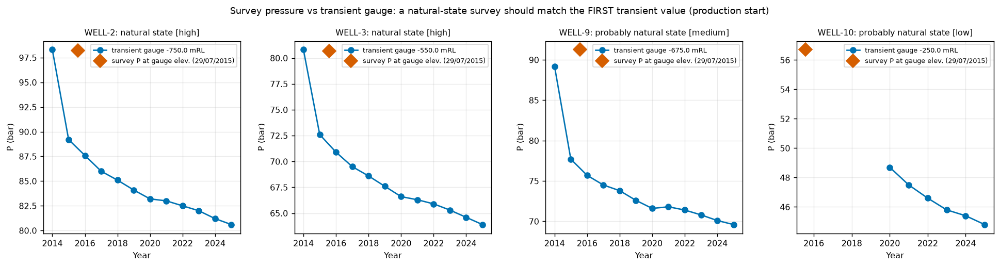
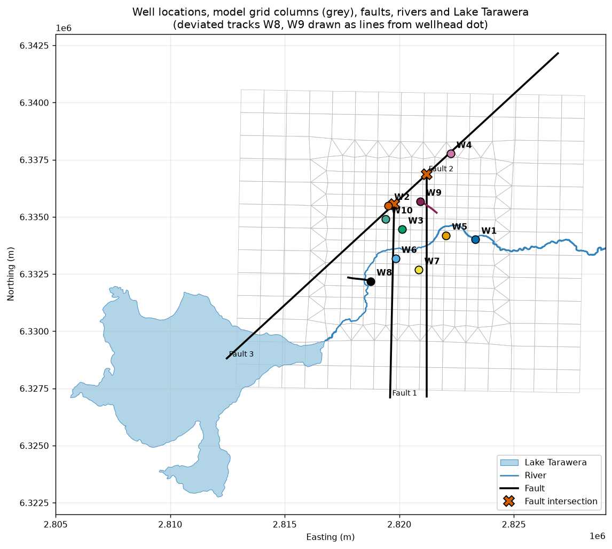
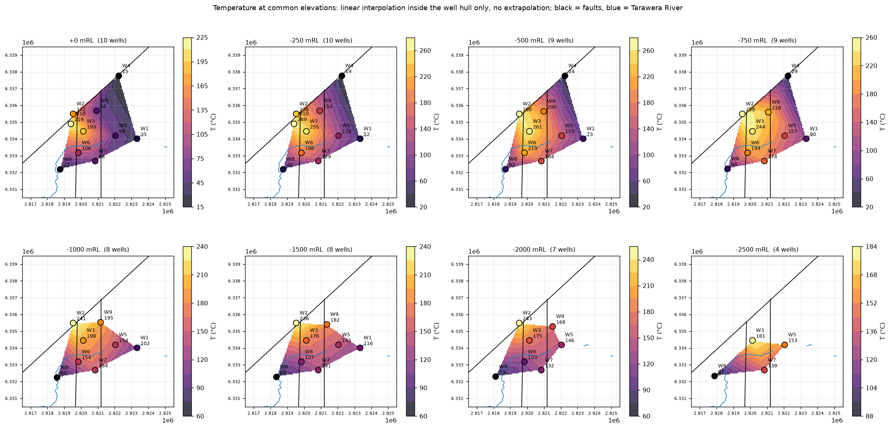
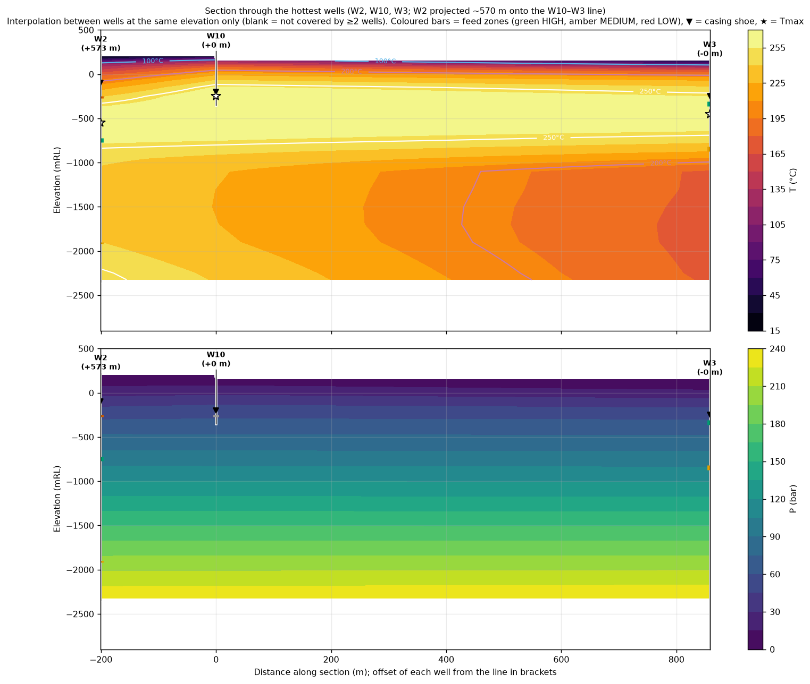
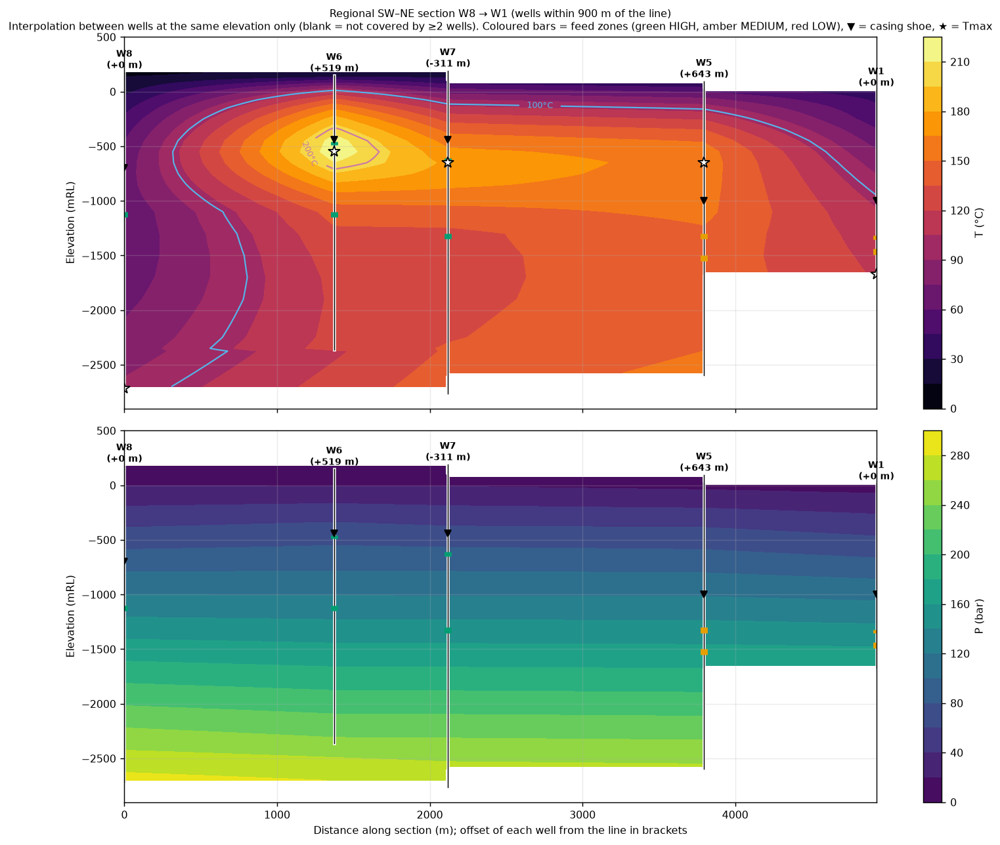
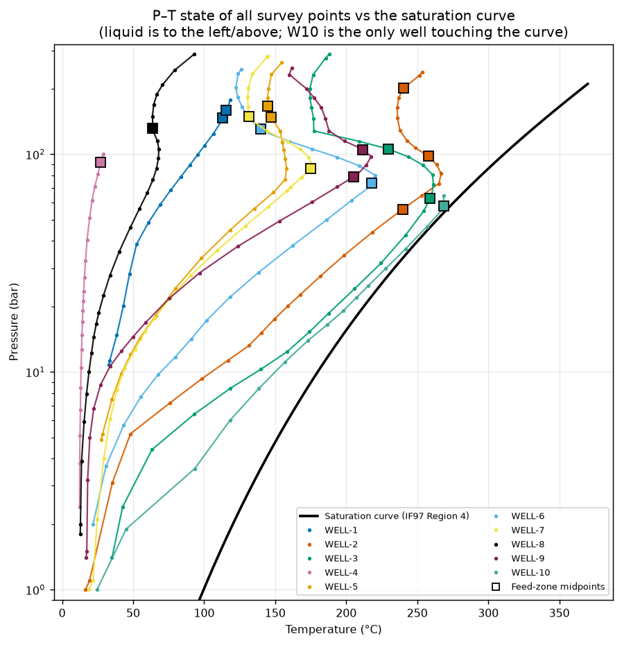
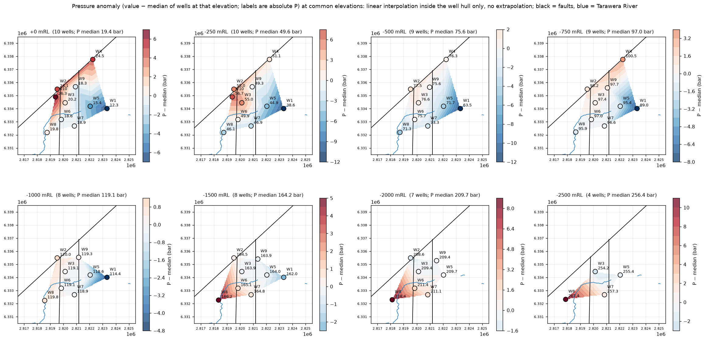
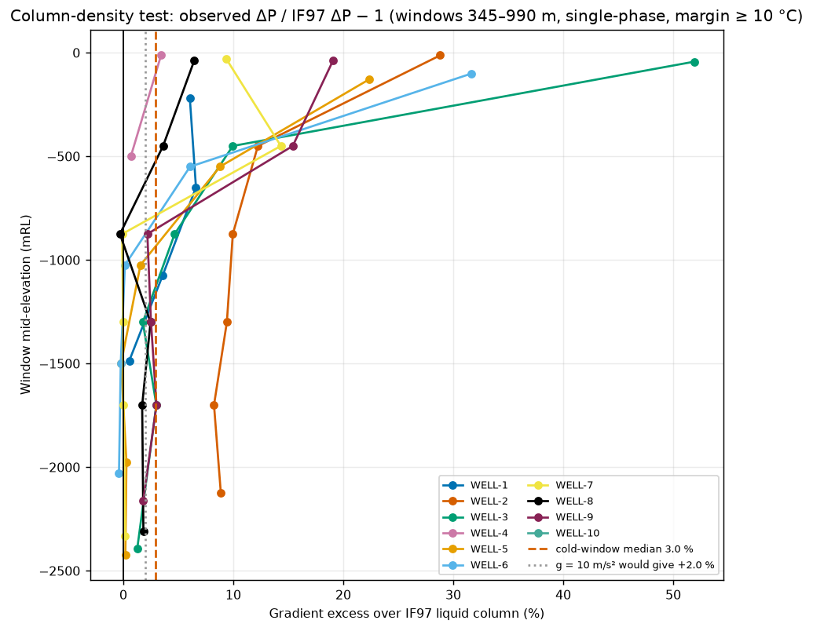

# Natural-state data interpretation – Teaching_Model_3D (TE14515 grid)

*Scope: natural state only. Inputs: `Baseline/Teaching_Model_3D` (read-only). Every number below is taken from a table in `Output/` written by `Scripts/natural_state_analysis.py`. Claims are tagged **[Obs]** observation, **[Int]** interpretation, **[Assump]** assumption. Elevations mRL, pressures bar (absolute), temperatures °C.*

## 1. Key conclusions for calibration

1. **[Obs] The surveys dated 29/07/2015 reproduce the pressure at the *start* of production, not at the survey date.** WELL-2 and WELL-3 survey pressures at the gauge elevation (98.2 and 80.7 bar) equal the first transient values (98.3 and 80.8 bar, 01/01/2014; Δ = -0.10 and -0.10 bar), whereas the gauges had already fallen to 89.2 and 72.6 bar by 01/01/2015 (`pressure_consistency_check.csv`). **Action:** treat the surveys as natural-state (pre-production) data and resolve the date label (§7.1). Verdicts and confidence (§2) set the weights.
2. **[Obs] The hottest, shallowest water is a compact zone around WELL-10, WELL-2 and WELL-3** (Tmax 269, 267, 261 °C at -250, -550, -450 mRL), falling to 220 (W6), 218 (W9), 177 (W7), 158 (W5) and only 93 (W8), 29 (W4). **[Int]** the upflow is under or next to this zone, which is 259 m (WELL-2) from the Fault 1 × Fault 3 intersection. **Action:** put the deep heat/mass input here. WELL-2 is still 254 °C at -2348 mRL, so no well constrains the source depth.
3. **[Obs] WELL-10 follows the boiling-point-for-depth curve** (minimum margin 2.6 °C at -150 mRL; 4 points < 5 °C, 6 < 10 °C). No other well is below 12.2 °C. **Action:** the model must reproduce a near-saturated or two-phase zone between about −75 and −350 mRL near WELL-10; match T together with Tsat(P).
4. **[Obs] Six wells (W2, W3, W5, W6, W7, W9) have temperature inversions of 13–98 K** with peaks at -450 to -750 mRL (W3 87 K, W6 98 K). **[Int]** a lateral outflow layer near −450…−750 mRL over cooler water. **Action:** the model needs a permeable layer there; deep isothermal sections get reduced weight (§3).
5. **[Obs] Pressure in the upper ~250–650 m of every well rises with depth faster than any liquid column can** (the first window exceeds the maximum liquid gradient in 9 of the 9 wells that can be tested, W10 excluded as near-boiling: WELL-1, WELL-2, WELL-3, WELL-4, WELL-5, WELL-6, WELL-7, WELL-8, WELL-9). Cold wells W1, W4, W8 show 3.5–6.5 %, hot wells up to 52 %. **Action:** do not use shallow pressure gradients as a target (weight 0.25 × location weight); use pressure at feed zones/pivots. Cause unresolved (§7.2).
6. **[Obs] Below about −750 mRL the pressure profiles of WELL-5, WELL-6, WELL-7 equal the IAPWS-IF97 liquid column within ±0.5 %**, so units and gravity are consistent. Deep excess elsewhere is -0.4 to 8.9 % (W2 largest): well-specific, not a single field-wide offset.
7. **[Obs] Deep pressures are nearly uniform across the field** (−1500 mRL: 162.0–169.2 bar; −2000 mRL: 208.6–218.4 bar; W8 highest). **[Int]** laterally connected deep reservoir with near-hydrostatic head over ≥ 5 km; W8's high value is consistent with its cold, dense column rather than a lateral head.
8. **[Obs] Wellheads lie below the model surface by up to 105 m** (WELL-1); estimated water levels span 113–251 mRL. **Action:** use an atmospheric-pressure water-table boundary; do not take the wellhead elevation as the grid top.
9. **[Obs] WELL-1 (east), WELL-4 (north) and WELL-8 (south-west) are cold:** W1 gradient 73 K/km (top) and 16 (deep); W4 only 14 K/km and 29 °C at -750 mRL; W8 is 64–68 °C from about −650 to −1500 mRL. **[Int]** cold recharge/downflow north and south-west, conductive east.

## 2. The data

**Inventory.** 10 wells (`Groups_data.json`), one T and one P survey each, all dated 29/07/2015 and flagged stable. Producers W2, W3, W9, W10 have transient gauges; W4, W5, W8 are injectors; W1, W6, W7 have no flow data. Faults, river, lake from `Mapping.json`; grid columns, 69 active layers and surface from `gTE14515.dat`.

**Checks** (`data_integrity_check.csv`, 140 rows): JSON vs `.dat` for every T and P point and every transient series — no difference (119 PASS rows in total); all survey points lie within the track; every feed zone is below the casing shoe in slotted/open hole and contains a survey point; all survey and feed-zone blocks agree with `gTE14515_wells.json`. Flag: WELL-4: Liner 4-1/2": -450..-3251 mRL, slotted=True; track bottom -750.0 (design/track inconsistency; no survey affected). Notes: feed-zone values are labelled "m" but are elevations (mRL); JSON track/design/feed-zone entries mix lists and strings (parsed). IAPWS-IF97 Regions 4 and 1 were validated against published values (errors ≪ 0.1 K; `run_console_log.txt`).

**Natural-state timing and verdicts** (`pressure_consistency_check.csv`):

| well | role | verdict | confidence | factor | gauge mRL | survey P at gauge bar | first transient P bar | Δ bar | FZ P offset vs W2/W3 (bar; * pivot) |
|---|---|---|---|---|---|---|---|---|---|
| WELL-1 | monitor (no flow data) | probably natural state | medium | 0.75 | – | – | – | – | FZ1@-1338:-2.9; FZ2@-1465:-2.4* |
| WELL-2 | producer | natural state | high | 1.00 | -750.00 | 98.20 | 98.30 | -0.10 | FZ1@-260:-0.0; FZ2@-745:+0.8*; FZ3@-1910:-0.6 |
| WELL-3 | producer | natural state | high | 1.00 | -550.00 | 80.70 | 80.80 | -0.10 | FZ1@-335:-0.3*; FZ2@-845:-0.8 |
| WELL-4 | injector | probably natural state | low | 0.60 | – | – | – | – | FZ1@-655:+1.9* |
| WELL-5 | injector | possibly disturbed | low | 0.40 | – | – | – | – | FZ1@-1325:-0.4*; FZ2@-1525:-0.1 |
| WELL-6 | monitor (no flow data) | probably natural state | medium | 0.75 | – | – | – | – | FZ1@-475:-1.5*; FZ2@-1125:-0.2 |
| WELL-7 | monitor (no flow data) | probably natural state | medium | 0.75 | – | – | – | – | FZ1@-630:-1.7*; FZ2@-1325:+0.2 |
| WELL-8 | injector | probably natural state | low | 0.60 | – | – | – | – | FZ1@-1125:+1.3* |
| WELL-9 | producer | probably natural state | medium | 0.75 | -675.00 | 91.25 | 89.20 | 2.05 | FZ1@-535:-1.0; FZ2@-838:-0.1* |
| WELL-10 | producer | probably natural state | low | 0.60 | -250.00 | 56.70 | 48.70 | 8.00 | FZ1@-262:+1.6* |

Method: survey P interpolated to the gauge elevation vs the **first** transient value. Valid test and |Δ| ≤ 0.5 bar ⇒ *natural state* (high, factor 1.0). WELL-9 is +2.05 bar *above* the first value: opposite to drawdown, so not production-disturbed but unexplained ⇒ *probably natural state* (medium, 0.75). WELL-10's series starts 01/01/2020, after production began (01/12/2019), so the test is invalid; the survey is +8.0 bar above the 2020 value (sign expected from later drawdown) and its feed-zone P is +1.6 bar from W2/W3 ⇒ *probably natural state* (low, 0.6). Wells without gauges are compared at feed-zone elevations with W2/W3. **Injectors** ran at 110/100/100 kg/s (W4/W5/W8) of water at ≈ 80 °C [Assump: cp 4.19 kJ/kg/K] from 01/01/2014. W4 and W8 profiles are colder than the injectate (no warm-injection signature) ⇒ probably natural (low, 0.6); W5's feed-zone T (147 °C) exceeds the injectate, so cooling could be hidden ⇒ possibly disturbed (0.4). No injector has a gauge. WELL-1 is -2.4 bar from W2/W3 at its pivot (probably natural, medium, 0.75), as are W6 and W7.

**Geometry** (`well_geometry_check.csv`):

| well | wellhead mRL | model surface mRL | wellhead − surface m | max deviation m | →Fault 1 m | →Fault 2 m | →Fault 3 m | →river m | →lake edge m |
|---|---|---|---|---|---|---|---|---|---|
| WELL-1 | 15 | 120 | -105 | 0 | 3583 | 2141 | 3545 | 96 | 7892 |
| WELL-2 | 225 | 260 | -35 | 0 | 250 | 1662 | 125 | 1906 | 6495 |
| WELL-3 | 164 | 180 | -16 | 0 | 378 | 1056 | 1051 | 828 | 5892 |
| WELL-4 | 340 | 340 | 0 | 0 | 3290 | 1354 | 50 | 3125 | 9815 |
| WELL-5 | 93 | 140 | -47 | 0 | 2294 | 855 | 2541 | 345 | 6978 |
| WELL-6 | 147 | 160 | -13 | 0 | 113 | 1348 | 1791 | 424 | 4701 |
| WELL-7 | 190 | 240 | -50 | 0 | 1122 | 349 | 2832 | 858 | 5092 |
| WELL-8 | 176 | 260 | -84 | 1000 | 950 | 2432 | 1785 | 235 | 3247 |
| WELL-9 | 174 | 220 | -46 | 868 | 1145 | 269 | 684 | 1488 | 7348 |
| WELL-10 | 260 | 260 | 0 | 0 | 365 | 1789 | 226 | 1337 | 5904 |

W8 and W9 are deviated (1000 and 868 m at TD); blocks follow the track. No wellhead is inside the lake; the nearest lake edge is 3247 m away.

## 3. Temperature structure

Per-well characteristics (`well_summary.csv`). Cap gradient = top 300 m, deep = bottom 500 m (K/km, positive = T rises with depth). Inversion = largest drop below an earlier maximum (threshold 3 K). 0.9·Tmax is an operational marker of the cap base (hot wells only).

| well | regime | Tmax °C | Tmax mRL | T@TD °C | inversion K | inv. top mRL | inv. bottom mRL | cap grad K/km | deep grad K/km | 100 °C mRL | 200 °C mRL | 0.9·Tmax mRL | min margin °C | at mRL |
|---|---|---|---|---|---|---|---|---|---|---|---|---|---|---|
| WELL-1 | conductive | 119 | -1672 | 119 | 0 | – | – | 73 | 16 | -946 | – | – | 150 | 15 |
| WELL-2 | upflow (hot to TD, with shallow outflow peak) | 267 | -550 | 254 | 31 | -550 | -1500 | 664 | 31 | 128 | -81 | -263 | 24 | -450 |
| WELL-3 | outflow over cooler deep water (inversion) | 261 | -450 | 188 | 87 | -450 | -1700 | 860 | 20 | 104 | -14 | -122 | 12 | -150 |
| WELL-4 | recharge / downflow (cold, sub-conductive gradient) | 29 | -750 | 29 | 0 | – | – | 14 | 20 | – | – | – | 114 | 230 |
| WELL-5 | outflow over cooler deep water (inversion) | 158 | -650 | 155 | 13 | -650 | -1700 | 295 | 21 | -160 | – | -401 | 124 | 93 |
| WELL-6 | outflow over cooler deep water (inversion) | 220 | -550 | 126 | 98 | -550 | -1900 | 490 | 7 | 13 | -329 | -320 | 70 | -450 |
| WELL-7 | outflow over cooler deep water (inversion) | 177 | -650 | 145 | 46 | -650 | -1700 | 280 | 25 | -114 | – | -455 | 80 | 170 |
| WELL-8 | conductive-cold with weak inversion (lateral cold flow) | 93 | -2716 | 93 | 4 | -850 | -1300 | 85 | 30 | – | – | – | 104 | 176 |
| WELL-9 | outflow over cooler deep water (inversion) | 218 | -750 | 162 | 58 | -750 | -2250 | 319 | 9 | -84 | -496 | -467 | 88 | -550 |
| WELL-10 | two-phase / near-boiling upflow | 269 | -250 | 268 | 0 | – | – | 760 | 285 | 165 | 46 | -76 | 3 | -150 |

**Isothermal sections** (≥ 300 m within 3 K):

| well | isothermal_sections |
|---|---|
| WELL-2 | -1100 to -1700 mRL |
| WELL-3 | -1100 to -2250 mRL |
| WELL-5 | -550 to -950 mRL; -1300 to -2250 mRL |
| WELL-6 | -1700 to -2250 mRL |
| WELL-7 | -1300 to -1900 mRL; -1900 to -2250 mRL |
| WELL-8 | -650 to -950 mRL; -1100 to -1500 mRL |

**Wellbore check.** Inversion peaks lie below the casing shoe (open hole) in W2, W3, W6, W7 and W9, and behind casing in W5 (peak -650, shoe -1000); internal flow could alter the open-hole parts. **[Int]** The long isothermal sections below or between feed zones (e.g. W3, W6, W7) may be partly wellbore convection; open-hole points inside them get weight 0.5 not 0.8 and are not used to infer reservoir uniformity. The peaks lie close to a feed zone in W3 (peak -450, feed zone −335), W6 (-550 vs −475), W7 (-650 vs −630) and W2 (-550 vs −745 and −260), which favours a reservoir origin there. In W5 the peak (-650 mRL) lies ~650 m above its shallowest feed zone (−1325), but it is behind casing, where T is closer to conductive formation T, so it is a formation feature without a nearby feed zone (an open question for the outflow depth there); W9's peak (-750) lies between its feed zones (−535, −838).

**Temperature at common elevations** (`T_P_at_common_elevations.csv`, interpolation only):

| well | +100 mRL | +0 mRL | -250 mRL | -500 mRL | -750 mRL | -1000 mRL | -1500 mRL | -2000 mRL | -2500 mRL |
|---|---|---|---|---|---|---|---|---|---|
| WELL-1 | – | 35 | 52 | 73 | 90 | 102 | 116 | – | – |
| WELL-10 | 165 | 219 | 269 | – | – | – | – | – | – |
| WELL-2 | 124 | 172 | 238 | 266 | 258 | 241 | 236 | 243 | – |
| WELL-3 | 106 | 193 | 255 | 261 | 244 | 198 | 176 | 175 | 181 |
| WELL-4 | 14 | 15 | 19 | 24 | 29 | – | – | – | – |
| WELL-5 | – | 58 | 118 | 153 | 157 | 154 | 145 | 146 | 153 |
| WELL-6 | 50 | 106 | 186 | 219 | 194 | 154 | 127 | 123 | – |
| WELL-7 | 36 | 68 | 129 | 164 | 174 | 154 | 131 | 132 | 139 |
| WELL-8 | 18 | 27 | 48 | 62 | 68 | 66 | 64 | 73 | 87 |
| WELL-9 | 25 | 64 | 153 | 200 | 218 | 195 | 182 | 168 | – |

The N–S section (W4→W7) is also in `figures/`. Sections interpolate between wells at the same elevation only: they are schematic between wells, not constrained images.

**Heat-flux contrast (assumption-based).** With an assumed 2.0 W/m/K [Assump, not in the data] the cap gradients give 28 (W4), 146 (W1), 169 (W8) mW/m² at the cold margins and 1329 (W2) to 1721 (W3) mW/m² in the core. The core values include a near-surface hydrological gradient and are not pure conduction; use only as a margin-to-core contrast.

## 4. Pressure structure

**Rule applied:** wellbore pressure equals formation pressure only at feed zones; elsewhere it follows the fluid column, pivoting at the dominant feed zone (highest quality tag, ties by higher survey T). Wellhead pressures of ≈ 1–11 bar are not reservoir pressure.

Pressure at common elevations (bar):

| well | +100 mRL | +0 mRL | -250 mRL | -500 mRL | -750 mRL | -1000 mRL | -1500 mRL | -2000 mRL | -2500 mRL |
|---|---|---|---|---|---|---|---|---|---|
| WELL-1 | – | 12.3 | 38.6 | 63.5 | 89.0 | 114.4 | 162.0 | – | – |
| WELL-10 | 12.5 | 26.3 | 56.7 | – | – | – | – | – | – |
| WELL-2 | 12.2 | 24.1 | 55.0 | 77.5 | 98.2 | 120.0 | 164.5 | 208.6 | – |
| WELL-3 | 7.4 | 20.2 | 55.0 | 76.6 | 97.4 | 119.1 | 163.9 | 209.4 | 254.2 |
| WELL-4 | 13.8 | 24.5 | 51.1 | 76.3 | 100.5 | – | – | – | – |
| WELL-5 | – | 15.4 | 44.9 | 71.7 | 95.4 | 118.6 | 164.0 | 209.7 | 255.4 |
| WELL-6 | 6.7 | 18.6 | 49.9 | 75.7 | 97.0 | 119.1 | 165.1 | 211.4 | – |
| WELL-7 | 7.2 | 18.9 | 46.9 | 73.3 | 96.6 | 118.9 | 164.8 | 211.1 | 257.3 |
| WELL-8 | 8.9 | 19.8 | 46.1 | 71.3 | 95.9 | 119.8 | 169.2 | 218.4 | 267.4 |
| WELL-9 | 7.8 | 18.3 | 49.3 | 75.6 | 97.7 | 119.3 | 163.9 | 209.4 | – |

Pivot pressures and water levels (`well_summary.csv`):

| well | water level est. mRL (extrapolated) | model surface mRL | pivot FZ mRL | quality | pivot P bar | pivot T °C |
|---|---|---|---|---|---|---|
| WELL-1 | 113.0 | 120.0 | -1465.0 | MEDIUM | 158.7 | 115.5 |
| WELL-2 | 211.0 | 260.0 | -745.0 | HIGH | 97.8 | 258.0 |
| WELL-3 | 164.0 | 180.0 | -335.0 | HIGH | 62.8 | 259.1 |
| WELL-4 | 251.0 | 340.0 | -655.0 | MEDIUM | 91.7 | 27.3 |
| WELL-5 | 127.0 | 140.0 | -1325.0 | MEDIUM | 148.1 | 147.3 |
| WELL-6 | 157.0 | 160.0 | -475.0 | HIGH | 73.5 | 218.0 |
| WELL-7 | 161.0 | 240.0 | -630.0 | HIGH | 86.0 | 175.1 |
| WELL-8 | 180.0 | 260.0 | -1125.0 | HIGH | 132.0 | 63.9 |
| WELL-9 | 174.0 | 220.0 | -837.5 | MEDIUM | 105.2 | 211.6 |
| WELL-10 | 192.0 | 260.0 | -262.5 | Synthetic | 57.7 | 268.7 |

**Hydrostatic checks** (`hydrostatic_check.csv`; windows ≥ 300 m, single-phase only, margin ≥ 10 °C; W10 excluded). Rounding (0.1 bar) limits each window to about ±0.4 %.

| well | top mRL | bottom mRL | T range °C | min margin °C | ΔP obs bar | ΔP IF97 bar | excess % | apparent ρ | max liquid ρ | > max? |
|---|---|---|---|---|---|---|---|---|---|---|
| WELL-1 | 15.0 | -450.0 | 33-69 | 150.4 | 47.8 | 45.1 | 6.0 | 1049.9 | 1001.3 | True |
| WELL-1 | -450.0 | -850.0 | 69-95 | 205.1 | 40.7 | 38.2 | 6.6 | 1037.6 | 1003.8 | True |
| WELL-1 | -850.0 | -1300.0 | 95-112 | 215.2 | 43.9 | 42.4 | 3.6 | 995.6 | 1005.7 | False |
| WELL-1 | -1300.0 | -1672.0 | 112-119 | 226.0 | 35.0 | 34.8 | 0.6 | 959.7 | 1007.6 | False |
| WELL-2 | 225.0 | -250.0 | 16-238 | 31.8 | 54.0 | 41.9 | 28.8 | 1196.9 | 1000.8 | True |
| WELL-2 | -250.0 | -650.0 | 238-267 | 23.8 | 34.7 | 30.9 | 12.2 | 892.2 | 1003.4 | False |
| WELL-2 | -650.0 | -1100.0 | 238-264 | 39.5 | 39.2 | 35.6 | 10.0 | 883.7 | 1005.1 | False |
| WELL-2 | -1100.0 | -1500.0 | 236-238 | 92.4 | 35.6 | 32.5 | 9.4 | 907.3 | 1007.1 | False |
| WELL-2 | -1500.0 | -1900.0 | 236-240 | 113.6 | 35.3 | 32.6 | 8.2 | 899.7 | 1008.8 | False |
| WELL-2 | -1900.0 | -2348.0 | 240-254 | 123.3 | 39.3 | 36.1 | 8.9 | 895.6 | 1010.4 | False |
| WELL-3 | 164.0 | -250.0 | 35-255 | 12.2 | 53.6 | 35.3 | 51.9 | 1377.1 | 1000.8 | True |
| WELL-3 | -250.0 | -650.0 | 254-261 | 15.3 | 34.0 | 30.9 | 10.0 | 867.9 | 1003.4 | False |
| WELL-3 | -650.0 | -1100.0 | 177-254 | 48.2 | 39.0 | 37.3 | 4.7 | 879.6 | 1005.1 | False |
| WELL-3 | -1100.0 | -1500.0 | 176-177 | 152.5 | 35.9 | 35.3 | 1.8 | 915.3 | 1007.0 | False |
| WELL-3 | -1500.0 | -1900.0 | 174-176 | 173.7 | 36.5 | 35.4 | 3.0 | 930.4 | 1008.8 | False |
| WELL-3 | -1900.0 | -2887.0 | 174-188 | 188.8 | 88.4 | 87.3 | 1.3 | 912.3 | 1011.9 | False |
| WELL-4 | 230.0 | -250.0 | 12-19 | 113.8 | 48.7 | 47.1 | 3.5 | 1034.4 | 1000.8 | True |
| WELL-4 | -250.0 | -750.0 | 19-29 | 245.9 | 49.4 | 49.1 | 0.7 | 1007.4 | 1003.8 | False |
| WELL-5 | 93.0 | -350.0 | 28-135 | 123.6 | 51.3 | 41.9 | 22.4 | 1195.8 | 1001.0 | True |
| WELL-5 | -350.0 | -750.0 | 135-158 | 133.9 | 39.2 | 36.0 | 8.8 | 1000.6 | 1003.7 | False |
| WELL-5 | -750.0 | -1300.0 | 148-157 | 150.5 | 50.4 | 49.6 | 1.6 | 934.0 | 1005.7 | False |
| WELL-5 | -1300.0 | -1700.0 | 145-148 | 192.2 | 36.4 | 36.5 | -0.2 | 927.5 | 1007.8 | False |
| WELL-5 | -1700.0 | -2250.0 | 145-147 | 213.3 | 50.4 | 50.2 | 0.3 | 934.4 | 1009.8 | False |
| WELL-5 | -2250.0 | -2595.0 | 147-155 | 222.3 | 31.5 | 31.4 | 0.2 | 931.0 | 1011.9 | False |
| WELL-6 | 147.0 | -350.0 | 22-204 | 73.3 | 59.4 | 45.1 | 31.6 | 1252.7 | 1001.0 | True |
| WELL-6 | -350.0 | -750.0 | 194-220 | 70.0 | 35.6 | 33.6 | 6.1 | 908.7 | 1003.8 | False |
| WELL-6 | -750.0 | -1300.0 | 132-194 | 115.2 | 49.6 | 49.5 | 0.1 | 917.2 | 1005.8 | False |
| WELL-6 | -1300.0 | -1700.0 | 124-132 | 208.8 | 37.0 | 37.1 | -0.2 | 943.1 | 1007.9 | False |
| WELL-6 | -1700.0 | -2359.0 | 122-126 | 235.1 | 61.2 | 61.4 | -0.4 | 946.6 | 1010.4 | False |
| WELL-7 | 190.0 | -250.0 | 19-129 | 80.5 | 45.9 | 42.0 | 9.4 | 1074.5 | 1000.7 | True |
| WELL-7 | -250.0 | -650.0 | 129-177 | 125.0 | 41.0 | 35.9 | 14.3 | 1042.2 | 1003.4 | True |
| WELL-7 | -650.0 | -1100.0 | 144-177 | 125.0 | 40.1 | 40.1 | -0.1 | 908.0 | 1005.1 | False |
| WELL-7 | -1100.0 | -1500.0 | 131-144 | 185.4 | 36.8 | 36.8 | -0.0 | 938.2 | 1007.1 | False |
| WELL-7 | -1500.0 | -1900.0 | 131-131 | 218.9 | 37.0 | 37.0 | 0.0 | 943.2 | 1008.8 | False |
| WELL-7 | -1900.0 | -2762.0 | 131-145 | 232.3 | 79.7 | 79.6 | 0.2 | 941.5 | 1011.9 | False |
| WELL-8 | 176.0 | -250.0 | 13-48 | 104.1 | 44.3 | 41.6 | 6.5 | 1061.9 | 1000.7 | True |
| WELL-8 | -250.0 | -650.0 | 48-66 | 210.9 | 40.1 | 38.7 | 3.6 | 1022.4 | 1003.2 | True |
| WELL-8 | -650.0 | -1100.0 | 64-68 | 233.8 | 43.3 | 43.4 | -0.3 | 981.2 | 1005.1 | False |
| WELL-8 | -1100.0 | -1500.0 | 64-64 | 266.8 | 39.7 | 38.7 | 2.5 | 1011.9 | 1007.0 | False |
| WELL-8 | -1500.0 | -1900.0 | 64-71 | 287.4 | 39.4 | 38.7 | 1.7 | 1004.3 | 1009.1 | False |
| WELL-8 | -1900.0 | -2716.1 | 71-93 | 283.9 | 80.0 | 78.6 | 1.8 | 999.7 | 1011.8 | False |
| WELL-9 | 174.0 | -250.0 | 17-153 | 92.4 | 47.9 | 40.2 | 19.1 | 1169.0 | 1000.7 | True |
| WELL-9 | -250.0 | -650.0 | 153-214 | 87.8 | 39.8 | 34.5 | 15.4 | 1012.7 | 1003.4 | True |
| WELL-9 | -650.0 | -1100.0 | 188-218 | 88.6 | 39.0 | 38.2 | 2.2 | 882.1 | 1005.2 | False |
| WELL-9 | -1100.0 | -1500.0 | 182-188 | 141.8 | 35.8 | 34.9 | 2.5 | 912.7 | 1007.0 | False |
| WELL-9 | -1500.0 | -1900.0 | 172-182 | 166.8 | 36.4 | 35.3 | 3.0 | 927.9 | 1008.8 | False |
| WELL-9 | -1900.0 | -2427.1 | 160-172 | 194.0 | 48.2 | 47.3 | 1.8 | 932.3 | 1010.9 | False |
| WELL-10 | 210.0 | -350.0 | 25-269 | 2.6 | 63.4 | 46.0 | – | 1203.0 | 1001.1 | True |

**[Obs]** Windows starting near the surface need an apparent density of 1034–1377 kg/m³ against a maximum liquid density of 1001–1001, so these profiles are not static single-phase columns. Cold windows (max T < 100 °C): shallow median 6.0 % (range 3.5–6.5), deeper median 1.8 %; overall median 3.0 %. For scale, g = 10 m/s² would give +2.0 %. **[Int]** The shallow excess common to the cold wells may be a datum/convention issue (not physical overpressure), but cannot explain the larger hot-well excess or why W5–W7 are exact at depth.

**Explanations checked:** units (bar and mRL agree between JSON and `.dat`); density (IF97 validated, Region 1 used on liquid windows only); datum (windows are elevation differences, so a constant offset cancels); wellbore (a static column cannot exceed the cold-water gradient). None resolves the hot-well excess.

## 5. Conceptual model

| Feature | Interpretation (strength) | Supporting observation |
|---|---|---|
| Upflow | Under/near W10–W2–W3, close to Fault 1 × Fault 3 (259 m from W2) (moderate) | Tmax 269/267/261 °C; W2 T@TD 254 °C and rising; W10 on the boiling curve; 200 °C at 46/-81/-14 mRL |
| Outflow | Lateral layer ≈ −450…−750 mRL towards S, SE, E (W6, W7, W9, W5) (moderate; direction inferred from the T pattern only) | inversion peaks -550 (W6), -650 (W7), -750 (W9), -650 (W5) mRL (near feed zones except W5); peak T 220/218/177/158 °C |
| Cap | Conductive top; thin over W10, deeper away (moderate) | cap gradients 664–860 K/km (core); 0.9·Tmax at -76 (W10), -122 (W3), -263 (W2), -320 (W6), -467 (W9) mRL |
| Two-phase zone | Small, near W10, ≈ −75…−350 mRL (one well) | margin 2.6 °C |
| Cold recharge/downflow | North (W4), south-west (W8) (weak–moderate) | W4 14 K/km; W8 64–68 °C at −650…−1500 mRL; river 235 m from W8; lake ≥ 3247 m away, so no direct lake influence is seen |
| Conductive margin | East (W1) (moderate) | monotonic T, 119 °C at -1672 mRL |
| Deep pressure connection | Laterally connected, near-hydrostatic (moderate) | P at −1500 mRL 162.0–169.2 bar |
| Faults | Hot wells lie within 113–378 m of Fault 1 (W6, W2, W10, W3) and within 125/226 m of Fault 3 (W2/W10); W9/W7 are 269/349 m from Fault 2 (spatial association only; dip and permeability unknown) | `well_geometry_check.csv`, `fault_intersections.csv` |

## 6. Recommended calibration set-up

**Targets and weights** (`NS_calibration_targets.csv`, 266 survey points; weight = location weight × natural-state factor; extra columns `weight_P`, `P_role`):

| location_class | points | mean_weight |
|---|---|---|
| behind casing | 121 | 0.35 |
| feed zone | 32 | 0.76 |
| near wellhead | 28 | 0.22 |
| open hole | 60 | 0.63 |
| open hole (isothermal section) | 25 | 0.39 |

Scheme: feed zone 1.0; near wellhead (top 50 m) 0.3; behind casing 0.5; open hole 0.8, **reduced to 0.5 inside isothermal sections ≥ 300 m** (possible wellbore flow); above model surface 0 (none occur); multiplied by the factor 1.0 / 0.75 / 0.6 / 0.4. Pressure outside feed zones gets 0.25 × the location weight because it reflects the wellbore column. **Feed-zone targets** (`feedzones.csv`; all blocks match `gTE14515_wells.json`):

| well | feed | mid mRL | quality | T °C | P bar | Tsat °C | margin °C | block | pivot | weight |
|---|---|---|---|---|---|---|---|---|---|---|
| WELL-1 | Feed 1 | -1337.5 | MEDIUM | 113.2 | 146.7 | 340.4 | 227.2 | arg63 | False | 0.8 |
| WELL-1 | Feed 2 | -1465.0 | MEDIUM | 115.5 | 158.7 | 346.7 | 231.2 | arg64 | True | 0.8 |
| WELL-2 | Feed 1 | -260.0 | LOW | 239.7 | 55.9 | 271.0 | 31.3 | ajf54 | False | 1.0 |
| WELL-2 | Feed 2 | -745.0 | HIGH | 258.0 | 97.8 | 309.4 | 51.4 | ajf59 | True | 1.0 |
| WELL-2 | Feed 3 | -1910.0 | MEDIUM | 240.3 | 200.7 | 366.0 | 125.7 | ajf66 | False | 1.0 |
| WELL-3 | Feed 1 | -335.0 | HIGH | 259.1 | 62.8 | 278.6 | 19.5 | asd55 | True | 1.0 |
| WELL-3 | Feed 2 | -845.0 | MEDIUM | 229.8 | 105.6 | 315.0 | 85.2 | asd60 | False | 1.0 |
| WELL-4 | Feed 1 | -655.0 | MEDIUM | 27.3 | 91.7 | 304.7 | 277.4 | aop58 | True | 0.6 |
| WELL-5 | Feed 1 | -1325.0 | MEDIUM | 147.3 | 148.1 | 341.1 | 193.8 | arc63 | True | 0.4 |
| WELL-5 | Feed 2 | -1525.0 | MEDIUM | 144.8 | 166.3 | 350.5 | 205.7 | arc64 | False | 0.4 |
| WELL-6 | Feed 1 | -475.0 | HIGH | 218.0 | 73.5 | 289.2 | 71.2 | aph56 | True | 0.8 |
| WELL-6 | Feed 2 | -1125.0 | HIGH | 139.8 | 130.5 | 331.2 | 191.4 | aph62 | False | 0.8 |
| WELL-7 | Feed 1 | -630.0 | HIGH | 175.1 | 86.0 | 300.1 | 125.0 | apk58 | True | 0.8 |
| WELL-7 | Feed 2 | -1325.0 | HIGH | 131.3 | 148.7 | 341.5 | 210.2 | apk63 | False | 0.8 |
| WELL-8 | Feed 1 | -1125.0 | HIGH | 63.9 | 132.0 | 332.0 | 268.1 | ana62 | True | 0.6 |
| WELL-9 | Feed 1 | -535.0 | LOW | 205.4 | 78.9 | 294.0 | 88.6 | ajj57 | False | 0.8 |
| WELL-9 | Feed 2 | -837.5 | MEDIUM | 211.6 | 105.2 | 314.7 | 103.1 | ajq60 | True | 0.8 |
| WELL-10 | Feed 1 | -262.5 | Synthetic | 268.7 | 57.7 | 273.0 | 4.3 | arz54 | True | 0.6 |

**Heat and mass.** Deep hot input near W10–W2–W3 (T ≥ 254 °C at depth in W2); the data give no flux, only the temperatures to match. Cooling/recharge from the north (W4) and south-west (W8). Conductive heat loss at the top (§3 contrast). **Permeability structure implied [Int]:** low-permeability cap above roughly −150…−450 mRL (steep T gradient; steeper-than-hydrostatic P); a permeable lateral layer near −450…−750 mRL (inversion peaks near feed zones in W2, W3, W6, W7; HIGH-quality feed zones at W2 −745, W3 −335, W6 −475/−1125, W7 −630/−1325, W8 −1125); a laterally connected, near-hydrostatic deep column; vertical connection in the hot core. **Boundaries:** atmospheric pressure at the water table (estimated 113–251 mRL); near-surface T about 12–35 °C at the wellheads; lateral sides open to deep pressure support; no flux can be derived for the base.

`T_P_at_layer_centres.csv` gives 232 well/layer pairs for block-wise comparison.

## 7. Data quality issues and open questions (ranked by effect on calibration)

1. **Survey date vs content.** Surveys dated 29/07/2015 match the 01/01/2014 pressure (98.2 bar vs 89.2 bar at W2 on 01/01/2015). Either the date is wrong or the data are reconstructed pre-production values. Confirm: the whole natural-state calibration depends on it.
2. **Pressure gradients steeper than a water column** in the upper part of all wells (hot wells up to 52 %; cold wells 3.5–6.5 %) and a well-dependent excess at depth (W2 mean 8.8 % below −1100 mRL; W5–W7 ≈ 0). Obtain survey conditions (static or flowing, gauge reference) before using non-feed-zone pressure.
3. **WELL-10:** no valid natural-state test; near-boiling, so P and T errors are coupled; feed-zone quality is "Synthetic".
4. **Injectors W4, W5, W8:** no gauges; W5 possibly disturbed; W4's survey ends at -750 mRL while its liner is designed to −3251 mRL.
5. **WELL-1 pressure** is -2.4 bar from W2/W3 at its pivot; its wellhead is 105 m below the grid surface and reads 10.8 bar at the wellhead: check the datum.
6. **Grid surface vs wellhead elevation** differs by up to 105 m; confirm topography.
7. Feed-zone units labelled "m" but are mRL; mixed JSON list/string formats; dominant feed zone not given (chosen by quality, then temperature).
8. Faults have no dip or permeability; no lake data (lake assumed unimportant only because it is far).
9. Rock conductivity for heat flux is assumed (2.0 W/m/K).

## 8. Output file index

| File | Content |
|---|---|
| `Scripts/natural_state_analysis.py` | regenerates everything except the hand-written `process_log.md` |
| `Output/NS_data_interpretation.md` | this report |
| `Output/NS_calibration_targets.csv` | 266 survey points, weights, blocks (+ `weight_P`, `P_role`, `location_class`) |
| `Output/feedzones.csv` | feed-zone T/P/margin, blocks, weights |
| `Output/T_P_at_layer_centres.csv` | T, P at layer centres, no extrapolation |
| `Output/T_P_at_common_elevations.csv` | T, P at common elevations |
| `Output/well_summary.csv` | per-well characteristics and regime |
| `Output/pressure_consistency_check.csv` | natural-state timing tests and verdicts |
| `Output/hydrostatic_check.csv` | column-density windows |
| `Output/well_geometry_check.csv`, `Output/fault_intersections.csv` | geometry, distances, fault intersections |
| `Output/data_integrity_check.csv` | all integrity checks |
| `Output/figures/` | well maps, 10 profiles, T/P maps, 3 sections, P–T plot, hydrostatic excess, natural-state test, conceptual sketch |
| `Output/run_console_log.txt` | console output of the final run |
| `Output/process_log.md` | prompt, rules applied, steps |
